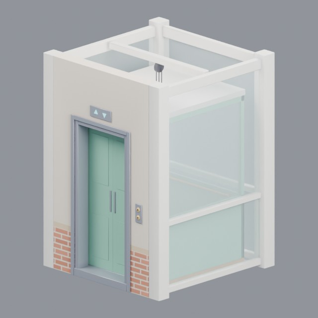
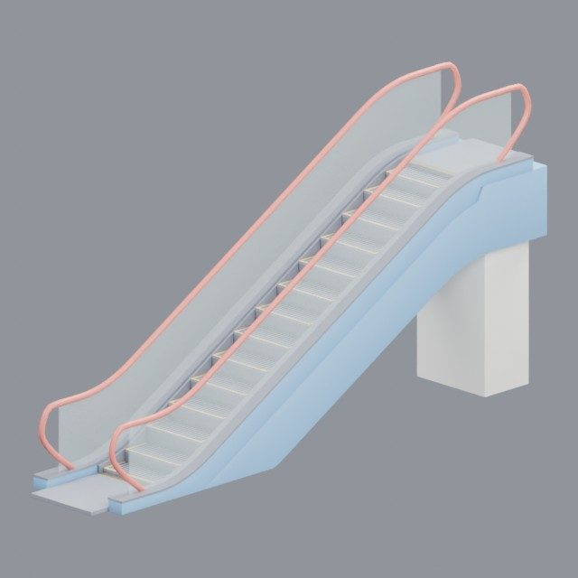
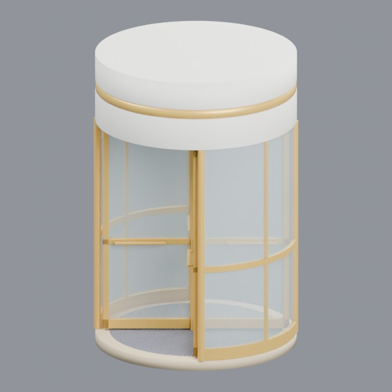

# buildings/modular

Reusable building parts such as lifts and doors

Approved assets: **3**

## Modular glass elevator shaft

- Creator: Grab3D; style: stylized; CC0-1.0
- 3,748 triangles; 12 texture images
- [Asset folder](../../assets/buildings/modular/g3-elevator/) · [Metadata](../../assets/buildings/modular/g3-elevator/asset.json) · [All inspection views](../../assets/buildings/modular/g3-elevator/previews/contact-sheet.jpg)

## Escalator with glass balustrades

- Creator: Grab3D; style: stylized; CC0-1.0
- 16,816 triangles; 3 texture images
- [Asset folder](../../assets/buildings/modular/g3-escalator/) · [Metadata](../../assets/buildings/modular/g3-escalator/asset.json) · [All inspection views](../../assets/buildings/modular/g3-escalator/previews/contact-sheet.jpg)

## Revolving door with glass drum

- Creator: Grab3D; style: stylized; CC0-1.0
- 9,212 triangles; 6 texture images
- [Asset folder](../../assets/buildings/modular/g3-revolving-door/) · [Metadata](../../assets/buildings/modular/g3-revolving-door/asset.json) · [All inspection views](../../assets/buildings/modular/g3-revolving-door/previews/contact-sheet.jpg)
