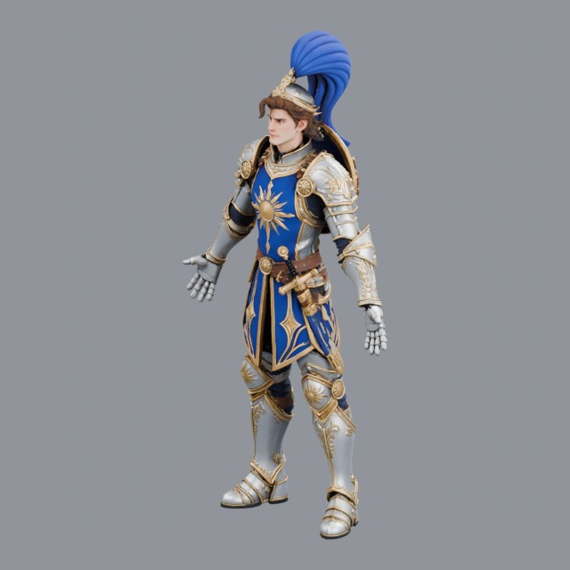
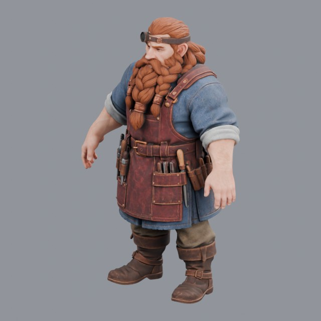
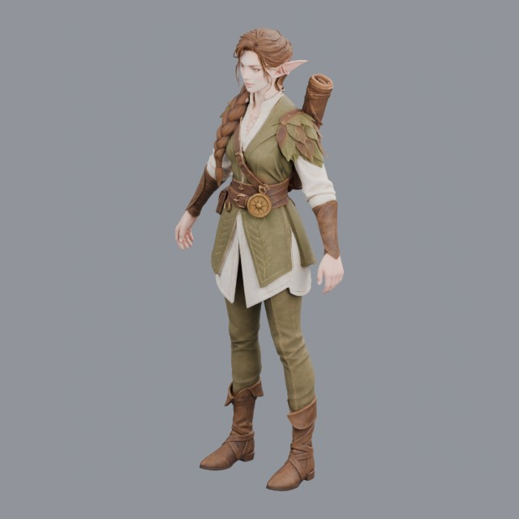
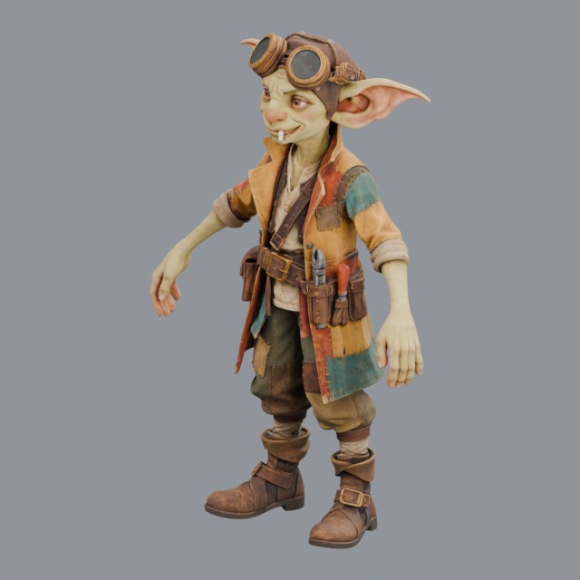
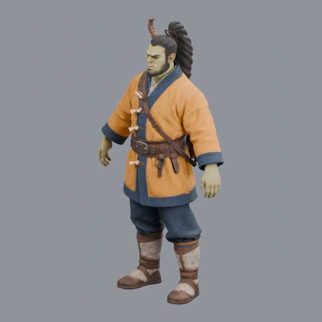
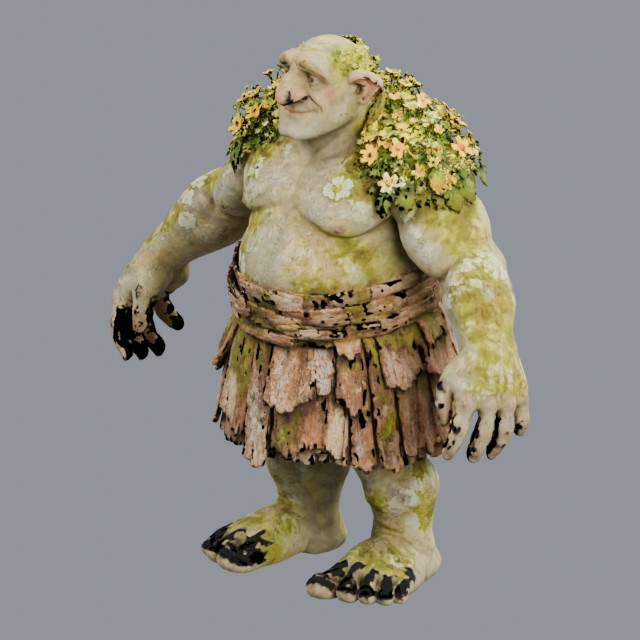
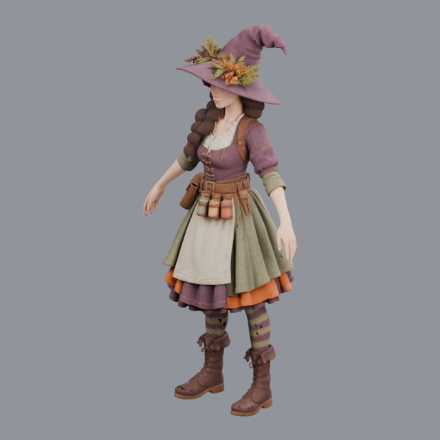

# characters/fantasy

Rigged fantasy humanoids such as orcs, elves and dwarves

Approved assets: **7**

## Knight in silver and gold plate

- Creator: Grab3D; style: realistic; CC0-1.0
- 291,910 triangles; 3 texture images
- [Asset folder](../../assets/characters/fantasy/grab3d-armored-knight/) · [Metadata](../../assets/characters/fantasy/grab3d-armored-knight/asset.json) · [All inspection views](../../assets/characters/fantasy/grab3d-armored-knight/previews/contact-sheet.jpg)

## Dwarf gem cutter with loupe

- Creator: Grab3D; style: realistic; CC0-1.0
- 300,000 triangles; 3 texture images
- [Asset folder](../../assets/characters/fantasy/grab3d-dwarf/) · [Metadata](../../assets/characters/fantasy/grab3d-dwarf/asset.json) · [All inspection views](../../assets/characters/fantasy/grab3d-dwarf/previews/contact-sheet.jpg)

## Elf cartographer with map tube

- Creator: Grab3D; style: realistic; CC0-1.0
- 300,000 triangles; 3 texture images
- [Asset folder](../../assets/characters/fantasy/grab3d-elf/) · [Metadata](../../assets/characters/fantasy/grab3d-elf/asset.json) · [All inspection views](../../assets/characters/fantasy/grab3d-elf/previews/contact-sheet.jpg)

## Goblin tinkerer with goggles

- Creator: Grab3D; style: realistic; CC0-1.0
- 300,000 triangles; 3 texture images
- [Asset folder](../../assets/characters/fantasy/grab3d-goblin/) · [Metadata](../../assets/characters/fantasy/grab3d-goblin/asset.json) · [All inspection views](../../assets/characters/fantasy/grab3d-goblin/previews/contact-sheet.jpg)

## Orc warrior in steppe coat with quiver

- Creator: Grab3D; style: realistic; CC0-1.0
- 300,000 triangles; 3 texture images
- [Asset folder](../../assets/characters/fantasy/grab3d-orc/) · [Metadata](../../assets/characters/fantasy/grab3d-orc/asset.json) · [All inspection views](../../assets/characters/fantasy/grab3d-orc/previews/contact-sheet.jpg)

## Mossy bridge troll

- Creator: Grab3D; style: realistic; CC0-1.0
- 185,000 triangles; 3 texture images
- [Asset folder](../../assets/characters/fantasy/grab3d-troll/) · [Metadata](../../assets/characters/fantasy/grab3d-troll/asset.json) · [All inspection views](../../assets/characters/fantasy/grab3d-troll/previews/contact-sheet.jpg)

## Herbalist witch with potion jars

- Creator: Grab3D; style: realistic; CC0-1.0
- 300,000 triangles; 3 texture images
- [Asset folder](../../assets/characters/fantasy/grab3d-witch/) · [Metadata](../../assets/characters/fantasy/grab3d-witch/asset.json) · [All inspection views](../../assets/characters/fantasy/grab3d-witch/previews/contact-sheet.jpg)

