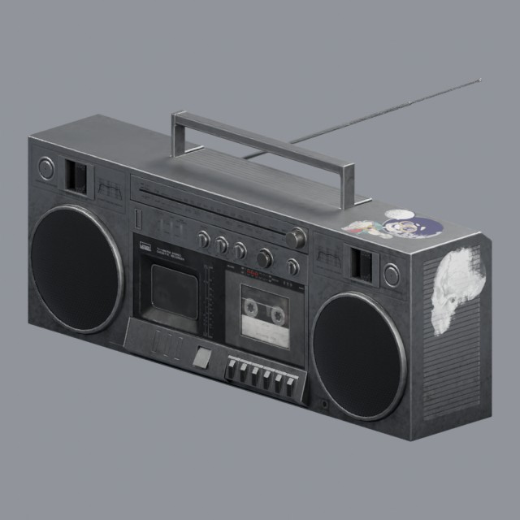
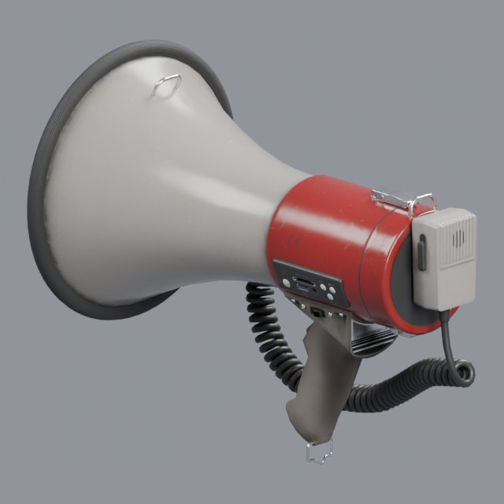

# electronics/audio

Radios, speakers, megaphones and portable audio equipment

Approved assets: **2**

## Eighties portable boombox

- Creator: Thomas Paul Mouilleron; style: realistic; CC0-1.0
- 10,168 triangles; 5 texture images
- [Asset folder](../../assets/electronics/audio/ph-boombox/) · [Metadata](../../assets/electronics/audio/ph-boombox/asset.json) · [All inspection views](../../assets/electronics/audio/ph-boombox/previews/contact-sheet.jpg)

## Handheld megaphone

- Creator: Ethan Simon-Law; style: realistic; CC0-1.0
- 15,814 triangles; 3 texture images
- [Asset folder](../../assets/electronics/audio/ph-megaphone/) · [Metadata](../../assets/electronics/audio/ph-megaphone/asset.json) · [All inspection views](../../assets/electronics/audio/ph-megaphone/previews/contact-sheet.jpg)

