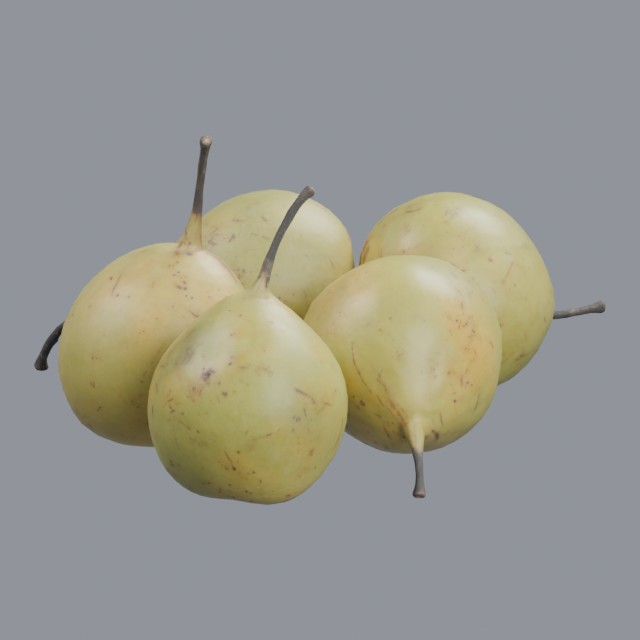
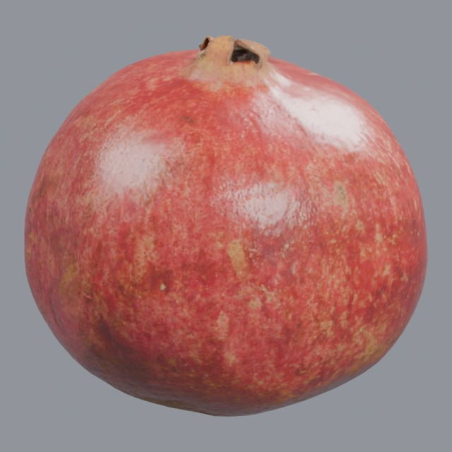
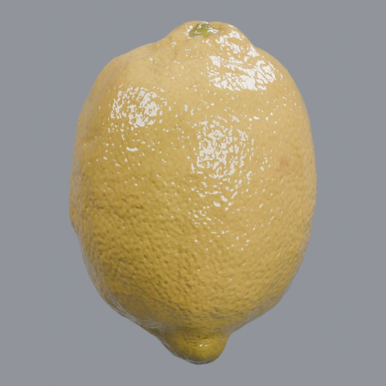
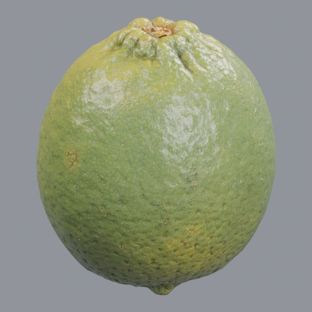
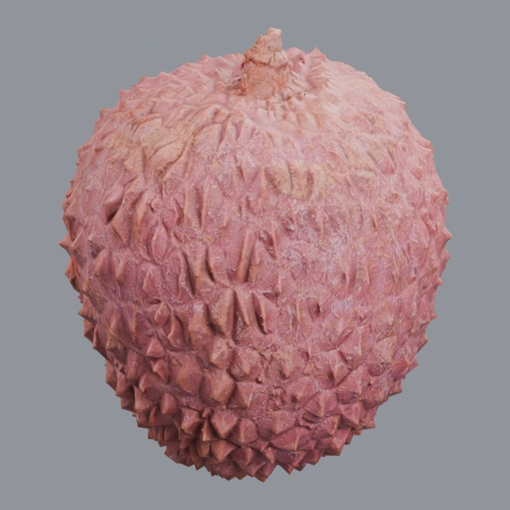

# food/fruit

Whole fruit models

Approved assets: **10**

## Kenney stylized apple

- Creator: Kenney; style: low-poly; CC0-1.0
- 136 triangles; 1 texture images
- [Asset folder](../../assets/food/fruit/kenney-apple/) · [Metadata](../../assets/food/fruit/kenney-apple/asset.json) · [All inspection views](../../assets/food/fruit/kenney-apple/previews/contact-sheet.jpg)

## Ripe Hass avocado

- Creator: Oliver Harries; style: realistic; CC0-1.0
- 7,743 triangles; 3 texture images
- [Asset folder](../../assets/food/fruit/ph-avocado/) · [Metadata](../../assets/food/fruit/ph-avocado/asset.json) · [All inspection views](../../assets/food/fruit/ph-avocado/previews/contact-sheet.jpg)

## Ripe bananas, bunch and singles

- Creator: Alexander Shulha; style: realistic; CC0-1.0
- 46,868 triangles; 3 texture images
- [Asset folder](../../assets/food/fruit/ph-bananas/) · [Metadata](../../assets/food/fruit/ph-bananas/asset.json) · [All inspection views](../../assets/food/fruit/ph-bananas/previews/contact-sheet.jpg)

## Pears Asian 01

- Creator: Amal Kumar; style: realistic; CC0-1.0
- 12,572 triangles; 3 texture images
- [Asset folder](../../assets/food/fruit/ph-food-pears-asian-01/) · [Metadata](../../assets/food/fruit/ph-food-pears-asian-01/asset.json) · [All inspection views](../../assets/food/fruit/ph-food-pears-asian-01/previews/contact-sheet.jpg)

## Food Pomegranate 01

- Creator: Oliver Harries; style: realistic; CC0-1.0
- 8,142 triangles; 3 texture images
- [Asset folder](../../assets/food/fruit/ph-food-pomegranate-01/) · [Metadata](../../assets/food/fruit/ph-food-pomegranate-01/asset.json) · [All inspection views](../../assets/food/fruit/ph-food-pomegranate-01/previews/contact-sheet.jpg)

## Photoscanned kiwi fruit

- Creator: Oliver Harries; style: realistic; CC0-1.0
- 7,748 triangles; 3 texture images
- [Asset folder](../../assets/food/fruit/ph-kiwi/) · [Metadata](../../assets/food/fruit/ph-kiwi/asset.json) · [All inspection views](../../assets/food/fruit/ph-kiwi/previews/contact-sheet.jpg)

## Lemon

- Creator: Kuutti Siitonen; style: realistic; CC0-1.0
- 4,012 triangles; 3 texture images
- [Asset folder](../../assets/food/fruit/ph-lemon/) · [Metadata](../../assets/food/fruit/ph-lemon/asset.json) · [All inspection views](../../assets/food/fruit/ph-lemon/previews/contact-sheet.jpg)

## Photoscanned fresh lime

- Creator: Oliver Harries; style: realistic; CC0-1.0
- 8,100 triangles; 3 texture images
- [Asset folder](../../assets/food/fruit/ph-lime/) · [Metadata](../../assets/food/fruit/ph-lime/asset.json) · [All inspection views](../../assets/food/fruit/ph-lime/previews/contact-sheet.jpg)

## Photoscanned lychee fruit

- Creator: Oliver Harries; style: realistic; CC0-1.0
- 6,783 triangles; 3 texture images
- [Asset folder](../../assets/food/fruit/ph-lychee/) · [Metadata](../../assets/food/fruit/ph-lychee/asset.json) · [All inspection views](../../assets/food/fruit/ph-lychee/previews/contact-sheet.jpg)

## Realistic red apple

- Creator: Oliver Harries; style: realistic; CC0-1.0
- 7,012 triangles; 3 texture images
- [Asset folder](../../assets/food/fruit/ph-red-apple/) · [Metadata](../../assets/food/fruit/ph-red-apple/asset.json) · [All inspection views](../../assets/food/fruit/ph-red-apple/previews/contact-sheet.jpg)
