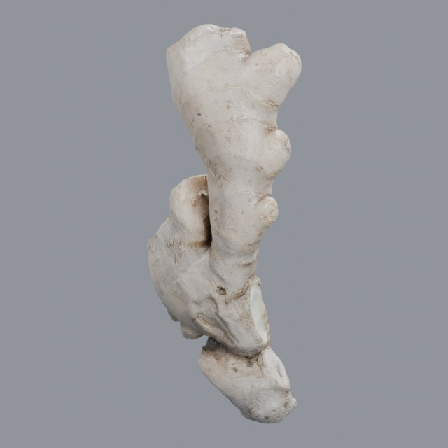
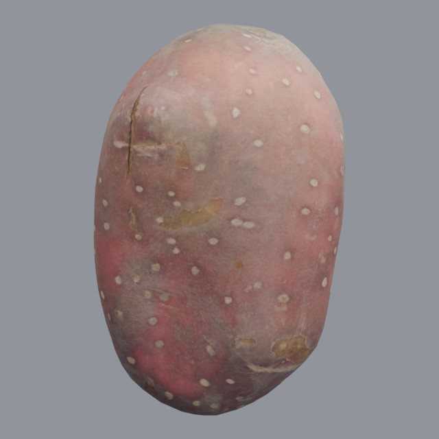
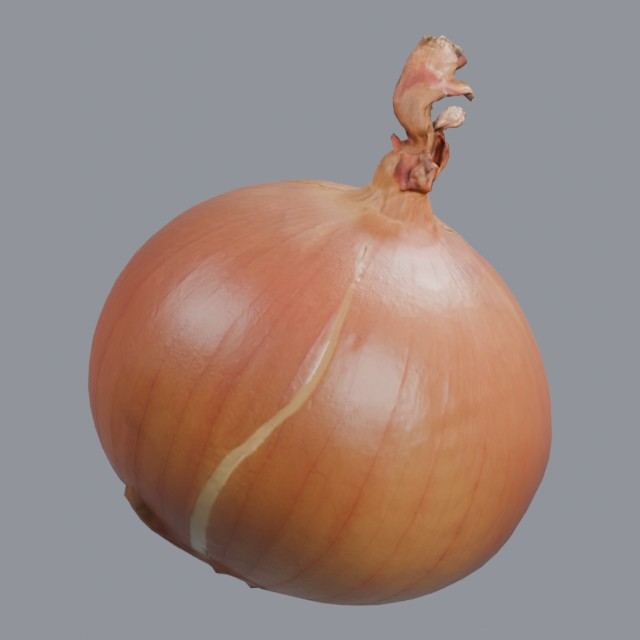

# food/vegetables

Whole vegetable and root models

Approved assets: **3**

## Photoscanned ginger root

- Creator: Oliver Harries; style: realistic; CC0-1.0
- 7,205 triangles; 3 texture images
- [Asset folder](../../assets/food/vegetables/ph-ginger-root/) · [Metadata](../../assets/food/vegetables/ph-ginger-root/asset.json) · [All inspection views](../../assets/food/vegetables/ph-ginger-root/previews/contact-sheet.jpg)

## Sweet Potato

- Creator: Jan Martens; style: realistic; CC0-1.0
- 2,042 triangles; 3 texture images
- [Asset folder](../../assets/food/vegetables/ph-sweet-potato/) · [Metadata](../../assets/food/vegetables/ph-sweet-potato/asset.json) · [All inspection views](../../assets/food/vegetables/ph-sweet-potato/previews/contact-sheet.jpg)

## Yellow Onion

- Creator: Kuutti Siitonen; style: realistic; CC0-1.0
- 5,444 triangles; 3 texture images
- [Asset folder](../../assets/food/vegetables/ph-yellow-onion/) · [Metadata](../../assets/food/vegetables/ph-yellow-onion/asset.json) · [All inspection views](../../assets/food/vegetables/ph-yellow-onion/previews/contact-sheet.jpg)
