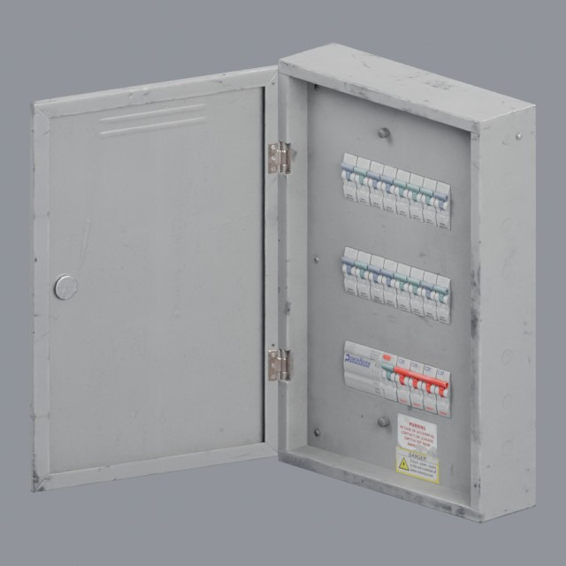
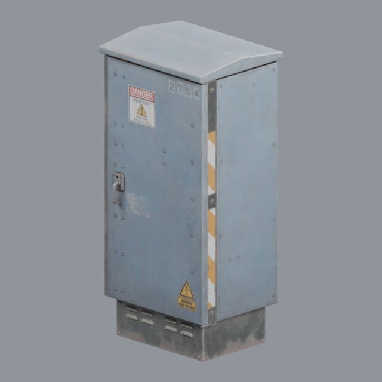

# industrial/electrical

Distribution boards, power boxes and wiring hardware

Approved assets: **2**

## Industrial electrical power box

- Creator: Rico Cilliers, Yann Kervran; style: realistic; CC0-1.0
- 21,272 triangles; 3 texture images
- [Asset folder](../../assets/industrial/electrical/ph-power-box/) · [Metadata](../../assets/industrial/electrical/ph-power-box/asset.json) · [All inspection views](../../assets/industrial/electrical/ph-power-box/previews/contact-sheet.jpg)

## Utility Box 01

- Creator: James Ray Cock; style: realistic; CC0-1.0
- 4,404 triangles; 3 texture images
- [Asset folder](../../assets/industrial/electrical/ph-utility-box-01/) · [Metadata](../../assets/industrial/electrical/ph-utility-box-01/asset.json) · [All inspection views](../../assets/industrial/electrical/ph-utility-box-01/previews/contact-sheet.jpg)
