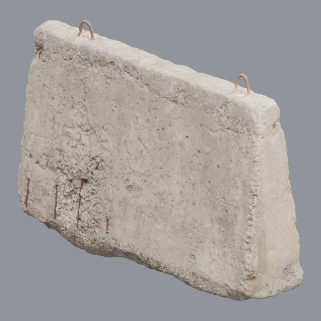
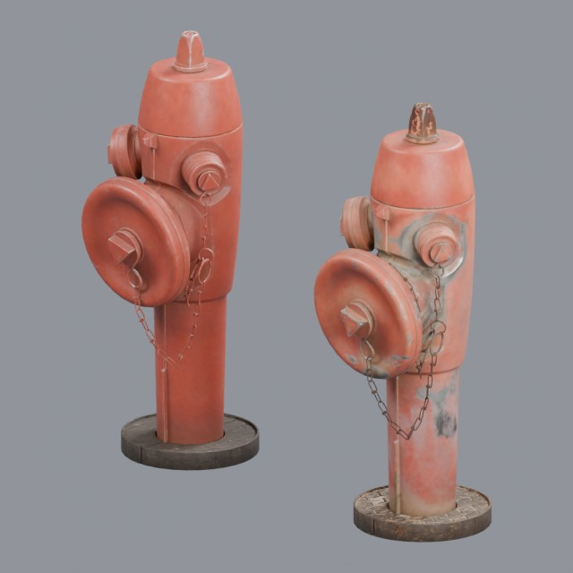

# industrial/infrastructure

Street furniture, barriers and utility structures

Approved assets: **2**

## Concrete Road Barrier 02

- Creator: Amal Kumar; style: realistic; CC0-1.0
- 23,822 triangles; 3 texture images
- [Asset folder](../../assets/industrial/infrastructure/ph-concrete-road-barrier-02/) · [Metadata](../../assets/industrial/infrastructure/ph-concrete-road-barrier-02/asset.json) · [All inspection views](../../assets/industrial/infrastructure/ph-concrete-road-barrier-02/previews/contact-sheet.jpg)

## Street fire hydrant

- Creator: Gonçalo Felício; style: realistic; CC0-1.0
- 86,316 triangles; 6 texture images
- [Asset folder](../../assets/industrial/infrastructure/ph-fire-hydrant/) · [Metadata](../../assets/industrial/infrastructure/ph-fire-hydrant/asset.json) · [All inspection views](../../assets/industrial/infrastructure/ph-fire-hydrant/previews/contact-sheet.jpg)
