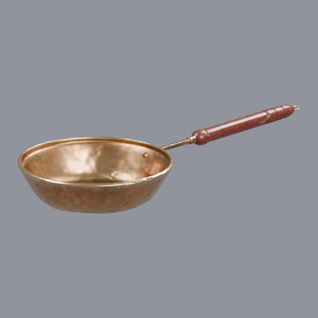
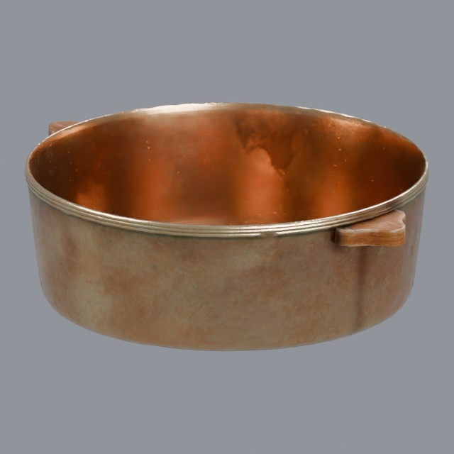
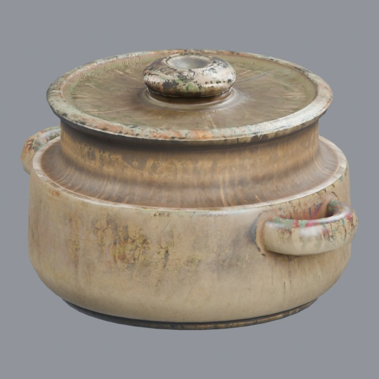
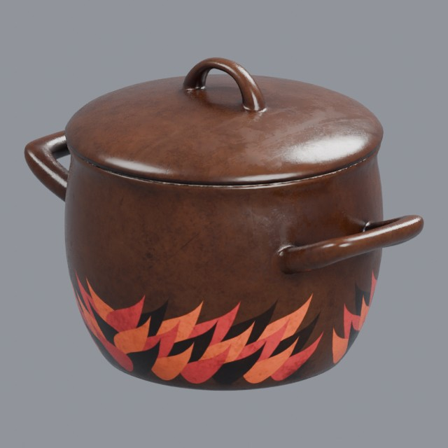

# kitchen/cookware

Pots, pans and vessels used for cooking

Approved assets: **4**

## Worn brass frying pan

- Creator: Rico Cilliers; style: realistic; CC0-1.0
- 4,340 triangles; 3 texture images
- [Asset folder](../../assets/kitchen/cookware/ph-brass-pan/) · [Metadata](../../assets/kitchen/cookware/ph-brass-pan/asset.json) · [All inspection views](../../assets/kitchen/cookware/ph-brass-pan/previews/contact-sheet.jpg)

## Worn brass cooking pot

- Creator: Rico Cilliers; style: realistic; CC0-1.0
- 3,344 triangles; 3 texture images
- [Asset folder](../../assets/kitchen/cookware/ph-brass-pot/) · [Metadata](../../assets/kitchen/cookware/ph-brass-pot/asset.json) · [All inspection views](../../assets/kitchen/cookware/ph-brass-pot/previews/contact-sheet.jpg)

## Lidded ceramic cooking pot

- Creator: Aron Łyczek; style: realistic; CC0-1.0
- 3,592 triangles; 3 texture images
- [Asset folder](../../assets/kitchen/cookware/ph-ceramic-pot/) · [Metadata](../../assets/kitchen/cookware/ph-ceramic-pot/asset.json) · [All inspection views](../../assets/kitchen/cookware/ph-ceramic-pot/previews/contact-sheet.jpg)

## Enamel cooking pot with lid

- Creator: Kuutti Siitonen; style: realistic; CC0-1.0
- 11,416 triangles; 3 texture images
- [Asset folder](../../assets/kitchen/cookware/ph-enamel-pot/) · [Metadata](../../assets/kitchen/cookware/ph-enamel-pot/asset.json) · [All inspection views](../../assets/kitchen/cookware/ph-enamel-pot/previews/contact-sheet.jpg)

