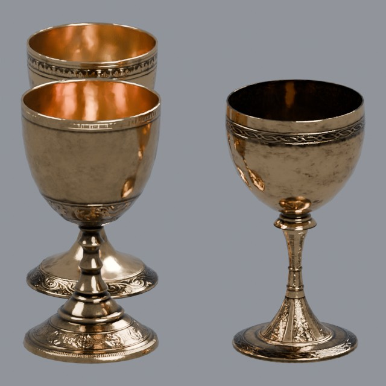
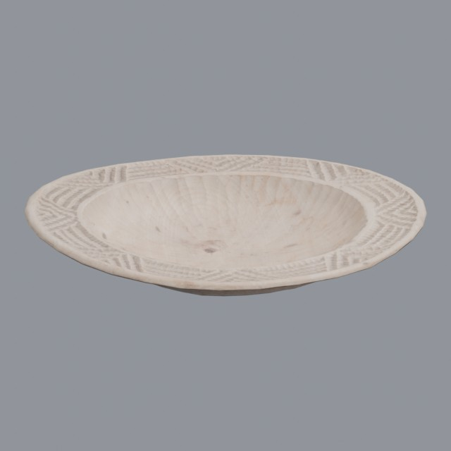
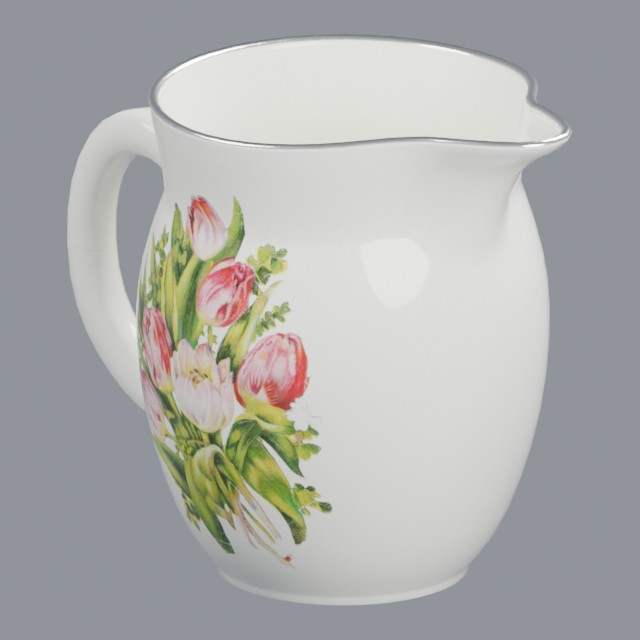
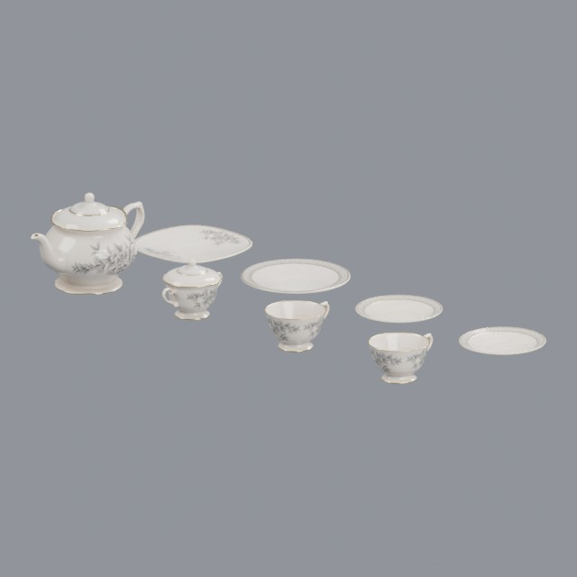

# kitchen/tableware

Plates, goblets, jugs and tea service for the table

Approved assets: **4**

## Ornate brass goblets

- Creator: Tina; style: realistic; CC0-1.0
- 9,600 triangles; 9 texture images
- [Asset folder](../../assets/kitchen/tableware/ph-brass-goblets/) · [Metadata](../../assets/kitchen/tableware/ph-brass-goblets/asset.json) · [All inspection views](../../assets/kitchen/tableware/ph-brass-goblets/previews/contact-sheet.jpg)

## Hand-carved wooden plate

- Creator: Jan Martens; style: realistic; CC0-1.0
- 2,112 triangles; 3 texture images
- [Asset folder](../../assets/kitchen/tableware/ph-carved-wooden-plate/) · [Metadata](../../assets/kitchen/tableware/ph-carved-wooden-plate/asset.json) · [All inspection views](../../assets/kitchen/tableware/ph-carved-wooden-plate/previews/contact-sheet.jpg)

## Painted ceramic milk jug

- Creator: Kuutti Siitonen; style: realistic; CC0-1.0
- 5,770 triangles; 3 texture images
- [Asset folder](../../assets/kitchen/tableware/ph-ceramic-jug/) · [Metadata](../../assets/kitchen/tableware/ph-ceramic-jug/asset.json) · [All inspection views](../../assets/kitchen/tableware/ph-ceramic-jug/previews/contact-sheet.jpg)

## Antique floral tea set

- Creator: James Ray Cock, Rico Cilliers, Jurita Burger; style: realistic; CC0-1.0
- 40,296 triangles; 3 texture images
- [Asset folder](../../assets/kitchen/tableware/ph-tea-set/) · [Metadata](../../assets/kitchen/tableware/ph-tea-set/asset.json) · [All inspection views](../../assets/kitchen/tableware/ph-tea-set/previews/contact-sheet.jpg)
