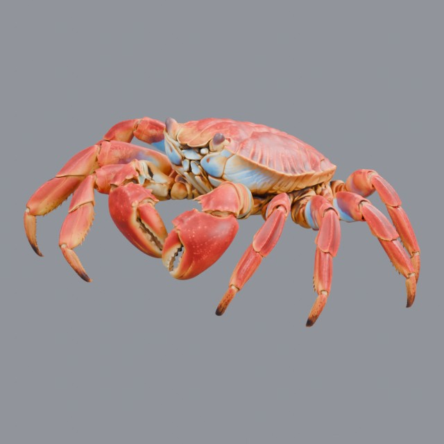
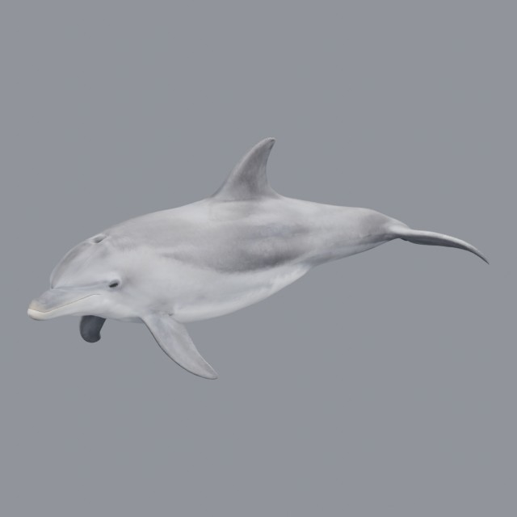
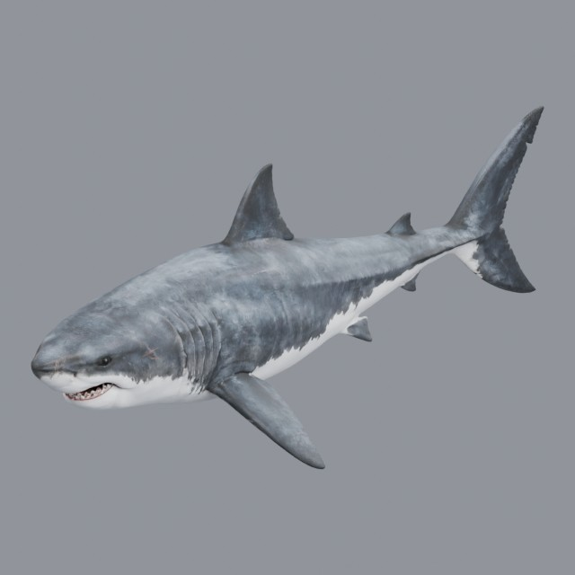
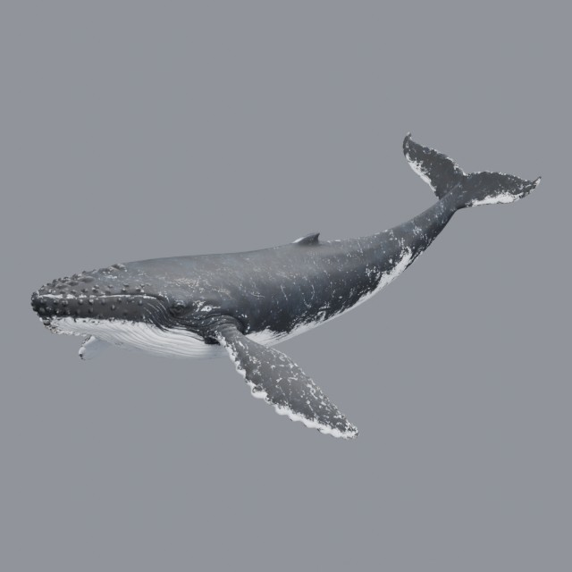
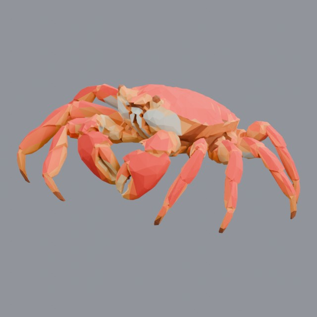

# nature/aquatic

Fish and marine life

Approved assets: **6**

## Red Rock Crab

- Creator: Grab3D; style: realistic; CC0-1.0
- 800,000 triangles; 3 texture images
- [Asset folder](../../assets/nature/aquatic/g3-crab/) · [Metadata](../../assets/nature/aquatic/g3-crab/asset.json) · [All inspection views](../../assets/nature/aquatic/g3-crab/previews/contact-sheet.jpg)

## Bottlenose Dolphin

- Creator: Grab3D; style: realistic; CC0-1.0
- 71,906 triangles; 3 texture images
- [Asset folder](../../assets/nature/aquatic/g3-dolphin/) · [Metadata](../../assets/nature/aquatic/g3-dolphin/asset.json) · [All inspection views](../../assets/nature/aquatic/g3-dolphin/previews/contact-sheet.jpg)

## Great White Shark

- Creator: Grab3D; style: realistic; CC0-1.0
- 166,988 triangles; 3 texture images
- [Asset folder](../../assets/nature/aquatic/g3-great-white-shark/) · [Metadata](../../assets/nature/aquatic/g3-great-white-shark/asset.json) · [All inspection views](../../assets/nature/aquatic/g3-great-white-shark/previews/contact-sheet.jpg)

## Humpback Whale

- Creator: Grab3D; style: realistic; CC0-1.0
- 219,982 triangles; 3 texture images
- [Asset folder](../../assets/nature/aquatic/g3-humpback-whale/) · [Metadata](../../assets/nature/aquatic/g3-humpback-whale/asset.json) · [All inspection views](../../assets/nature/aquatic/g3-humpback-whale/previews/contact-sheet.jpg)

## Low Poly Crab

- Creator: Grab3D; style: low-poly; CC0-1.0
- 5,994 triangles; 1 texture images
- [Asset folder](../../assets/nature/aquatic/g3-low-poly-crab/) · [Metadata](../../assets/nature/aquatic/g3-low-poly-crab/asset.json) · [All inspection views](../../assets/nature/aquatic/g3-low-poly-crab/previews/contact-sheet.jpg)

## Clownfish

- Creator: Grab3D; style: realistic; CC0-1.0
- 517,626 triangles; 3 texture images
- [Asset folder](../../assets/nature/aquatic/grab3d-clownfish/) · [Metadata](../../assets/nature/aquatic/grab3d-clownfish/asset.json) · [All inspection views](../../assets/nature/aquatic/grab3d-clownfish/previews/contact-sheet.jpg)

