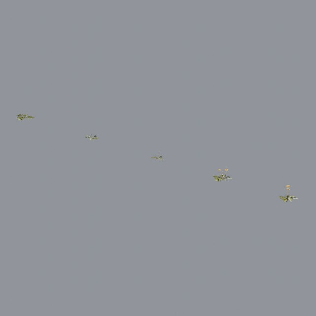
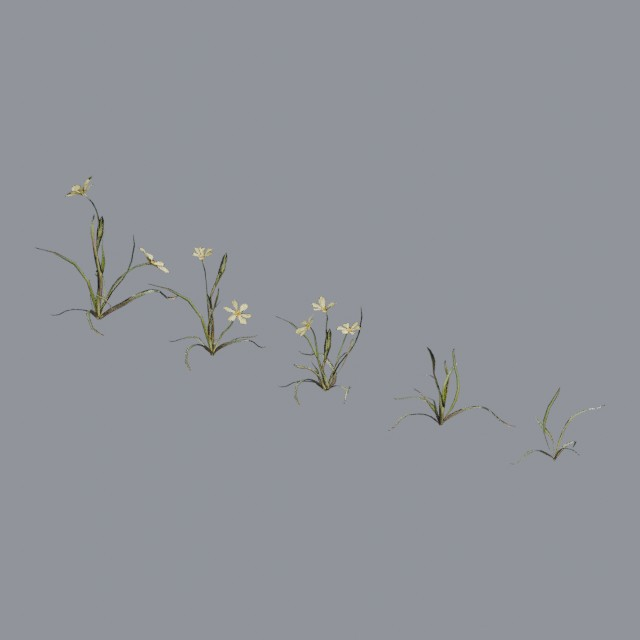
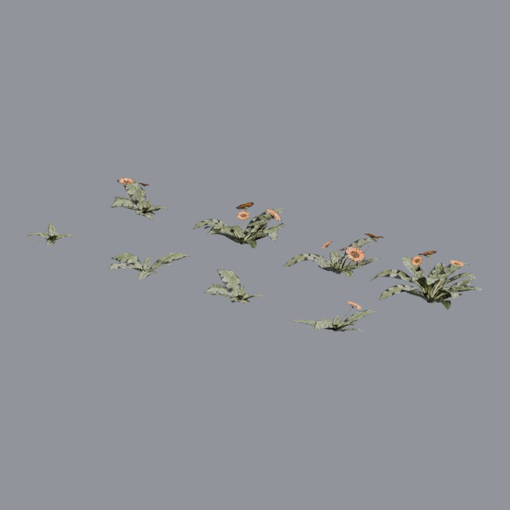
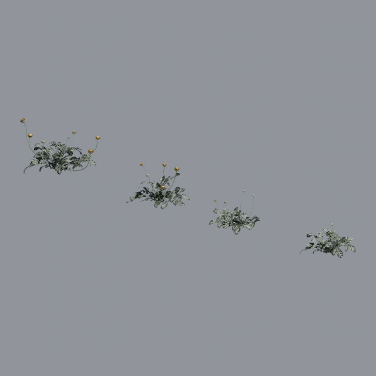
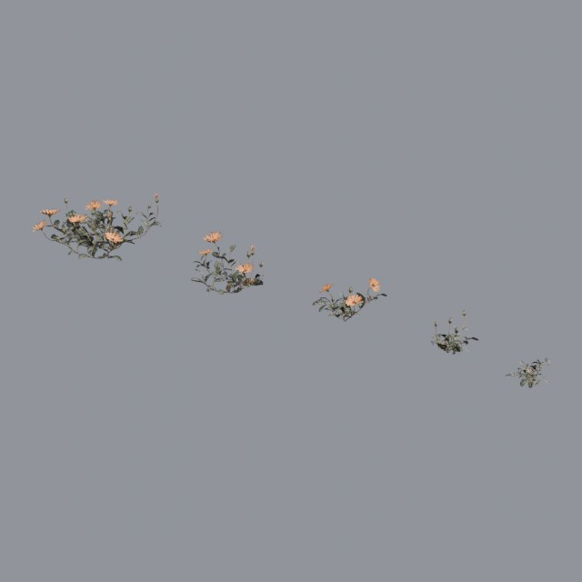
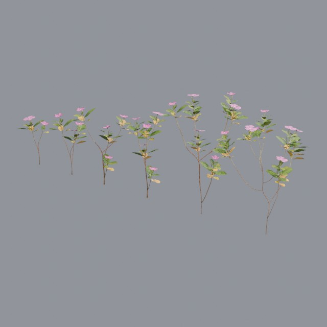
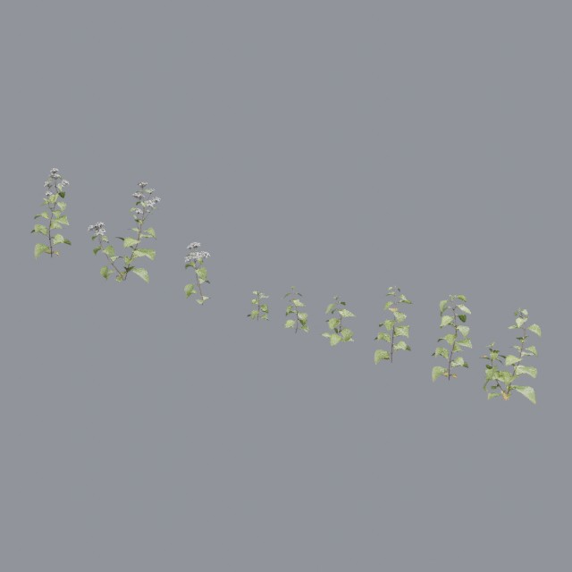

# nature/flowers

Wildflowers, ground cover and flowering shrubs

Approved assets: **7**

## Dandelion 01

- Creator: Rob Tuytel, Rico Cilliers; style: realistic; CC0-1.0
- 54,764 triangles; 3 texture images
- [Asset folder](../../assets/nature/flowers/ph-dandelion-01/) · [Metadata](../../assets/nature/flowers/ph-dandelion-01/asset.json) · [All inspection views](../../assets/nature/flowers/ph-dandelion-01/previews/contact-sheet.jpg)

## Flower Empodium

- Creator: Jenelle van Heerden, Rico Cilliers; style: realistic; CC0-1.0
- 3,053 triangles; 3 texture images
- [Asset folder](../../assets/nature/flowers/ph-flower-empodium/) · [Metadata](../../assets/nature/flowers/ph-flower-empodium/asset.json) · [All inspection views](../../assets/nature/flowers/ph-flower-empodium/previews/contact-sheet.jpg)

## Flower Gazania

- Creator: James Ray Cock, Jenelle van Heerden; style: realistic; CC0-1.0
- 14,340 triangles; 3 texture images
- [Asset folder](../../assets/nature/flowers/ph-flower-gazania/) · [Metadata](../../assets/nature/flowers/ph-flower-gazania/asset.json) · [All inspection views](../../assets/nature/flowers/ph-flower-gazania/previews/contact-sheet.jpg)

## Flower Stinkkruid

- Creator: Jenelle van Heerden, Rico Cilliers; style: realistic; CC0-1.0
- 80,716 triangles; 3 texture images
- [Asset folder](../../assets/nature/flowers/ph-flower-stinkkruid/) · [Metadata](../../assets/nature/flowers/ph-flower-stinkkruid/asset.json) · [All inspection views](../../assets/nature/flowers/ph-flower-stinkkruid/previews/contact-sheet.jpg)

## Flower Ursinia

- Creator: Jenelle van Heerden, Rico Cilliers; style: realistic; CC0-1.0
- 24,917 triangles; 3 texture images
- [Asset folder](../../assets/nature/flowers/ph-flower-ursinia/) · [Metadata](../../assets/nature/flowers/ph-flower-ursinia/asset.json) · [All inspection views](../../assets/nature/flowers/ph-flower-ursinia/previews/contact-sheet.jpg)

## Periwinkle Plant

- Creator: Amal Kumar; style: realistic; CC0-1.0
- 34,350 triangles; 3 texture images
- [Asset folder](../../assets/nature/flowers/ph-periwinkle-plant/) · [Metadata](../../assets/nature/flowers/ph-periwinkle-plant/asset.json) · [All inspection views](../../assets/nature/flowers/ph-periwinkle-plant/previews/contact-sheet.jpg)

## Shrub 01

- Creator: Rico Cilliers; style: realistic; CC0-1.0
- 156,012 triangles; 3 texture images
- [Asset folder](../../assets/nature/flowers/ph-shrub-01/) · [Metadata](../../assets/nature/flowers/ph-shrub-01/asset.json) · [All inspection views](../../assets/nature/flowers/ph-shrub-01/previews/contact-sheet.jpg)

