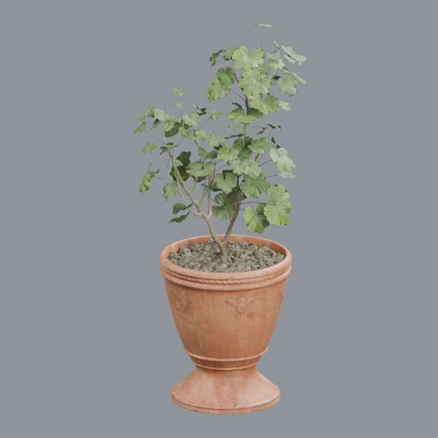
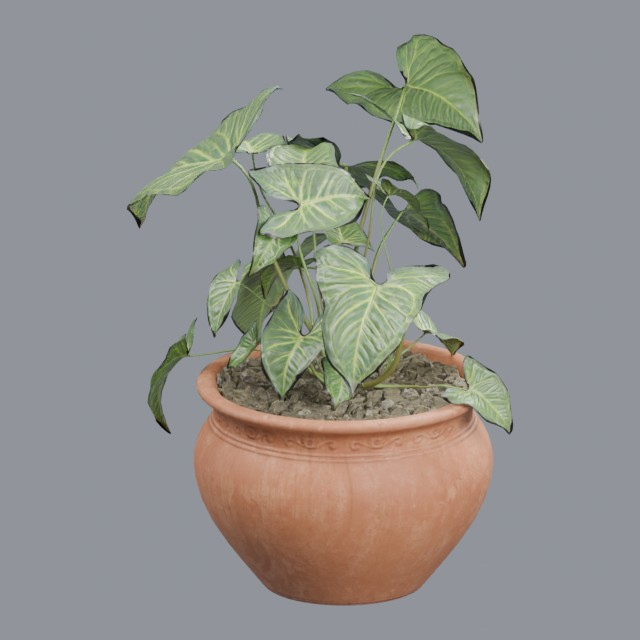
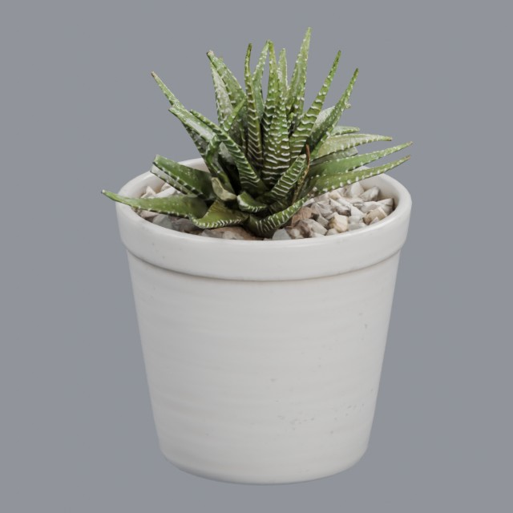

# nature/potted-plants

Plants supplied with their pots

Approved assets: **3**

## Potted leafy plant

- Creator: Rico Cilliers; style: realistic; CC0-1.0
- 176,226 triangles; 6 texture images
- [Asset folder](../../assets/nature/potted-plants/ph-potted-plant/) · [Metadata](../../assets/nature/potted-plants/ph-potted-plant/asset.json) · [All inspection views](../../assets/nature/potted-plants/ph-potted-plant/previews/contact-sheet.jpg)

## Potted Plant 02

- Creator: Rico Cilliers; style: realistic; CC0-1.0
- 69,806 triangles; 6 texture images
- [Asset folder](../../assets/nature/potted-plants/ph-potted-plant-02/) · [Metadata](../../assets/nature/potted-plants/ph-potted-plant-02/asset.json) · [All inspection views](../../assets/nature/potted-plants/ph-potted-plant-02/previews/contact-sheet.jpg)

## Potted zebra succulent

- Creator: James Ray Cock; style: realistic; CC0-1.0
- 8,929 triangles; 3 texture images
- [Asset folder](../../assets/nature/potted-plants/ph-potted-succulent/) · [Metadata](../../assets/nature/potted-plants/ph-potted-succulent/asset.json) · [All inspection views](../../assets/nature/potted-plants/ph-potted-succulent/previews/contact-sheet.jpg)
