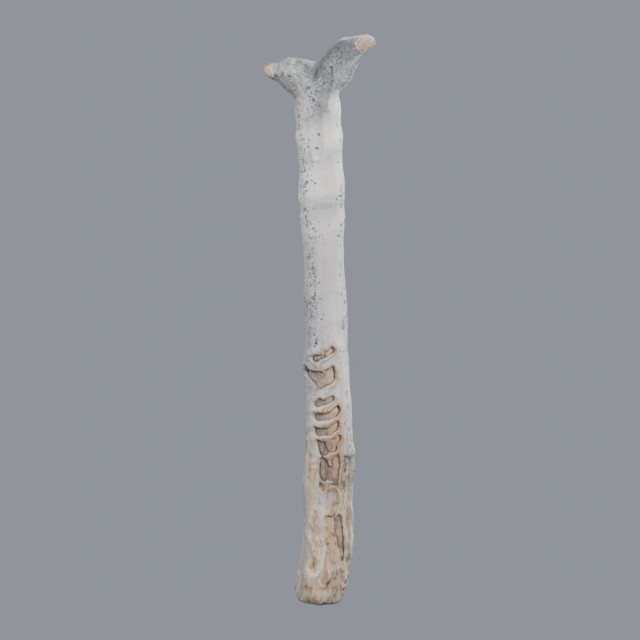
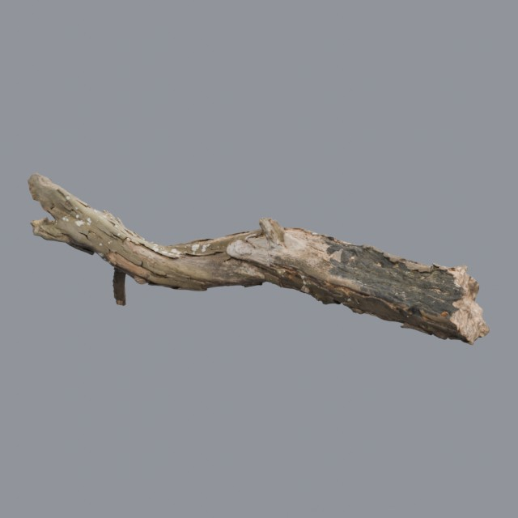

# nature/trees

Trees, saplings and tree trunks for environments

Approved assets: **2**

## Dead Quiver Trunk

- Creator: James Ray Cock, Dario Barresi, Rico Cilliers; style: realistic; CC0-1.0
- 17,978 triangles; 3 texture images
- [Asset folder](../../assets/nature/trees/ph-dead-quiver-trunk/) · [Metadata](../../assets/nature/trees/ph-dead-quiver-trunk/asset.json) · [All inspection views](../../assets/nature/trees/ph-dead-quiver-trunk/previews/contact-sheet.jpg)

## Dead Tree Trunk 02

- Creator: Jenelle van Heerden, Rico Cilliers; style: realistic; CC0-1.0
- 83,128 triangles; 3 texture images
- [Asset folder](../../assets/nature/trees/ph-dead-tree-trunk-02/) · [Metadata](../../assets/nature/trees/ph-dead-tree-trunk-02/asset.json) · [All inspection views](../../assets/nature/trees/ph-dead-tree-trunk-02/previews/contact-sheet.jpg)

