# nature/wildlife

Wild animals and vermin

Approved assets: **34**

## Brown Bear

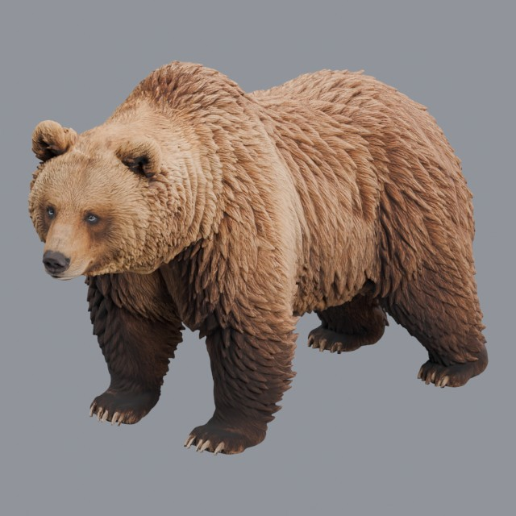

- Creator: Grab3D; style: realistic; CC0-1.0
- 800,000 triangles; 3 texture images
- [Asset folder](../../assets/nature/wildlife/g3-bear/) · [Metadata](../../assets/nature/wildlife/g3-bear/asset.json) · [All inspection views](../../assets/nature/wildlife/g3-bear/previews/contact-sheet.jpg)

## Bicolor Sphynx Cat

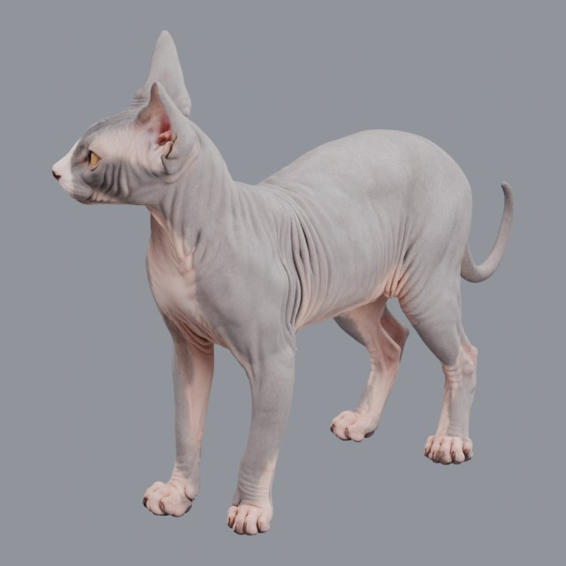

- Creator: Grab3D; style: realistic; CC0-1.0
- 593,712 triangles; 3 texture images
- [Asset folder](../../assets/nature/wildlife/g3-bicolor-sphynx-cat/) · [Metadata](../../assets/nature/wildlife/g3-bicolor-sphynx-cat/asset.json) · [All inspection views](../../assets/nature/wildlife/g3-bicolor-sphynx-cat/previews/contact-sheet.jpg)

## European Robin

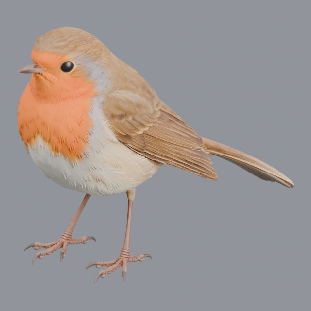

- Creator: Grab3D; style: realistic; CC0-1.0
- 799,999 triangles; 3 texture images
- [Asset folder](../../assets/nature/wildlife/g3-bird/) · [Metadata](../../assets/nature/wildlife/g3-bird/asset.json) · [All inspection views](../../assets/nature/wildlife/g3-bird/previews/contact-sheet.jpg)

## Black Bull

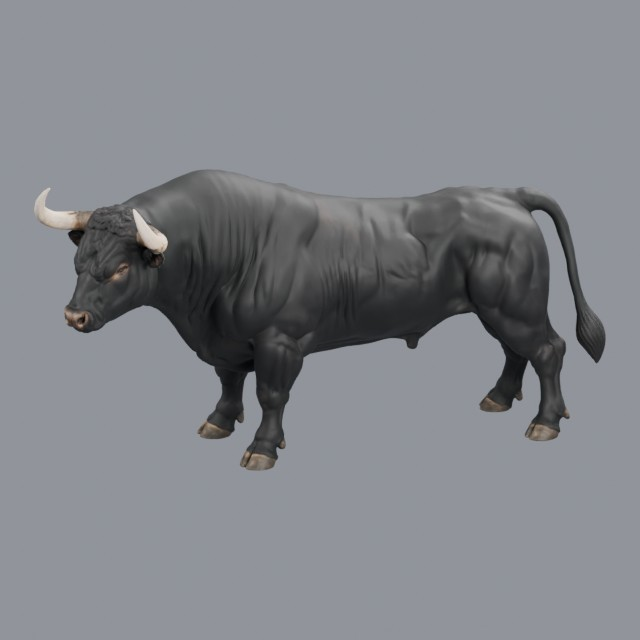

- Creator: Grab3D; style: realistic; CC0-1.0
- 454,836 triangles; 3 texture images
- [Asset folder](../../assets/nature/wildlife/g3-bull/) · [Metadata](../../assets/nature/wildlife/g3-bull/asset.json) · [All inspection views](../../assets/nature/wildlife/g3-bull/previews/contact-sheet.jpg)

## King Cheetah

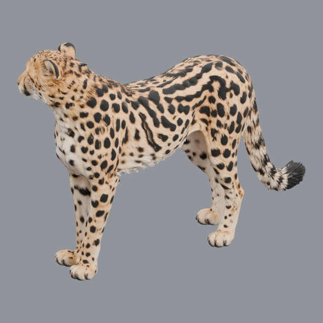

- Creator: Grab3D; style: realistic; CC0-1.0
- 800,000 triangles; 3 texture images
- [Asset folder](../../assets/nature/wildlife/g3-cheetah/) · [Metadata](../../assets/nature/wildlife/g3-cheetah/asset.json) · [All inspection views](../../assets/nature/wildlife/g3-cheetah/previews/contact-sheet.jpg)

## Chicken

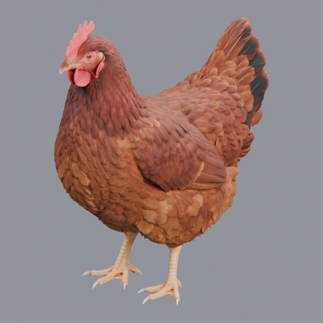

- Creator: Grab3D; style: realistic; CC0-1.0
- 800,000 triangles; 3 texture images
- [Asset folder](../../assets/nature/wildlife/g3-chicken/) · [Metadata](../../assets/nature/wildlife/g3-chicken/asset.json) · [All inspection views](../../assets/nature/wildlife/g3-chicken/previews/contact-sheet.jpg)

## Holstein Cow

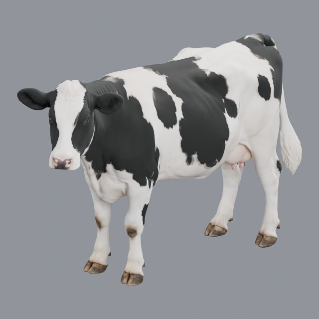

- Creator: Grab3D; style: realistic; CC0-1.0
- 385,450 triangles; 3 texture images
- [Asset folder](../../assets/nature/wildlife/g3-cow/) · [Metadata](../../assets/nature/wildlife/g3-cow/asset.json) · [All inspection views](../../assets/nature/wildlife/g3-cow/previews/contact-sheet.jpg)

## Crocodile

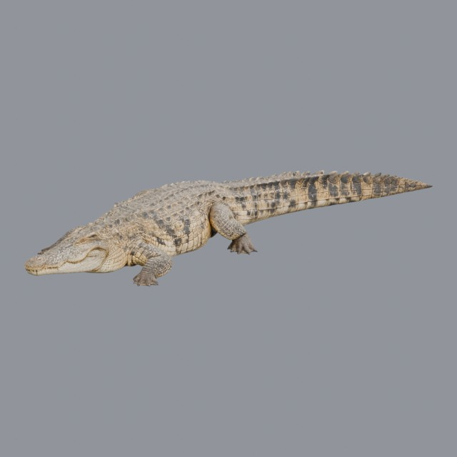

- Creator: Grab3D; style: realistic; CC0-1.0
- 755,514 triangles; 3 texture images
- [Asset folder](../../assets/nature/wildlife/g3-crocodile/) · [Metadata](../../assets/nature/wildlife/g3-crocodile/asset.json) · [All inspection views](../../assets/nature/wildlife/g3-crocodile/previews/contact-sheet.jpg)

## Bald Eagle

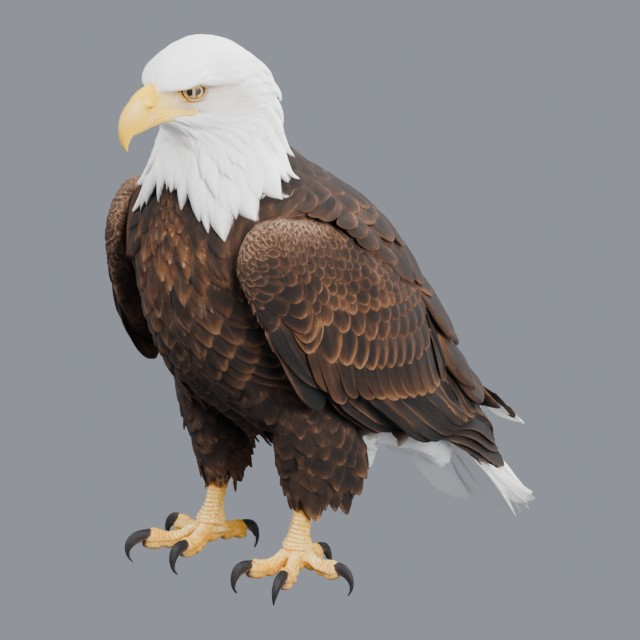

- Creator: Grab3D; style: realistic; CC0-1.0
- 800,000 triangles; 3 texture images
- [Asset folder](../../assets/nature/wildlife/g3-eagle/) · [Metadata](../../assets/nature/wildlife/g3-eagle/asset.json) · [All inspection views](../../assets/nature/wildlife/g3-eagle/previews/contact-sheet.jpg)

## African Elephant

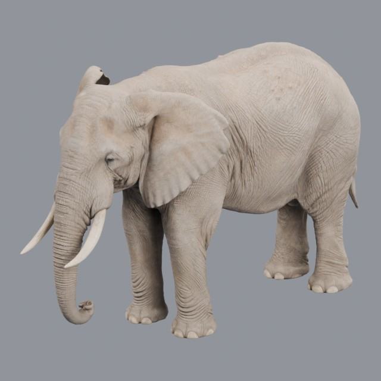

- Creator: Grab3D; style: realistic; CC0-1.0
- 800,000 triangles; 3 texture images
- [Asset folder](../../assets/nature/wildlife/g3-elephant/) · [Metadata](../../assets/nature/wildlife/g3-elephant/asset.json) · [All inspection views](../../assets/nature/wildlife/g3-elephant/previews/contact-sheet.jpg)

## Giraffe

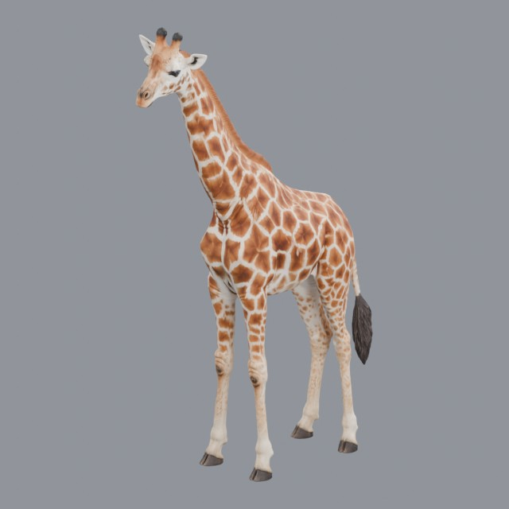

- Creator: Grab3D; style: realistic; CC0-1.0
- 428,570 triangles; 3 texture images
- [Asset folder](../../assets/nature/wildlife/g3-giraffe/) · [Metadata](../../assets/nature/wildlife/g3-giraffe/asset.json) · [All inspection views](../../assets/nature/wildlife/g3-giraffe/previews/contact-sheet.jpg)

## Hippopotamus

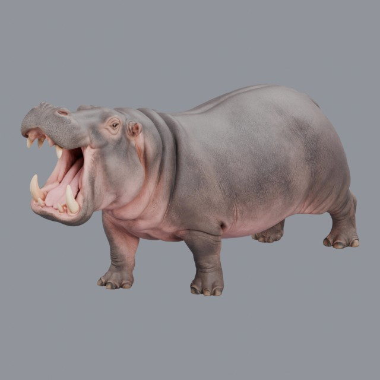

- Creator: Grab3D; style: realistic; CC0-1.0
- 482,440 triangles; 3 texture images
- [Asset folder](../../assets/nature/wildlife/g3-hippo/) · [Metadata](../../assets/nature/wildlife/g3-hippo/asset.json) · [All inspection views](../../assets/nature/wildlife/g3-hippo/previews/contact-sheet.jpg)

## Bay Horse

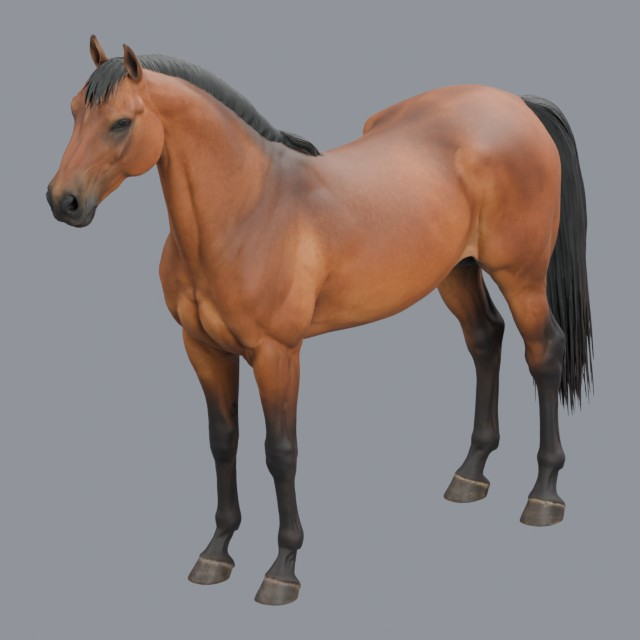

- Creator: Grab3D; style: realistic; CC0-1.0
- 731,120 triangles; 3 texture images
- [Asset folder](../../assets/nature/wildlife/g3-horse/) · [Metadata](../../assets/nature/wildlife/g3-horse/asset.json) · [All inspection views](../../assets/nature/wildlife/g3-horse/previews/contact-sheet.jpg)

## Calico Kitten

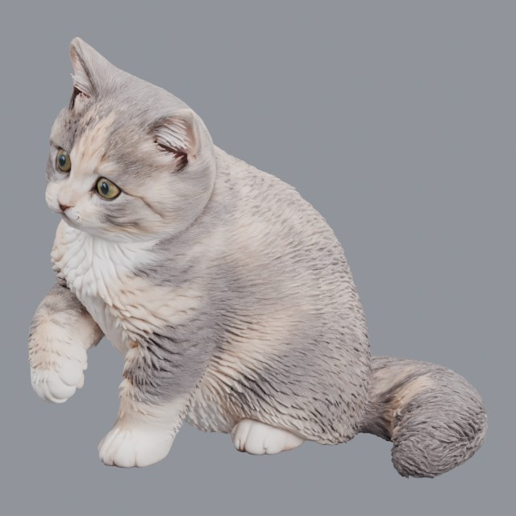

- Creator: Grab3D; style: realistic; CC0-1.0
- 799,998 triangles; 3 texture images
- [Asset folder](../../assets/nature/wildlife/g3-kitten/) · [Metadata](../../assets/nature/wildlife/g3-kitten/asset.json) · [All inspection views](../../assets/nature/wildlife/g3-kitten/previews/contact-sheet.jpg)

## Lion

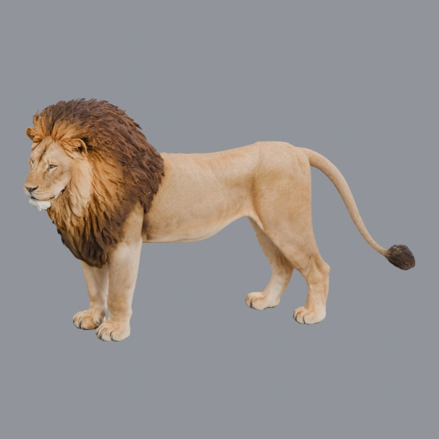

- Creator: Grab3D; style: realistic; CC0-1.0
- 800,000 triangles; 3 texture images
- [Asset folder](../../assets/nature/wildlife/g3-lion/) · [Metadata](../../assets/nature/wildlife/g3-lion/asset.json) · [All inspection views](../../assets/nature/wildlife/g3-lion/previews/contact-sheet.jpg)

## Llama

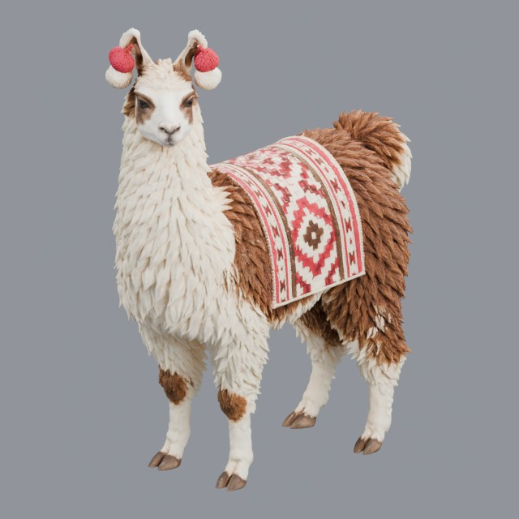

- Creator: Grab3D; style: realistic; CC0-1.0
- 800,000 triangles; 3 texture images
- [Asset folder](../../assets/nature/wildlife/g3-llama/) · [Metadata](../../assets/nature/wildlife/g3-llama/asset.json) · [All inspection views](../../assets/nature/wildlife/g3-llama/previews/contact-sheet.jpg)

## Low Poly Bear

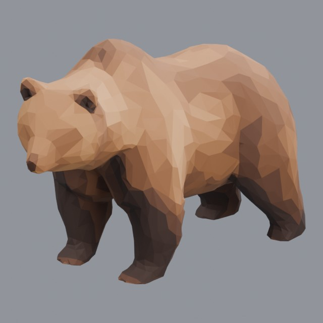

- Creator: Grab3D; style: low-poly; CC0-1.0
- 3,000 triangles; 1 texture images
- [Asset folder](../../assets/nature/wildlife/g3-low-poly-bear/) · [Metadata](../../assets/nature/wildlife/g3-low-poly-bear/asset.json) · [All inspection views](../../assets/nature/wildlife/g3-low-poly-bear/previews/contact-sheet.jpg)

## Low Poly Bull

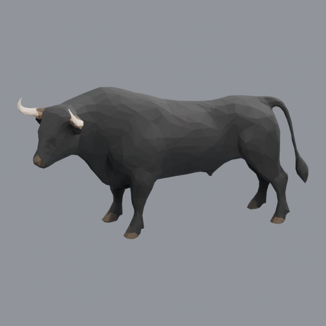

- Creator: Grab3D; style: low-poly; CC0-1.0
- 2,999 triangles; 1 texture images
- [Asset folder](../../assets/nature/wildlife/g3-low-poly-bull/) · [Metadata](../../assets/nature/wildlife/g3-low-poly-bull/asset.json) · [All inspection views](../../assets/nature/wildlife/g3-low-poly-bull/previews/contact-sheet.jpg)

## Low Poly Chicken

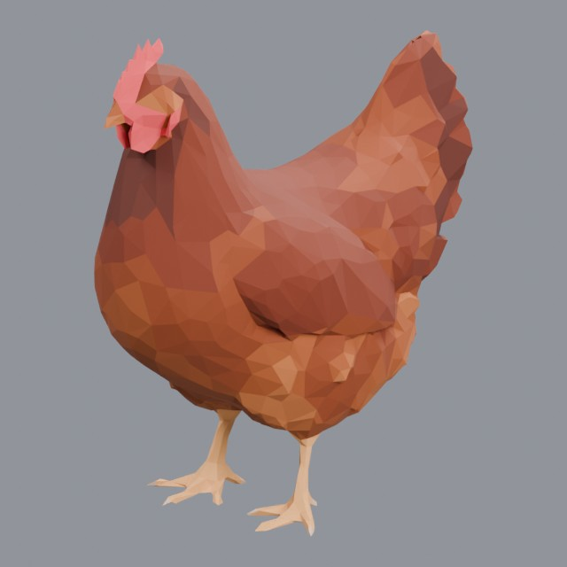

- Creator: Grab3D; style: low-poly; CC0-1.0
- 2,997 triangles; 1 texture images
- [Asset folder](../../assets/nature/wildlife/g3-low-poly-chicken/) · [Metadata](../../assets/nature/wildlife/g3-low-poly-chicken/asset.json) · [All inspection views](../../assets/nature/wildlife/g3-low-poly-chicken/previews/contact-sheet.jpg)

## Low Poly Cow

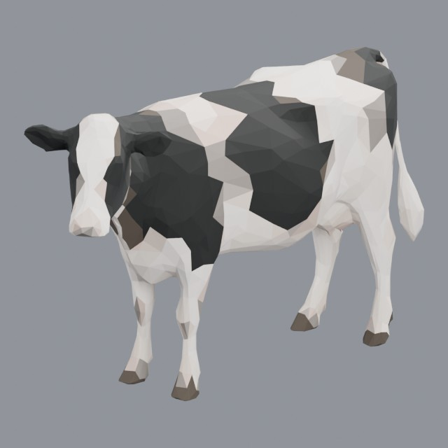

- Creator: Grab3D; style: low-poly; CC0-1.0
- 2,999 triangles; 1 texture images
- [Asset folder](../../assets/nature/wildlife/g3-low-poly-cow/) · [Metadata](../../assets/nature/wildlife/g3-low-poly-cow/asset.json) · [All inspection views](../../assets/nature/wildlife/g3-low-poly-cow/previews/contact-sheet.jpg)

## Low Poly Deer

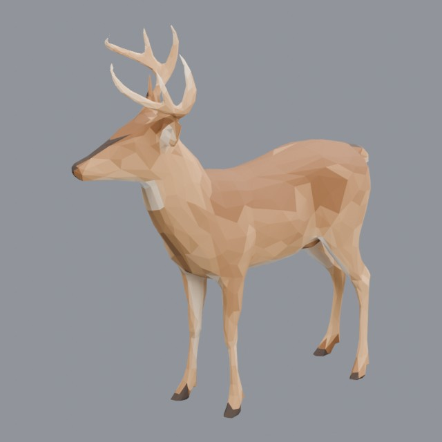

- Creator: Grab3D; style: low-poly; CC0-1.0
- 2,996 triangles; 1 texture images
- [Asset folder](../../assets/nature/wildlife/g3-low-poly-deer/) · [Metadata](../../assets/nature/wildlife/g3-low-poly-deer/asset.json) · [All inspection views](../../assets/nature/wildlife/g3-low-poly-deer/previews/contact-sheet.jpg)

## Low Poly Elephant

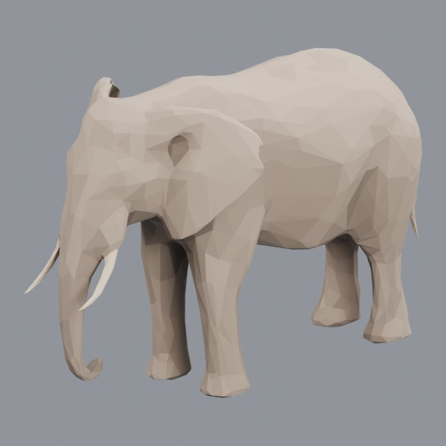

- Creator: Grab3D; style: low-poly; CC0-1.0
- 3,000 triangles; 1 texture images
- [Asset folder](../../assets/nature/wildlife/g3-low-poly-elephant/) · [Metadata](../../assets/nature/wildlife/g3-low-poly-elephant/asset.json) · [All inspection views](../../assets/nature/wildlife/g3-low-poly-elephant/previews/contact-sheet.jpg)

## Low Poly Fox

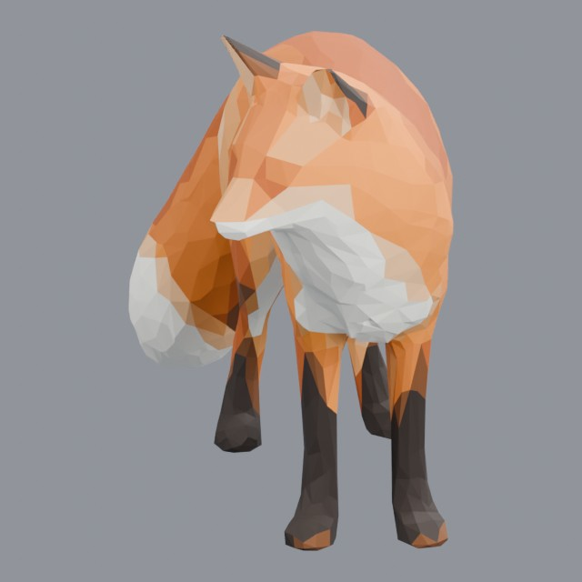

- Creator: Grab3D; style: low-poly; CC0-1.0
- 2,999 triangles; 1 texture images
- [Asset folder](../../assets/nature/wildlife/g3-low-poly-fox/) · [Metadata](../../assets/nature/wildlife/g3-low-poly-fox/asset.json) · [All inspection views](../../assets/nature/wildlife/g3-low-poly-fox/previews/contact-sheet.jpg)

## Low Poly Hippo

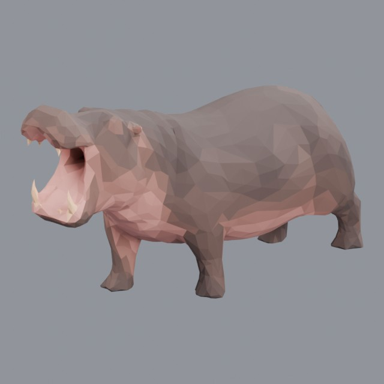

- Creator: Grab3D; style: low-poly; CC0-1.0
- 3,000 triangles; 1 texture images
- [Asset folder](../../assets/nature/wildlife/g3-low-poly-hippo/) · [Metadata](../../assets/nature/wildlife/g3-low-poly-hippo/asset.json) · [All inspection views](../../assets/nature/wildlife/g3-low-poly-hippo/previews/contact-sheet.jpg)

## Low Poly Horse

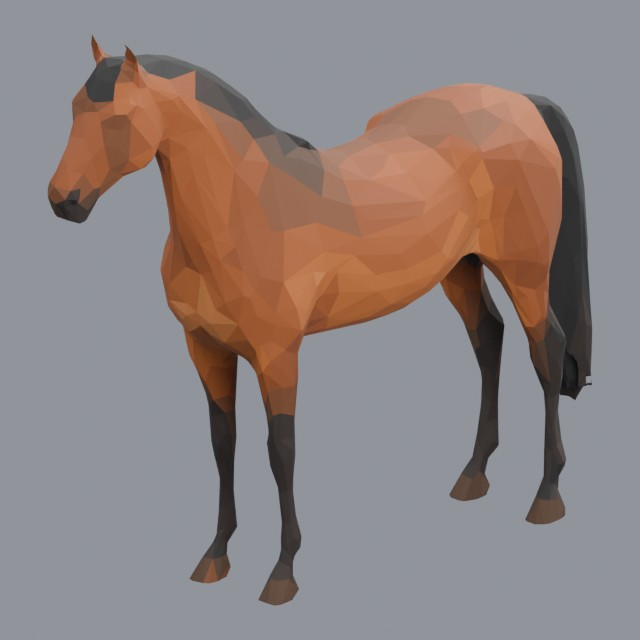

- Creator: Grab3D; style: low-poly; CC0-1.0
- 2,996 triangles; 1 texture images
- [Asset folder](../../assets/nature/wildlife/g3-low-poly-horse/) · [Metadata](../../assets/nature/wildlife/g3-low-poly-horse/asset.json) · [All inspection views](../../assets/nature/wildlife/g3-low-poly-horse/previews/contact-sheet.jpg)

## Low Poly Parrot

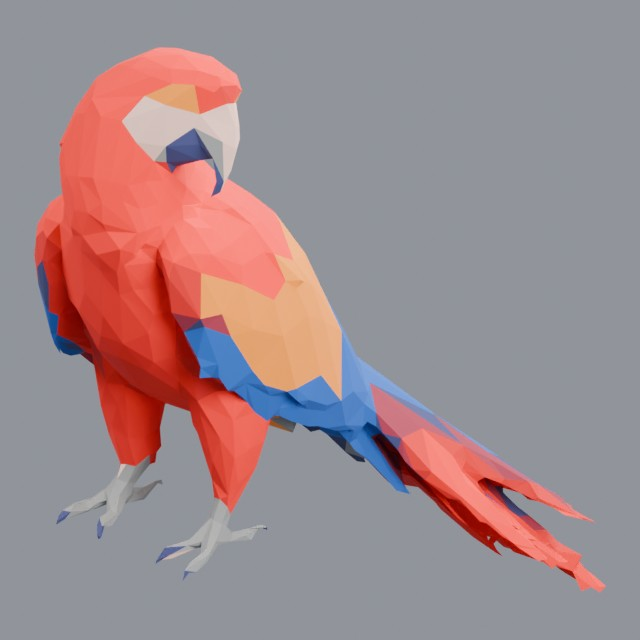

- Creator: Grab3D; style: low-poly; CC0-1.0
- 2,980 triangles; 1 texture images
- [Asset folder](../../assets/nature/wildlife/g3-low-poly-parrot/) · [Metadata](../../assets/nature/wildlife/g3-low-poly-parrot/asset.json) · [All inspection views](../../assets/nature/wildlife/g3-low-poly-parrot/previews/contact-sheet.jpg)

## Low Poly Rhino

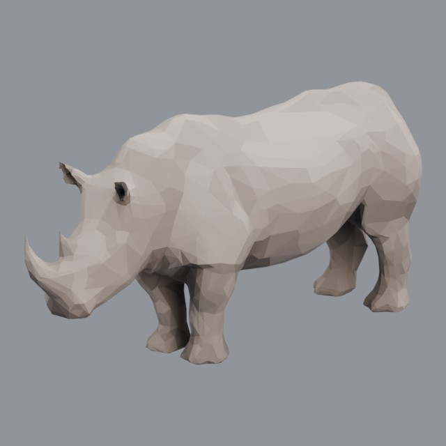

- Creator: Grab3D; style: low-poly; CC0-1.0
- 2,998 triangles; 1 texture images
- [Asset folder](../../assets/nature/wildlife/g3-low-poly-rhino/) · [Metadata](../../assets/nature/wildlife/g3-low-poly-rhino/asset.json) · [All inspection views](../../assets/nature/wildlife/g3-low-poly-rhino/previews/contact-sheet.jpg)

## Moose

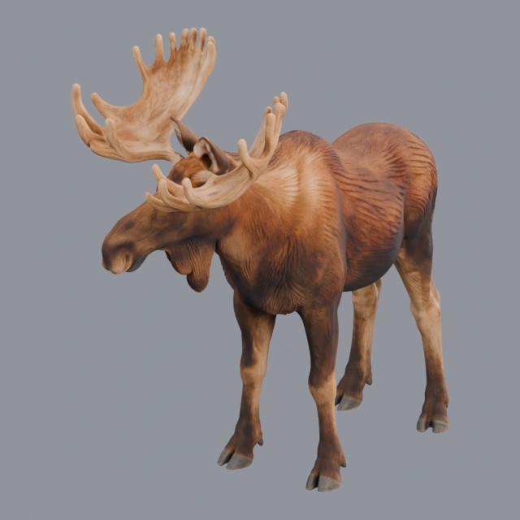

- Creator: Grab3D; style: realistic; CC0-1.0
- 800,000 triangles; 3 texture images
- [Asset folder](../../assets/nature/wildlife/g3-moose/) · [Metadata](../../assets/nature/wildlife/g3-moose/asset.json) · [All inspection views](../../assets/nature/wildlife/g3-moose/previews/contact-sheet.jpg)

## Bernese Mountain Dog Puppy

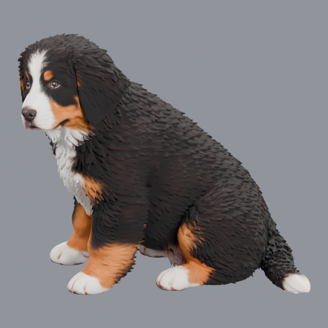

- Creator: Grab3D; style: realistic; CC0-1.0
- 800,000 triangles; 3 texture images
- [Asset folder](../../assets/nature/wildlife/g3-puppy/) · [Metadata](../../assets/nature/wildlife/g3-puppy/asset.json) · [All inspection views](../../assets/nature/wildlife/g3-puppy/previews/contact-sheet.jpg)

## Raccoon

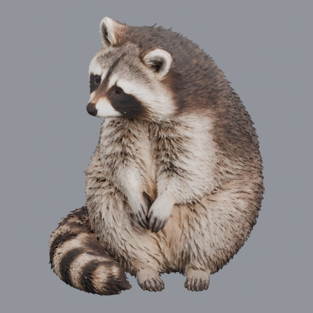

- Creator: Grab3D; style: realistic; CC0-1.0
- 399,997 triangles; 3 texture images
- [Asset folder](../../assets/nature/wildlife/g3-raccoon/) · [Metadata](../../assets/nature/wildlife/g3-raccoon/asset.json) · [All inspection views](../../assets/nature/wildlife/g3-raccoon/previews/contact-sheet.jpg)

## Sphynx Cat

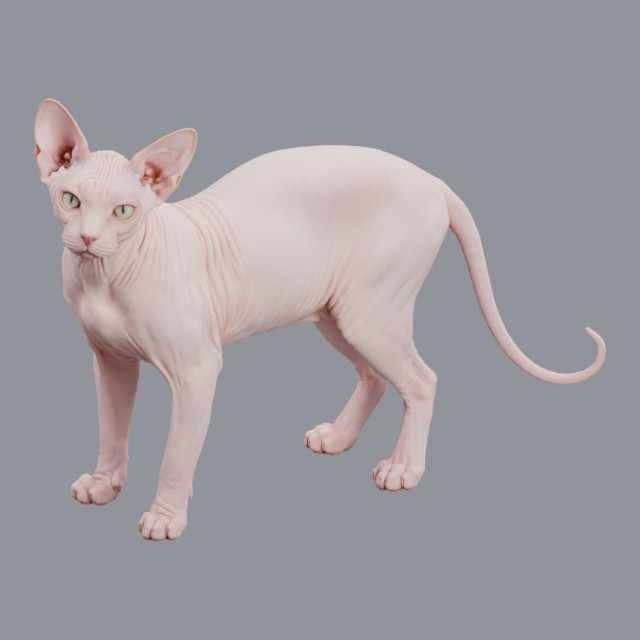

- Creator: Grab3D; style: realistic; CC0-1.0
- 579,774 triangles; 3 texture images
- [Asset folder](../../assets/nature/wildlife/g3-sphynx-cat/) · [Metadata](../../assets/nature/wildlife/g3-sphynx-cat/asset.json) · [All inspection views](../../assets/nature/wildlife/g3-sphynx-cat/previews/contact-sheet.jpg)

## Red Squirrel

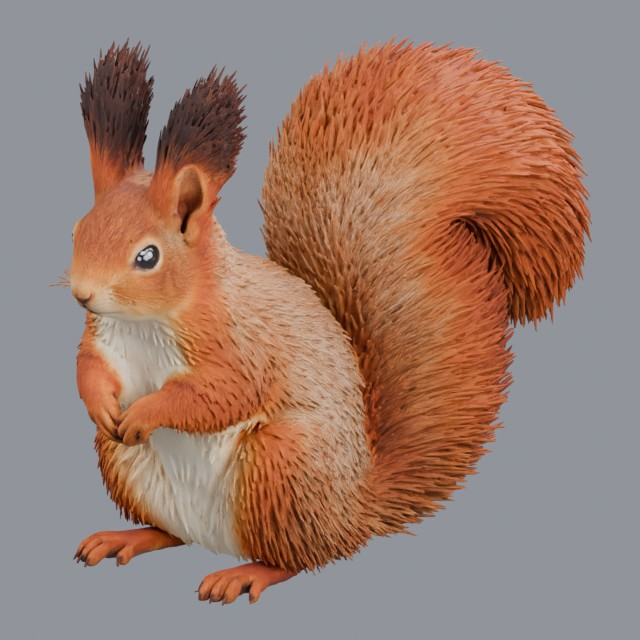

- Creator: Grab3D; style: realistic; CC0-1.0
- 799,999 triangles; 3 texture images
- [Asset folder](../../assets/nature/wildlife/g3-squirrel/) · [Metadata](../../assets/nature/wildlife/g3-squirrel/asset.json) · [All inspection views](../../assets/nature/wildlife/g3-squirrel/previews/contact-sheet.jpg)

## Hedgehog

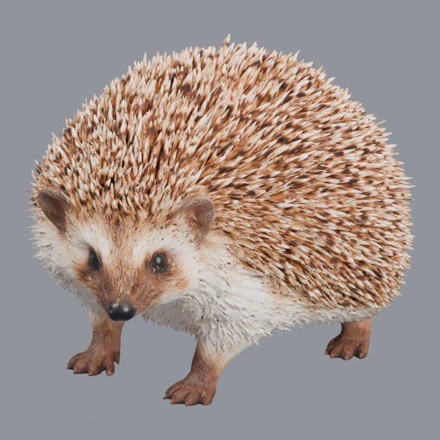

- Creator: Grab3D; style: realistic; CC0-1.0
- 399,997 triangles; 3 texture images
- [Asset folder](../../assets/nature/wildlife/grab3d-hedgehog/) · [Metadata](../../assets/nature/wildlife/grab3d-hedgehog/asset.json) · [All inspection views](../../assets/nature/wildlife/grab3d-hedgehog/previews/contact-sheet.jpg)

## Realistic street rat

- Creator: Sean Buckley; style: realistic; CC0-1.0
- 57,216 triangles; 3 texture images
- [Asset folder](../../assets/nature/wildlife/ph-street-rat/) · [Metadata](../../assets/nature/wildlife/ph-street-rat/asset.json) · [All inspection views](../../assets/nature/wildlife/ph-street-rat/previews/contact-sheet.jpg)
