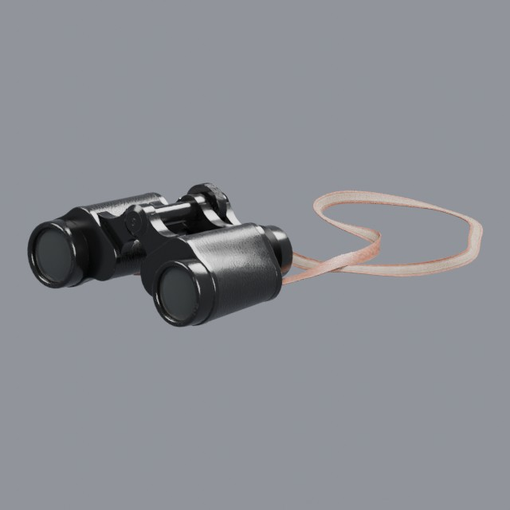
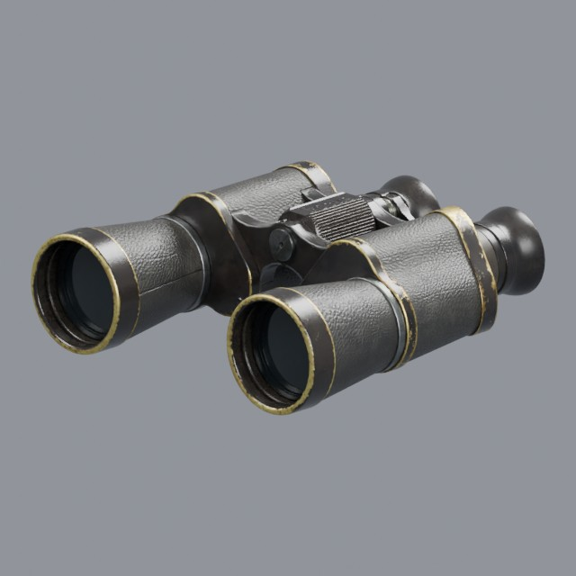
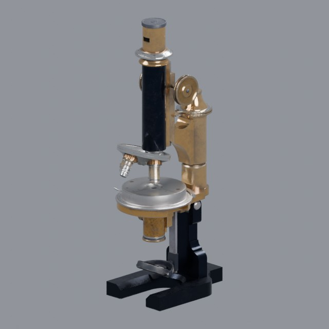

# science/optical

Microscopes, binoculars and optical instruments

Approved assets: **3**

## Leather-bodied field binoculars

- Creator: Derek Wight; style: realistic; CC0-1.0
- 19,248 triangles; 4 texture images
- [Asset folder](../../assets/science/optical/ph-field-binoculars/) · [Metadata](../../assets/science/optical/ph-field-binoculars/asset.json) · [All inspection views](../../assets/science/optical/ph-field-binoculars/previews/contact-sheet.jpg)

## Vintage brass binoculars

- Creator: Luke; style: realistic; CC0-1.0
- 19,362 triangles; 3 texture images
- [Asset folder](../../assets/science/optical/ph-vintage-binoculars/) · [Metadata](../../assets/science/optical/ph-vintage-binoculars/asset.json) · [All inspection views](../../assets/science/optical/ph-vintage-binoculars/previews/contact-sheet.jpg)

## Vintage brass microscope

- Creator: Luis José Fernández Rodríguez; style: realistic; CC0-1.0
- 20,631 triangles; 4 texture images
- [Asset folder](../../assets/science/optical/ph-vintage-microscope/) · [Metadata](../../assets/science/optical/ph-vintage-microscope/asset.json) · [All inspection views](../../assets/science/optical/ph-vintage-microscope/previews/contact-sheet.jpg)
