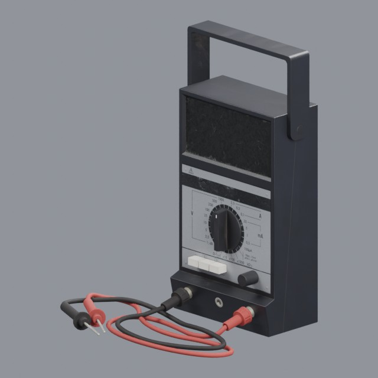
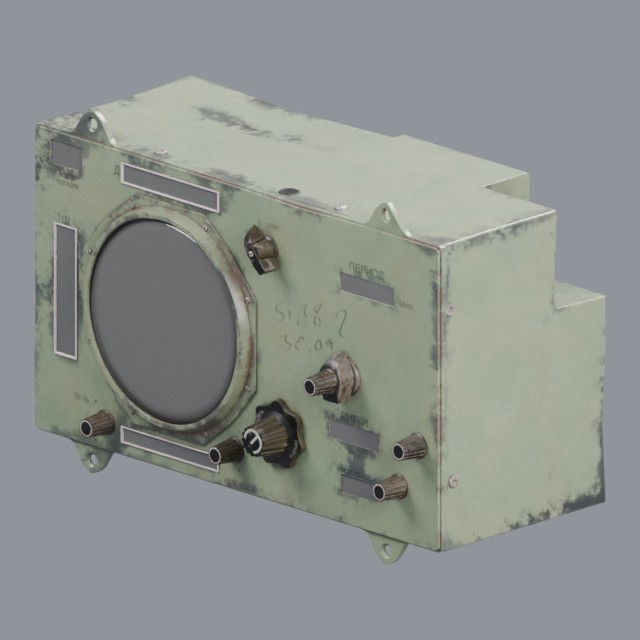

# tools/measuring

Multimeters, gauges and precision measuring instruments

Approved assets: **2**

## Retro analog multimeter

- Creator: elli moeller; style: realistic; CC0-1.0
- 8,948 triangles; 4 texture images
- [Asset folder](../../assets/tools/measuring/ph-retro-multimeter/) · [Metadata](../../assets/tools/measuring/ph-retro-multimeter/asset.json) · [All inspection views](../../assets/tools/measuring/ph-retro-multimeter/previews/contact-sheet.jpg)

## Vintage spacecraft instrument panel

- Creator: Michał Wiśniewski; style: realistic; CC0-1.0
- 13,279 triangles; 4 texture images
- [Asset folder](../../assets/tools/measuring/ph-spacecraft-instrument/) · [Metadata](../../assets/tools/measuring/ph-spacecraft-instrument/asset.json) · [All inspection views](../../assets/tools/measuring/ph-spacecraft-instrument/previews/contact-sheet.jpg)
