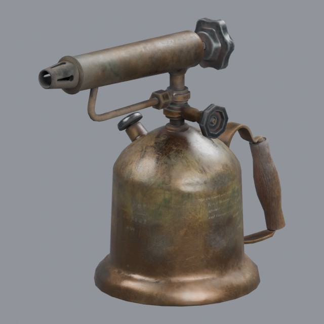
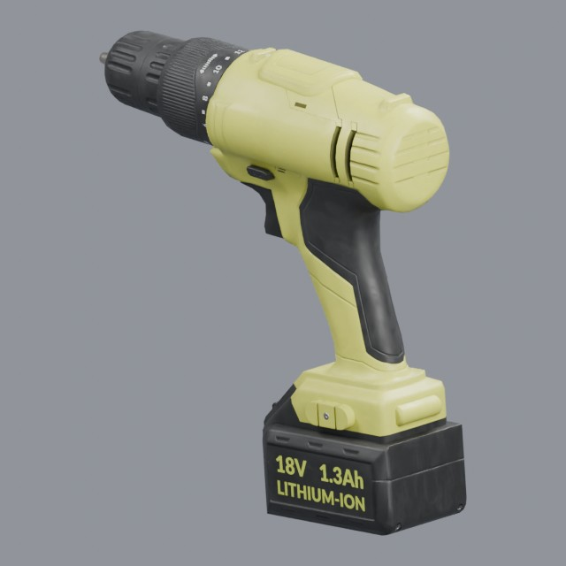
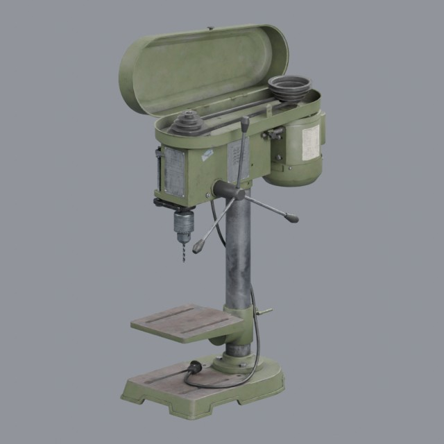

# tools/power-tools

Powered workshop tools and their accessories

Approved assets: **3**

## Brass blowtorch

- Creator: Ulan Cabanilla; style: realistic; CC0-1.0
- 11,750 triangles; 3 texture images
- [Asset folder](../../assets/tools/power-tools/ph-brass-blowtorch/) · [Metadata](../../assets/tools/power-tools/ph-brass-blowtorch/asset.json) · [All inspection views](../../assets/tools/power-tools/ph-brass-blowtorch/previews/contact-sheet.jpg)

## Cordless power drill

- Creator: Fernando Quinn; style: realistic; CC0-1.0
- 2,926 triangles; 3 texture images
- [Asset folder](../../assets/tools/power-tools/ph-cordless-drill/) · [Metadata](../../assets/tools/power-tools/ph-cordless-drill/asset.json) · [All inspection views](../../assets/tools/power-tools/ph-cordless-drill/previews/contact-sheet.jpg)

## Vintage workshop drill press

- Creator: Viktor; style: realistic; CC0-1.0
- 58,526 triangles; 3 texture images
- [Asset folder](../../assets/tools/power-tools/ph-drill-press/) · [Metadata](../../assets/tools/power-tools/ph-drill-press/asset.json) · [All inspection views](../../assets/tools/power-tools/ph-drill-press/previews/contact-sheet.jpg)
