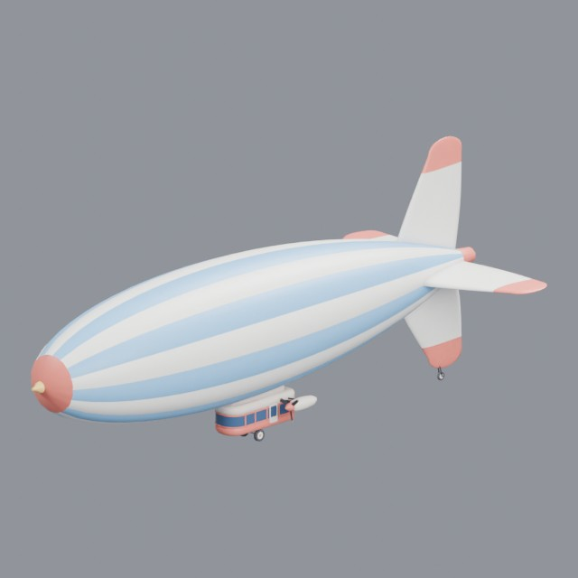
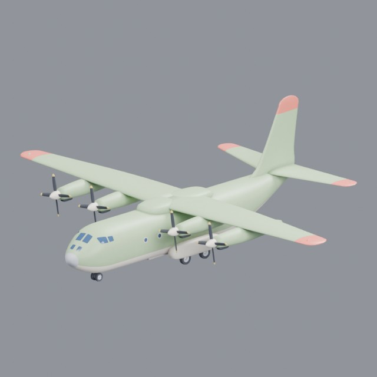
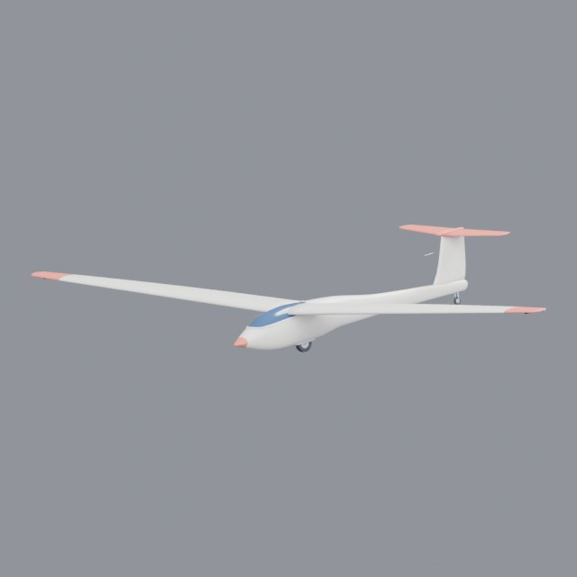
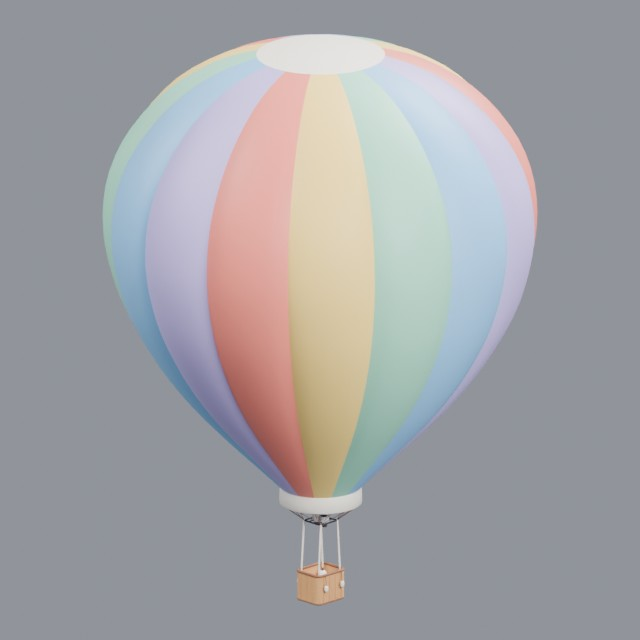
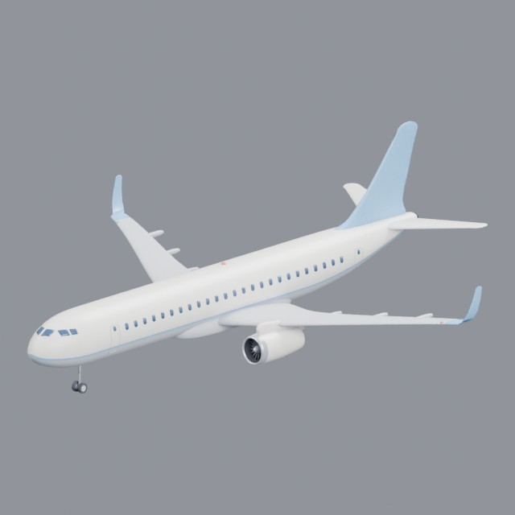
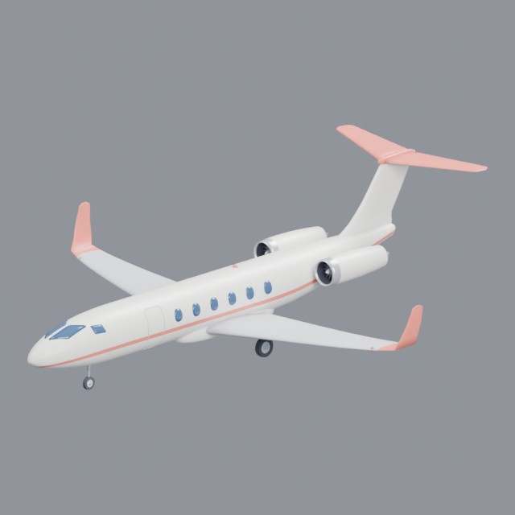
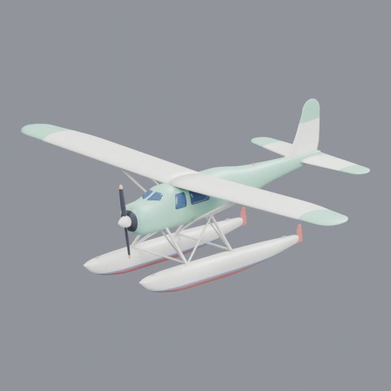

# vehicles/aircraft

Airplanes, helicopters and other aircraft

Approved assets: **9**

## Airship

- Creator: Grab3D; style: stylized; CC0-1.0
- 18,966 triangles; 3 texture images
- [Asset folder](../../assets/vehicles/aircraft/g3-airship/) · [Metadata](../../assets/vehicles/aircraft/g3-airship/asset.json) · [All inspection views](../../assets/vehicles/aircraft/g3-airship/previews/contact-sheet.jpg)

## Propeller biplane

- Creator: Grab3D; style: stylized; CC0-1.0
- 19,942 triangles; 3 texture images
- [Asset folder](../../assets/vehicles/aircraft/g3-biplane/) · [Metadata](../../assets/vehicles/aircraft/g3-biplane/asset.json) · [All inspection views](../../assets/vehicles/aircraft/g3-biplane/previews/contact-sheet.jpg)

## Turboprop cargo plane

- Creator: Grab3D; style: stylized; CC0-1.0
- 29,788 triangles; 3 texture images
- [Asset folder](../../assets/vehicles/aircraft/g3-cargo-plane/) · [Metadata](../../assets/vehicles/aircraft/g3-cargo-plane/asset.json) · [All inspection views](../../assets/vehicles/aircraft/g3-cargo-plane/previews/contact-sheet.jpg)

## Glider

- Creator: Grab3D; style: stylized; CC0-1.0
- 15,836 triangles; 3 texture images
- [Asset folder](../../assets/vehicles/aircraft/g3-glider/) · [Metadata](../../assets/vehicles/aircraft/g3-glider/asset.json) · [All inspection views](../../assets/vehicles/aircraft/g3-glider/previews/contact-sheet.jpg)

## Light helicopter

- Creator: Grab3D; style: stylized; CC0-1.0
- 38,420 triangles; 3 texture images
- [Asset folder](../../assets/vehicles/aircraft/g3-helicopter/) · [Metadata](../../assets/vehicles/aircraft/g3-helicopter/asset.json) · [All inspection views](../../assets/vehicles/aircraft/g3-helicopter/previews/contact-sheet.jpg)

## Hot air balloon

- Creator: Grab3D; style: stylized; CC0-1.0
- 28,408 triangles; 3 texture images
- [Asset folder](../../assets/vehicles/aircraft/g3-hot-air-balloon/) · [Metadata](../../assets/vehicles/aircraft/g3-hot-air-balloon/asset.json) · [All inspection views](../../assets/vehicles/aircraft/g3-hot-air-balloon/previews/contact-sheet.jpg)

## Passenger airplane

- Creator: Grab3D; style: stylized; CC0-1.0
- 29,706 triangles; 3 texture images
- [Asset folder](../../assets/vehicles/aircraft/g3-passenger-airplane/) · [Metadata](../../assets/vehicles/aircraft/g3-passenger-airplane/asset.json) · [All inspection views](../../assets/vehicles/aircraft/g3-passenger-airplane/previews/contact-sheet.jpg)

## Private jet

- Creator: Grab3D; style: stylized; CC0-1.0
- 23,104 triangles; 3 texture images
- [Asset folder](../../assets/vehicles/aircraft/g3-private-jet/) · [Metadata](../../assets/vehicles/aircraft/g3-private-jet/asset.json) · [All inspection views](../../assets/vehicles/aircraft/g3-private-jet/previews/contact-sheet.jpg)

## Floatplane

- Creator: Grab3D; style: stylized; CC0-1.0
- 19,850 triangles; 3 texture images
- [Asset folder](../../assets/vehicles/aircraft/g3-seaplane/) · [Metadata](../../assets/vehicles/aircraft/g3-seaplane/asset.json) · [All inspection views](../../assets/vehicles/aircraft/g3-seaplane/previews/contact-sheet.jpg)
