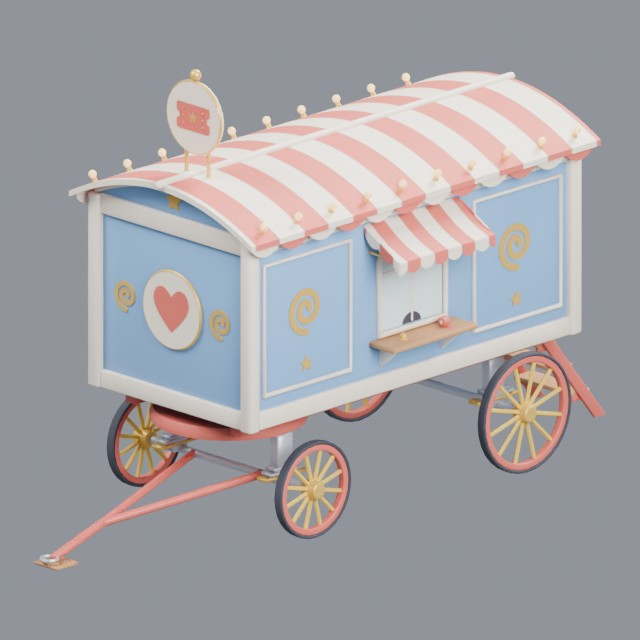
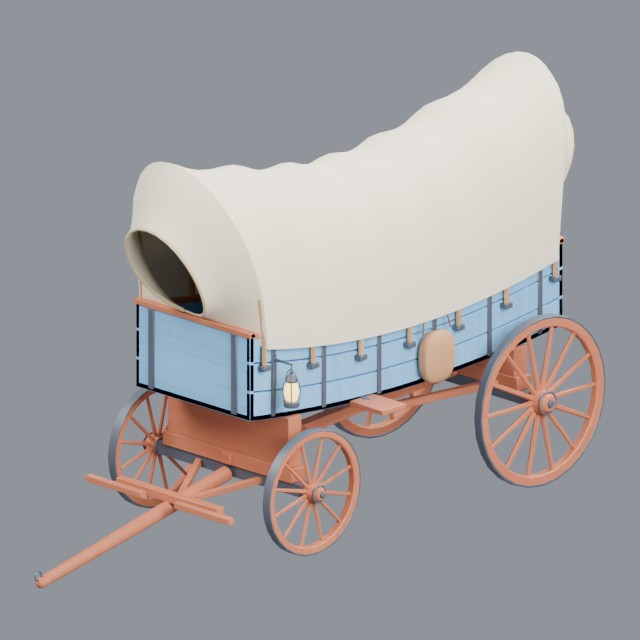
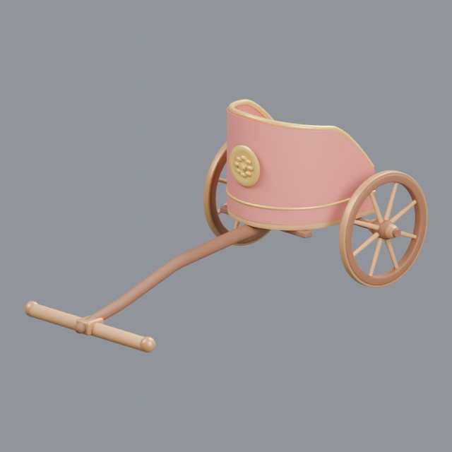
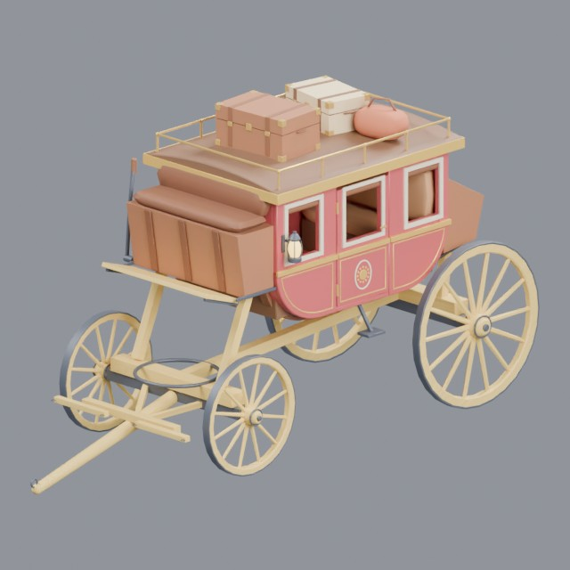

# vehicles/animal-drawn

Historical animal-drawn wagons, chariots and carriages (animals not necessarily included)

Approved assets: **4**

## Circus ticket wagon

- Creator: Grab3D; style: stylized; CC0-1.0
- 39,808 triangles; 3 texture images
- [Asset folder](../../assets/vehicles/animal-drawn/g3-circus-wagon/) · [Metadata](../../assets/vehicles/animal-drawn/g3-circus-wagon/asset.json) · [All inspection views](../../assets/vehicles/animal-drawn/g3-circus-wagon/previews/contact-sheet.jpg)

## Covered wagon

- Creator: Grab3D; style: stylized; CC0-1.0
- 29,112 triangles; 6 texture images
- [Asset folder](../../assets/vehicles/animal-drawn/g3-covered-wagon/) · [Metadata](../../assets/vehicles/animal-drawn/g3-covered-wagon/asset.json) · [All inspection views](../../assets/vehicles/animal-drawn/g3-covered-wagon/previews/contact-sheet.jpg)

## Ancient racing chariot

- Creator: Grab3D; style: stylized; CC0-1.0
- 14,880 triangles; 3 texture images
- [Asset folder](../../assets/vehicles/animal-drawn/g3-racing-chariot/) · [Metadata](../../assets/vehicles/animal-drawn/g3-racing-chariot/asset.json) · [All inspection views](../../assets/vehicles/animal-drawn/g3-racing-chariot/previews/contact-sheet.jpg)

## Stagecoach

- Creator: Grab3D; style: stylized; CC0-1.0
- 29,932 triangles; 4 texture images
- [Asset folder](../../assets/vehicles/animal-drawn/g3-stagecoach/) · [Metadata](../../assets/vehicles/animal-drawn/g3-stagecoach/asset.json) · [All inspection views](../../assets/vehicles/animal-drawn/g3-stagecoach/previews/contact-sheet.jpg)
