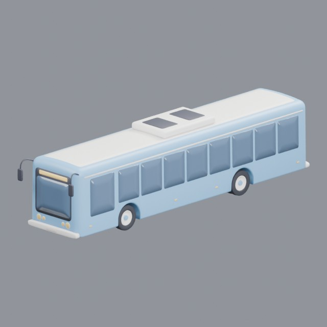
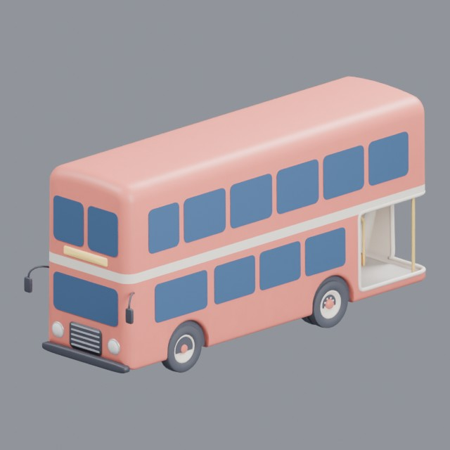
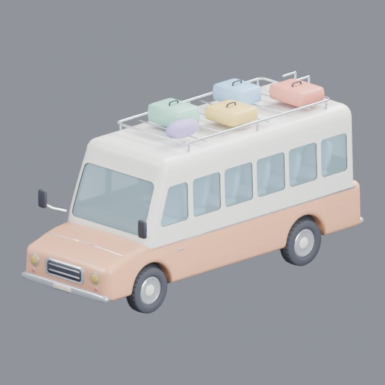
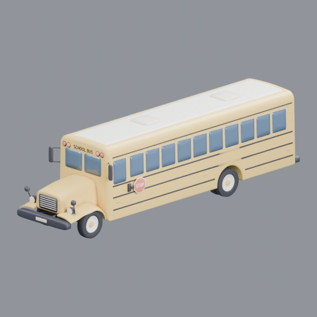

# vehicles/buses

Passenger buses and minibuses

Approved assets: **4**

## City bus

- Creator: Grab3D; style: stylized; CC0-1.0
- 29,866 triangles; 3 texture images
- [Asset folder](../../assets/vehicles/buses/g3-city-bus/) · [Metadata](../../assets/vehicles/buses/g3-city-bus/asset.json) · [All inspection views](../../assets/vehicles/buses/g3-city-bus/previews/contact-sheet.jpg)

## Double-decker bus

- Creator: Grab3D; style: stylized; CC0-1.0
- 28,405 triangles; 3 texture images
- [Asset folder](../../assets/vehicles/buses/g3-double-decker-bus/) · [Metadata](../../assets/vehicles/buses/g3-double-decker-bus/asset.json) · [All inspection views](../../assets/vehicles/buses/g3-double-decker-bus/previews/contact-sheet.jpg)

## Passenger minibus

- Creator: Grab3D; style: stylized; CC0-1.0
- 25,969 triangles; 5 texture images
- [Asset folder](../../assets/vehicles/buses/g3-minibus/) · [Metadata](../../assets/vehicles/buses/g3-minibus/asset.json) · [All inspection views](../../assets/vehicles/buses/g3-minibus/previews/contact-sheet.jpg)

## School bus

- Creator: Grab3D; style: stylized; CC0-1.0
- 44,066 triangles; 3 texture images
- [Asset folder](../../assets/vehicles/buses/g3-school-bus/) · [Metadata](../../assets/vehicles/buses/g3-school-bus/asset.json) · [All inspection views](../../assets/vehicles/buses/g3-school-bus/previews/contact-sheet.jpg)
