# vehicles/cars/classic

Classic and historical cars

Approved assets: **19**

## 1950s open roadster

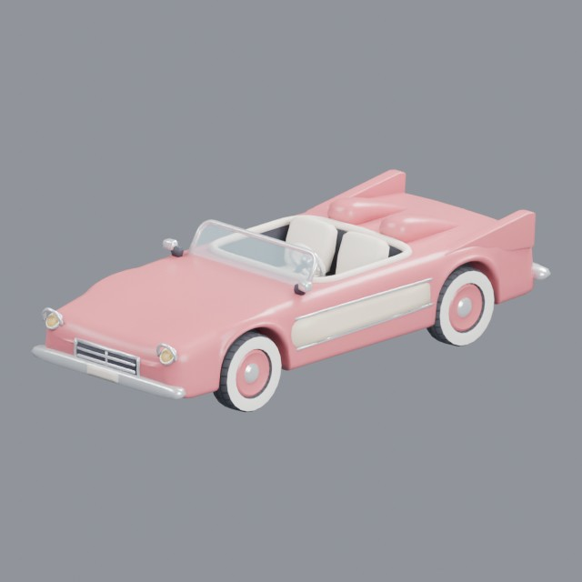

- Creator: Grab3D; style: stylized; CC0-1.0
- 15,801 triangles; 5 texture images
- [Asset folder](../../assets/vehicles/cars/classic/g3-1950s-roadster/) · [Metadata](../../assets/vehicles/cars/classic/g3-1950s-roadster/asset.json) · [All inspection views](../../assets/vehicles/cars/classic/g3-1950s-roadster/previews/contact-sheet.jpg)

## 1950s finned sedan

- Creator: Grab3D; style: stylized; CC0-1.0
- 19,584 triangles; 5 texture images
- [Asset folder](../../assets/vehicles/cars/classic/g3-1950s-sedan/) · [Metadata](../../assets/vehicles/cars/classic/g3-1950s-sedan/asset.json) · [All inspection views](../../assets/vehicles/cars/classic/g3-1950s-sedan/previews/contact-sheet.jpg)

## 1950s station wagon

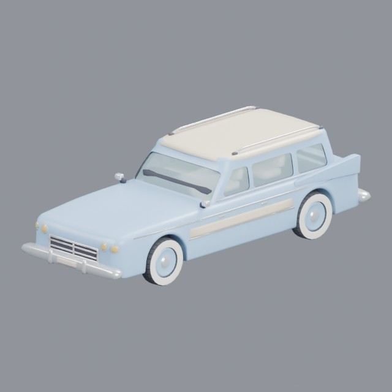

- Creator: Grab3D; style: stylized; CC0-1.0
- 19,896 triangles; 5 texture images
- [Asset folder](../../assets/vehicles/cars/classic/g3-1950s-station-wagon/) · [Metadata](../../assets/vehicles/cars/classic/g3-1950s-station-wagon/asset.json) · [All inspection views](../../assets/vehicles/cars/classic/g3-1950s-station-wagon/previews/contact-sheet.jpg)

## 1960s compact car

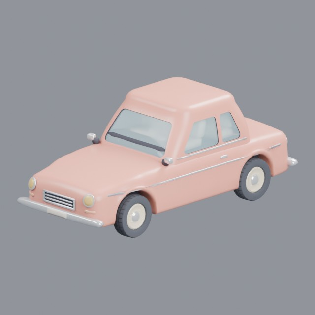

- Creator: Grab3D; style: stylized; CC0-1.0
- 16,797 triangles; 5 texture images
- [Asset folder](../../assets/vehicles/cars/classic/g3-1960s-compact-car/) · [Metadata](../../assets/vehicles/cars/classic/g3-1960s-compact-car/asset.json) · [All inspection views](../../assets/vehicles/cars/classic/g3-1960s-compact-car/previews/contact-sheet.jpg)

## 1960s convertible

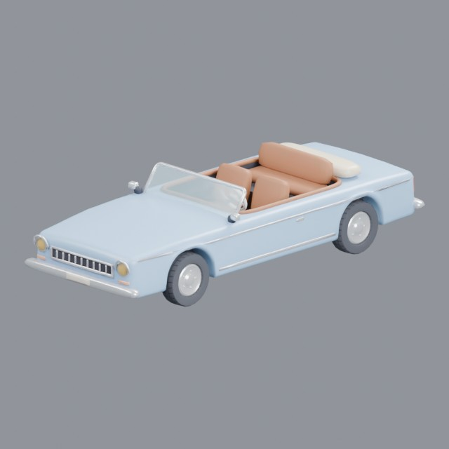

- Creator: Grab3D; style: stylized; CC0-1.0
- 16,001 triangles; 5 texture images
- [Asset folder](../../assets/vehicles/cars/classic/g3-1960s-convertible/) · [Metadata](../../assets/vehicles/cars/classic/g3-1960s-convertible/asset.json) · [All inspection views](../../assets/vehicles/cars/classic/g3-1960s-convertible/previews/contact-sheet.jpg)

## 1960s microbus

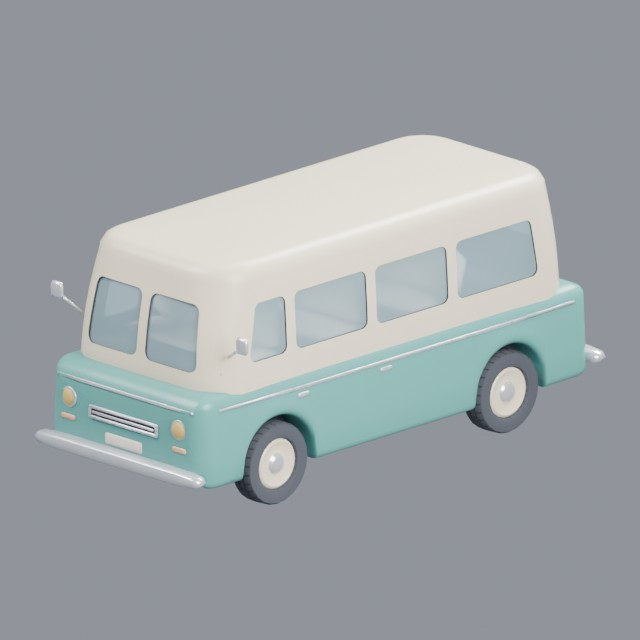

- Creator: Grab3D; style: stylized; CC0-1.0
- 17,349 triangles; 5 texture images
- [Asset folder](../../assets/vehicles/cars/classic/g3-1960s-microbus/) · [Metadata](../../assets/vehicles/cars/classic/g3-1960s-microbus/asset.json) · [All inspection views](../../assets/vehicles/cars/classic/g3-1960s-microbus/previews/contact-sheet.jpg)

## 1960s sports car

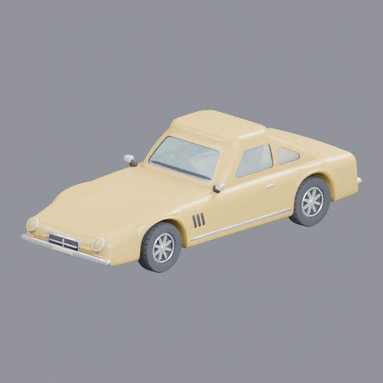

- Creator: Grab3D; style: stylized; CC0-1.0
- 18,555 triangles; 5 texture images
- [Asset folder](../../assets/vehicles/cars/classic/g3-1960s-sports-car/) · [Metadata](../../assets/vehicles/cars/classic/g3-1960s-sports-car/asset.json) · [All inspection views](../../assets/vehicles/cars/classic/g3-1960s-sports-car/previews/contact-sheet.jpg)

## 1970s coupe

- Creator: Grab3D; style: stylized; CC0-1.0
- 18,978 triangles; 5 texture images
- [Asset folder](../../assets/vehicles/cars/classic/g3-1970s-coupe/) · [Metadata](../../assets/vehicles/cars/classic/g3-1970s-coupe/asset.json) · [All inspection views](../../assets/vehicles/cars/classic/g3-1970s-coupe/previews/contact-sheet.jpg)

## 1970s hatchback

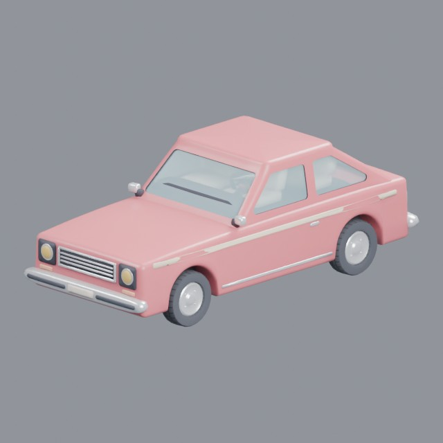

- Creator: Grab3D; style: stylized; CC0-1.0
- 16,438 triangles; 5 texture images
- [Asset folder](../../assets/vehicles/cars/classic/g3-1970s-hatchback/) · [Metadata](../../assets/vehicles/cars/classic/g3-1970s-hatchback/asset.json) · [All inspection views](../../assets/vehicles/cars/classic/g3-1970s-hatchback/previews/contact-sheet.jpg)

## 1980s-inspired hatchback

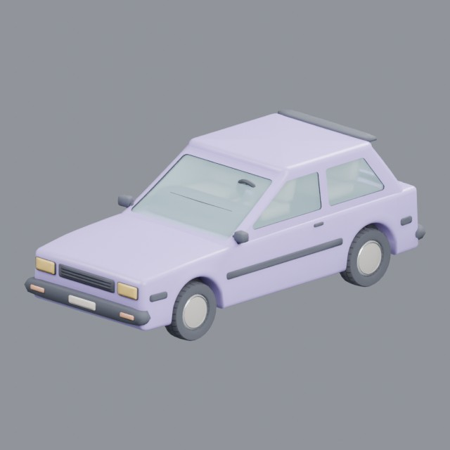

- Creator: Grab3D; style: stylized; CC0-1.0
- 15,612 triangles; 5 texture images
- [Asset folder](../../assets/vehicles/cars/classic/g3-1980s-hatchback/) · [Metadata](../../assets/vehicles/cars/classic/g3-1980s-hatchback/asset.json) · [All inspection views](../../assets/vehicles/cars/classic/g3-1980s-hatchback/previews/contact-sheet.jpg)

## 1980s wood-panel station wagon

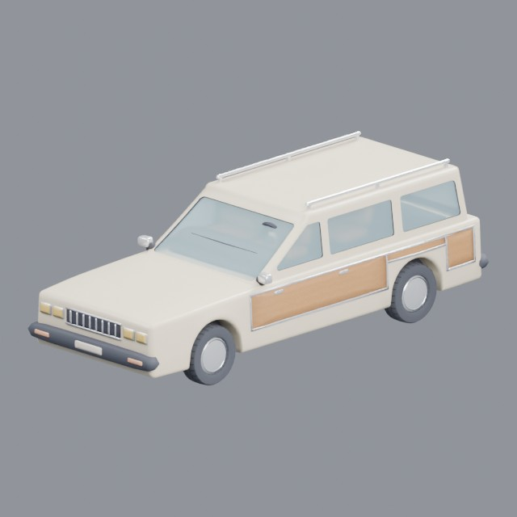

- Creator: Grab3D; style: stylized; CC0-1.0
- 19,644 triangles; 5 texture images
- [Asset folder](../../assets/vehicles/cars/classic/g3-1980s-station-wagon/) · [Metadata](../../assets/vehicles/cars/classic/g3-1980s-station-wagon/asset.json) · [All inspection views](../../assets/vehicles/cars/classic/g3-1980s-station-wagon/previews/contact-sheet.jpg)

## 1980s passenger van

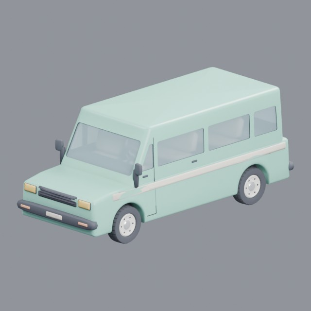

- Creator: Grab3D; style: stylized; CC0-1.0
- 19,749 triangles; 5 texture images
- [Asset folder](../../assets/vehicles/cars/classic/g3-1980s-van/) · [Metadata](../../assets/vehicles/cars/classic/g3-1980s-van/asset.json) · [All inspection views](../../assets/vehicles/cars/classic/g3-1980s-van/previews/contact-sheet.jpg)

## 1990s family sedan

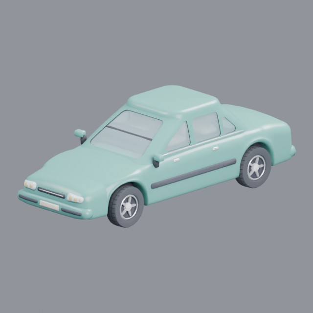

- Creator: Grab3D; style: stylized; CC0-1.0
- 19,368 triangles; 5 texture images
- [Asset folder](../../assets/vehicles/cars/classic/g3-1990s-sedan/) · [Metadata](../../assets/vehicles/cars/classic/g3-1990s-sedan/asset.json) · [All inspection views](../../assets/vehicles/cars/classic/g3-1990s-sedan/previews/contact-sheet.jpg)

## 1990s sports coupe

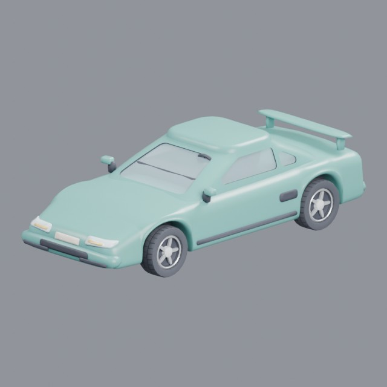

- Creator: Grab3D; style: stylized; CC0-1.0
- 16,983 triangles; 5 texture images
- [Asset folder](../../assets/vehicles/cars/classic/g3-1990s-sports-car/) · [Metadata](../../assets/vehicles/cars/classic/g3-1990s-sports-car/asset.json) · [All inspection views](../../assets/vehicles/cars/classic/g3-1990s-sports-car/previews/contact-sheet.jpg)

## 1990s sport utility vehicle

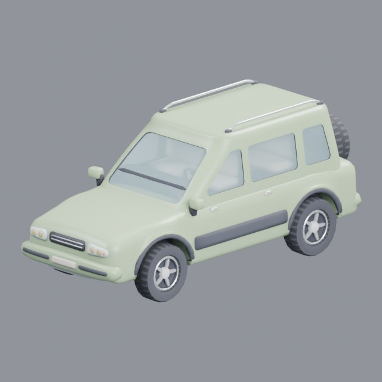

- Creator: Grab3D; style: stylized; CC0-1.0
- 19,885 triangles; 5 texture images
- [Asset folder](../../assets/vehicles/cars/classic/g3-1990s-suv/) · [Metadata](../../assets/vehicles/cars/classic/g3-1990s-suv/asset.json) · [All inspection views](../../assets/vehicles/cars/classic/g3-1990s-suv/previews/contact-sheet.jpg)

## Retro-futuristic bubble car

- Creator: Grab3D; style: stylized; CC0-1.0
- 15,482 triangles; 5 texture images
- [Asset folder](../../assets/vehicles/cars/classic/g3-atomic-age-car/) · [Metadata](../../assets/vehicles/cars/classic/g3-atomic-age-car/asset.json) · [All inspection views](../../assets/vehicles/cars/classic/g3-atomic-age-car/previews/contact-sheet.jpg)

## Classic lowrider coupe

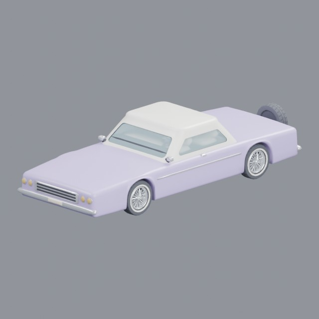

- Creator: Grab3D; style: stylized; CC0-1.0
- 19,739 triangles; 5 texture images
- [Asset folder](../../assets/vehicles/cars/classic/g3-lowrider/) · [Metadata](../../assets/vehicles/cars/classic/g3-lowrider/asset.json) · [All inspection views](../../assets/vehicles/cars/classic/g3-lowrider/previews/contact-sheet.jpg)

## Classic fastback muscle car

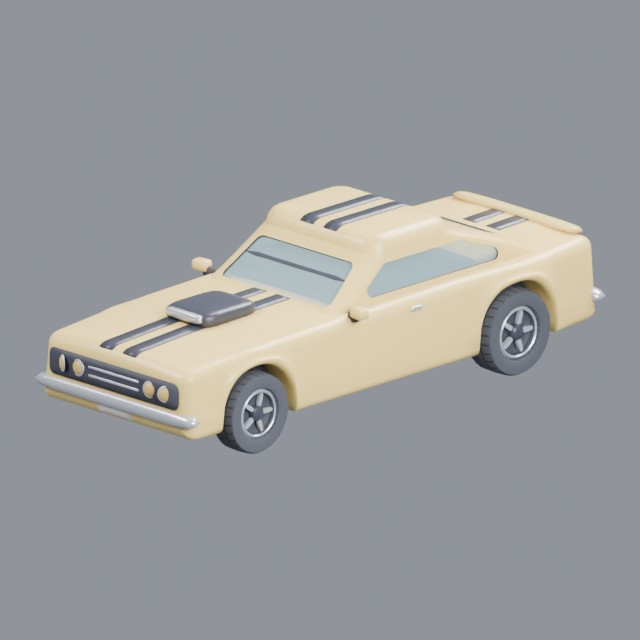

- Creator: Grab3D; style: stylized; CC0-1.0
- 19,806 triangles; 5 texture images
- [Asset folder](../../assets/vehicles/cars/classic/g3-muscle-car/) · [Metadata](../../assets/vehicles/cars/classic/g3-muscle-car/asset.json) · [All inspection views](../../assets/vehicles/cars/classic/g3-muscle-car/previews/contact-sheet.jpg)

## Old vintage car

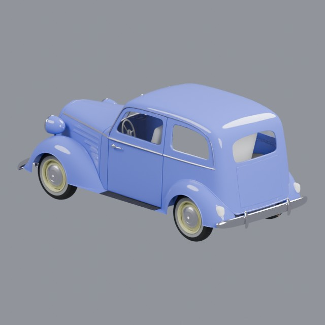

- Creator: piopis; scene by Benedikt Bitterli, glTF conversion by Erfan Momeni; style: realistic; CC0-1.0
- 771,640 triangles; 0 texture images
- [Asset folder](../../assets/vehicles/cars/classic/research-vintage-car/) · [Metadata](../../assets/vehicles/cars/classic/research-vintage-car/asset.json) · [All inspection views](../../assets/vehicles/cars/classic/research-vintage-car/previews/contact-sheet.jpg)
