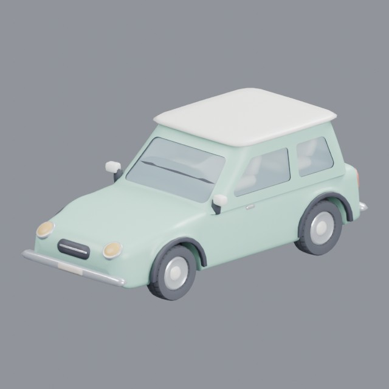
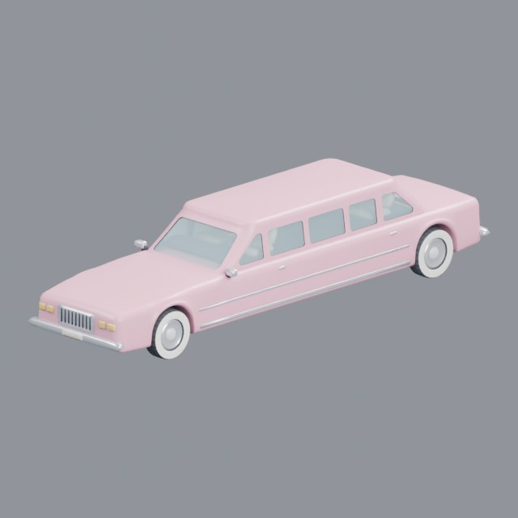
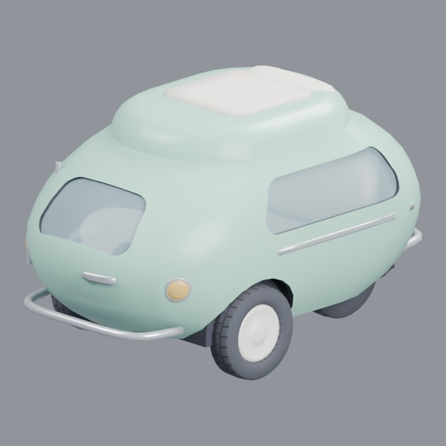
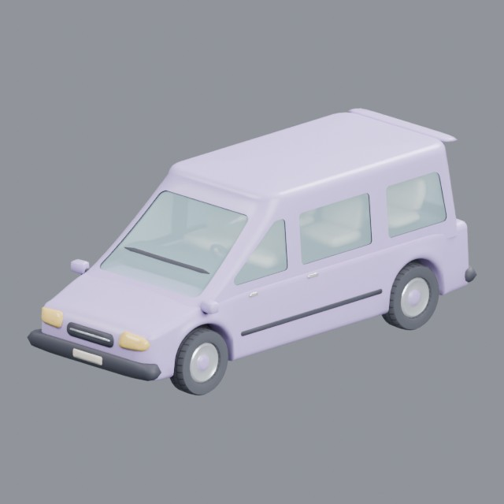

# vehicles/cars/passenger

Passenger cars, microcars, minivans and limousines

Approved assets: **4**

## Small hatchback compact car

- Creator: Grab3D; style: stylized; CC0-1.0
- 17,338 triangles; 5 texture images
- [Asset folder](../../assets/vehicles/cars/passenger/g3-compact-car/) · [Metadata](../../assets/vehicles/cars/passenger/g3-compact-car/asset.json) · [All inspection views](../../assets/vehicles/cars/passenger/g3-compact-car/previews/contact-sheet.jpg)

## Stretch limousine

- Creator: Grab3D; style: stylized; CC0-1.0
- 21,262 triangles; 5 texture images
- [Asset folder](../../assets/vehicles/cars/passenger/g3-limousine/) · [Metadata](../../assets/vehicles/cars/passenger/g3-limousine/asset.json) · [All inspection views](../../assets/vehicles/cars/passenger/g3-limousine/previews/contact-sheet.jpg)

## Bubble microcar

- Creator: Grab3D; style: stylized; CC0-1.0
- 13,792 triangles; 8 texture images
- [Asset folder](../../assets/vehicles/cars/passenger/g3-microcar/) · [Metadata](../../assets/vehicles/cars/passenger/g3-microcar/asset.json) · [All inspection views](../../assets/vehicles/cars/passenger/g3-microcar/previews/contact-sheet.jpg)

## Family minivan

- Creator: Grab3D; style: stylized; CC0-1.0
- 19,947 triangles; 5 texture images
- [Asset folder](../../assets/vehicles/cars/passenger/g3-minivan/) · [Metadata](../../assets/vehicles/cars/passenger/g3-minivan/asset.json) · [All inspection views](../../assets/vehicles/cars/passenger/g3-minivan/previews/contact-sheet.jpg)
