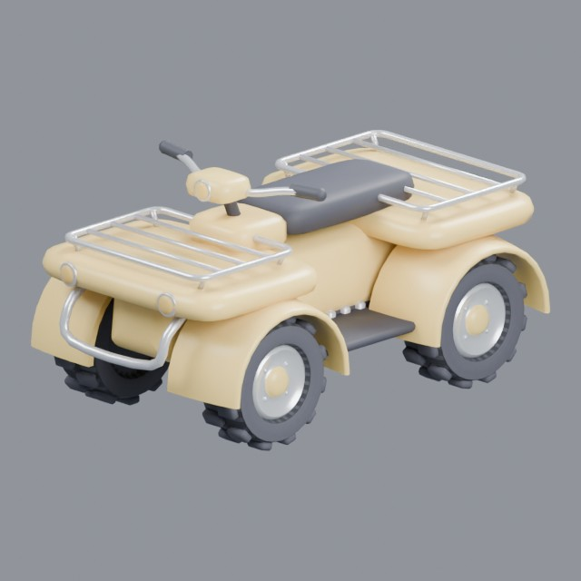
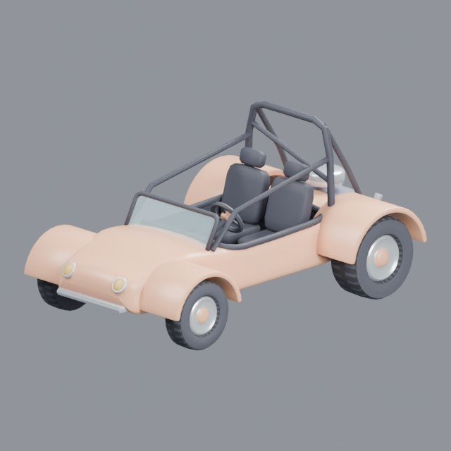
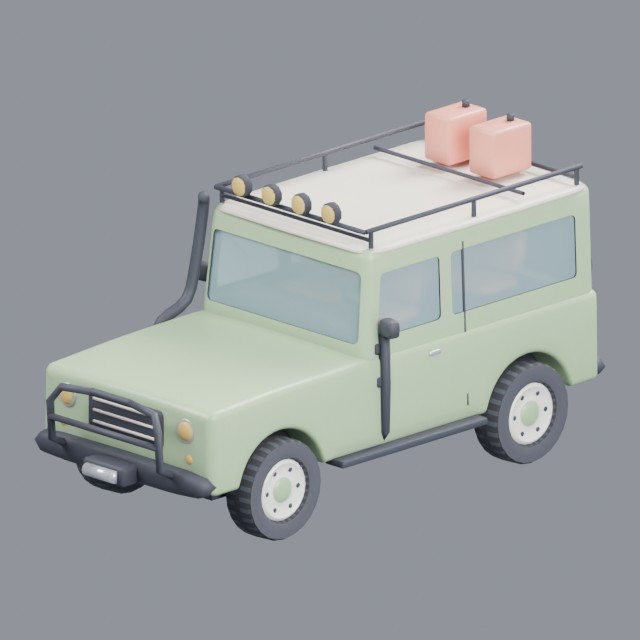

# vehicles/off-road

ATVs, dune buggies and off-road vehicles

Approved assets: **3**

## Four-wheeled ATV

- Creator: Grab3D; style: stylized; CC0-1.0
- 18,120 triangles; 5 texture images
- [Asset folder](../../assets/vehicles/off-road/g3-atv-quad/) · [Metadata](../../assets/vehicles/off-road/g3-atv-quad/asset.json) · [All inspection views](../../assets/vehicles/off-road/g3-atv-quad/previews/contact-sheet.jpg)

## Open dune buggy

- Creator: Grab3D; style: stylized; CC0-1.0
- 13,945 triangles; 5 texture images
- [Asset folder](../../assets/vehicles/off-road/g3-dune-buggy/) · [Metadata](../../assets/vehicles/off-road/g3-dune-buggy/asset.json) · [All inspection views](../../assets/vehicles/off-road/g3-dune-buggy/previews/contact-sheet.jpg)

## Off-road four-wheel drive

- Creator: Grab3D; style: stylized; CC0-1.0
- 19,882 triangles; 5 texture images
- [Asset folder](../../assets/vehicles/off-road/g3-off-road-4x4/) · [Metadata](../../assets/vehicles/off-road/g3-off-road-4x4/asset.json) · [All inspection views](../../assets/vehicles/off-road/g3-off-road-4x4/previews/contact-sheet.jpg)
