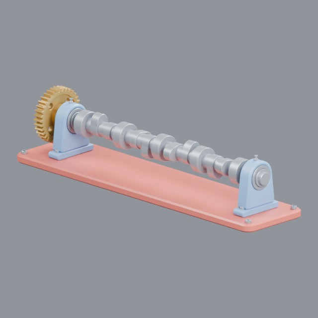
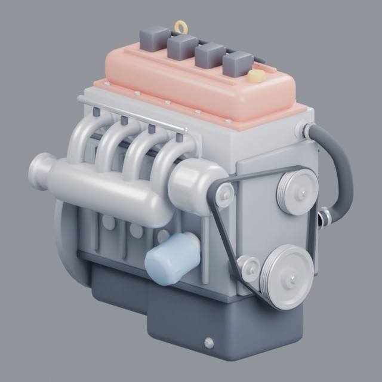
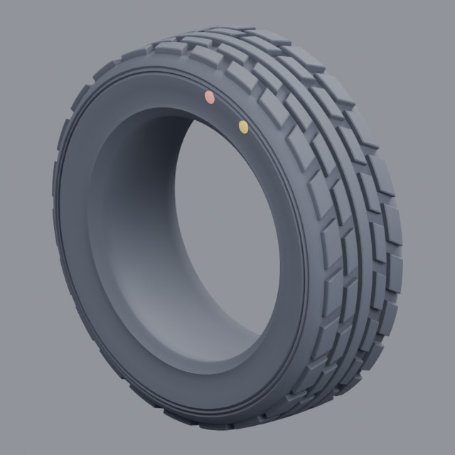
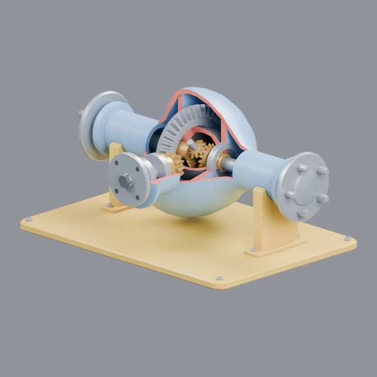
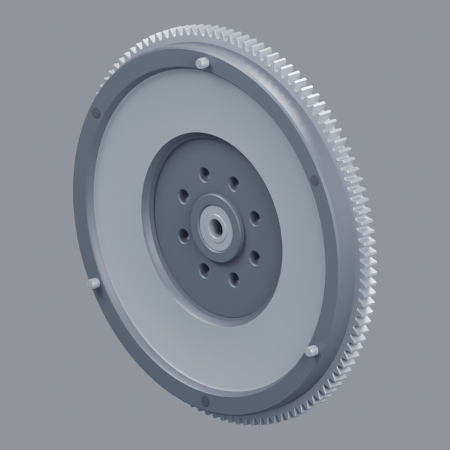
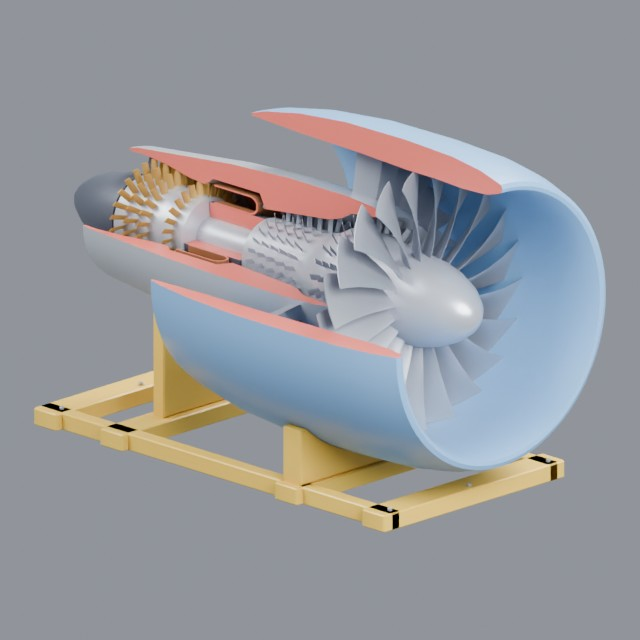

# vehicles/parts

Wheels, engines and individual automotive components

Approved assets: **6**

## Camshaft in bearing blocks

- Creator: Grab3D; style: stylized; CC0-1.0
- 19,312 triangles; 6 texture images
- [Asset folder](../../assets/vehicles/parts/g3-camshaft/) · [Metadata](../../assets/vehicles/parts/g3-camshaft/asset.json) · [All inspection views](../../assets/vehicles/parts/g3-camshaft/previews/contact-sheet.jpg)

## Car engine block assembly

- Creator: Grab3D; style: stylized; CC0-1.0
- 19,668 triangles; 3 texture images
- [Asset folder](../../assets/vehicles/parts/g3-car-engine/) · [Metadata](../../assets/vehicles/parts/g3-car-engine/asset.json) · [All inspection views](../../assets/vehicles/parts/g3-car-engine/previews/contact-sheet.jpg)

## Car tyre with tread pattern

- Creator: Grab3D; style: stylized; CC0-1.0
- 11,520 triangles; 3 texture images
- [Asset folder](../../assets/vehicles/parts/g3-car-tire/) · [Metadata](../../assets/vehicles/parts/g3-car-tire/asset.json) · [All inspection views](../../assets/vehicles/parts/g3-car-tire/previews/contact-sheet.jpg)

## Differential cutaway

- Creator: Grab3D; style: stylized; CC0-1.0
- 38,618 triangles; 9 texture images
- [Asset folder](../../assets/vehicles/parts/g3-differential/) · [Metadata](../../assets/vehicles/parts/g3-differential/asset.json) · [All inspection views](../../assets/vehicles/parts/g3-differential/previews/contact-sheet.jpg)

## Flywheel with clutch face

- Creator: Grab3D; style: stylized; CC0-1.0
- 19,484 triangles; 3 texture images
- [Asset folder](../../assets/vehicles/parts/g3-flywheel/) · [Metadata](../../assets/vehicles/parts/g3-flywheel/asset.json) · [All inspection views](../../assets/vehicles/parts/g3-flywheel/previews/contact-sheet.jpg)

## Turbofan jet engine cutaway

- Creator: Grab3D; style: stylized; CC0-1.0
- 39,382 triangles; 6 texture images
- [Asset folder](../../assets/vehicles/parts/g3-jet-engine/) · [Metadata](../../assets/vehicles/parts/g3-jet-engine/asset.json) · [All inspection views](../../assets/vehicles/parts/g3-jet-engine/previews/contact-sheet.jpg)
