# vehicles/rail

Locomotives, wagons and railway rolling stock

Approved assets: **12**

## Ribbed railway boxcar

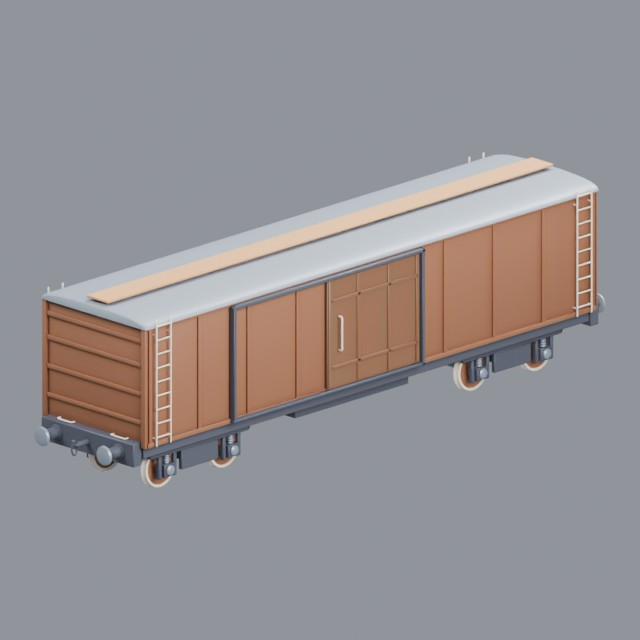

- Creator: Grab3D; style: stylized; CC0-1.0
- 20,690 triangles; 3 texture images
- [Asset folder](../../assets/vehicles/rail/g3-boxcar/) · [Metadata](../../assets/vehicles/rail/g3-boxcar/asset.json) · [All inspection views](../../assets/vehicles/rail/g3-boxcar/previews/contact-sheet.jpg)

## Railway caboose

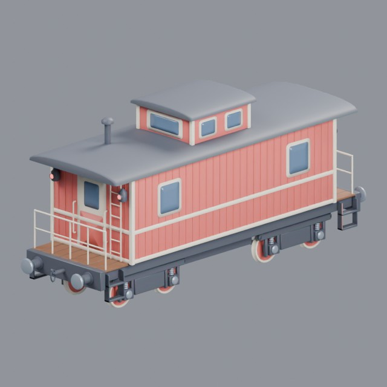

- Creator: Grab3D; style: stylized; CC0-1.0
- 25,764 triangles; 3 texture images
- [Asset folder](../../assets/vehicles/rail/g3-caboose/) · [Metadata](../../assets/vehicles/rail/g3-caboose/asset.json) · [All inspection views](../../assets/vehicles/rail/g3-caboose/previews/contact-sheet.jpg)

## Centre-cab diesel locomotive

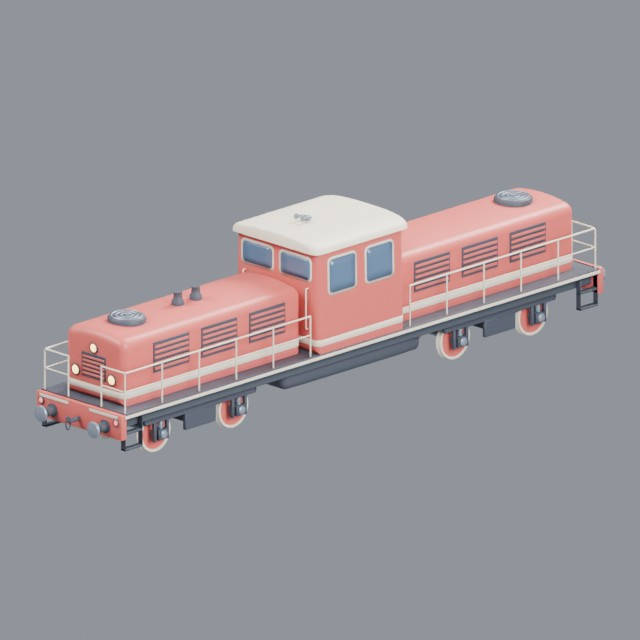

- Creator: Grab3D; style: stylized; CC0-1.0
- 34,616 triangles; 3 texture images
- [Asset folder](../../assets/vehicles/rail/g3-diesel-locomotive/) · [Metadata](../../assets/vehicles/rail/g3-diesel-locomotive/asset.json) · [All inspection views](../../assets/vehicles/rail/g3-diesel-locomotive/previews/contact-sheet.jpg)

## Electric locomotive with pantographs

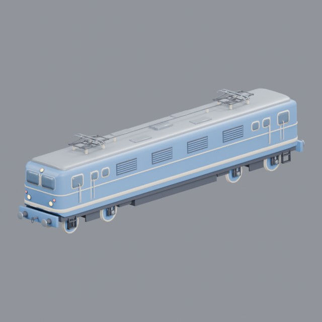

- Creator: Grab3D; style: stylized; CC0-1.0
- 34,940 triangles; 3 texture images
- [Asset folder](../../assets/vehicles/rail/g3-electric-locomotive/) · [Metadata](../../assets/vehicles/rail/g3-electric-locomotive/asset.json) · [All inspection views](../../assets/vehicles/rail/g3-electric-locomotive/previews/contact-sheet.jpg)

## High-speed train power car

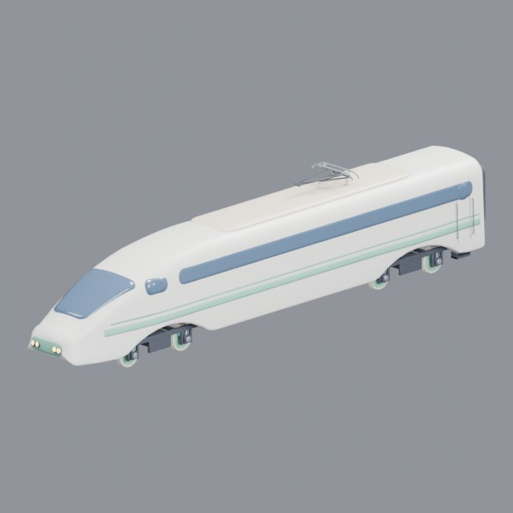

- Creator: Grab3D; style: stylized; CC0-1.0
- 29,487 triangles; 3 texture images
- [Asset folder](../../assets/vehicles/rail/g3-high-speed-train/) · [Metadata](../../assets/vehicles/rail/g3-high-speed-train/asset.json) · [All inspection views](../../assets/vehicles/rail/g3-high-speed-train/previews/contact-sheet.jpg)

## Monorail car

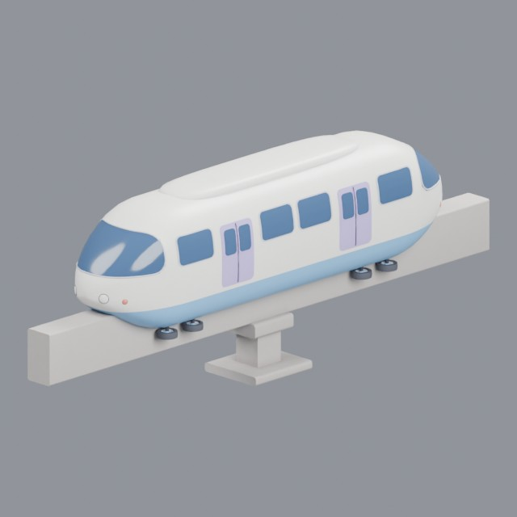

- Creator: Grab3D; style: stylized; CC0-1.0
- 24,612 triangles; 3 texture images
- [Asset folder](../../assets/vehicles/rail/g3-monorail/) · [Metadata](../../assets/vehicles/rail/g3-monorail/asset.json) · [All inspection views](../../assets/vehicles/rail/g3-monorail/previews/contact-sheet.jpg)

## Passenger railway coach

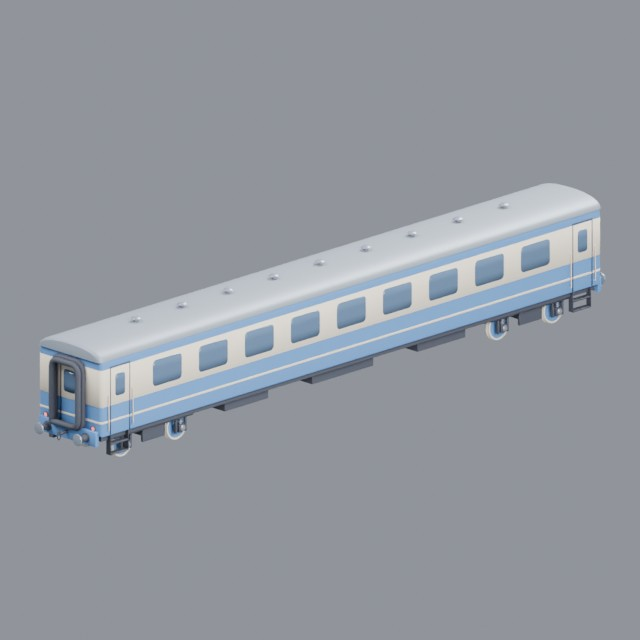

- Creator: Grab3D; style: stylized; CC0-1.0
- 27,308 triangles; 3 texture images
- [Asset folder](../../assets/vehicles/rail/g3-passenger-car/) · [Metadata](../../assets/vehicles/rail/g3-passenger-car/asset.json) · [All inspection views](../../assets/vehicles/rail/g3-passenger-car/previews/contact-sheet.jpg)

## Railway crane

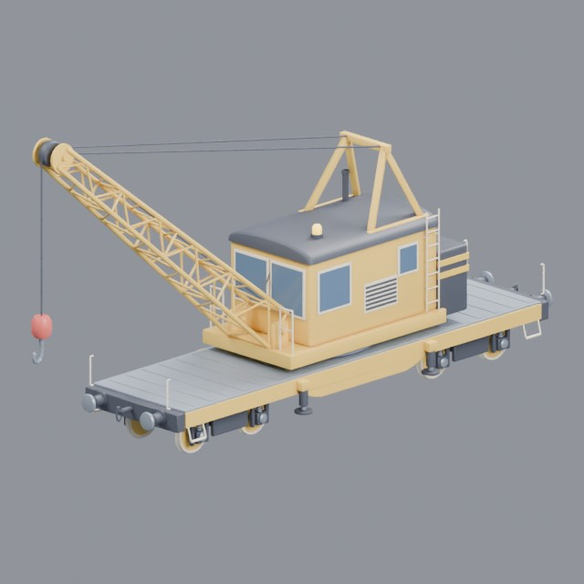

- Creator: Grab3D; style: stylized; CC0-1.0
- 25,562 triangles; 6 texture images
- [Asset folder](../../assets/vehicles/rail/g3-rail-crane/) · [Metadata](../../assets/vehicles/rail/g3-rail-crane/asset.json) · [All inspection views](../../assets/vehicles/rail/g3-rail-crane/previews/contact-sheet.jpg)

## Steam locomotive and tender

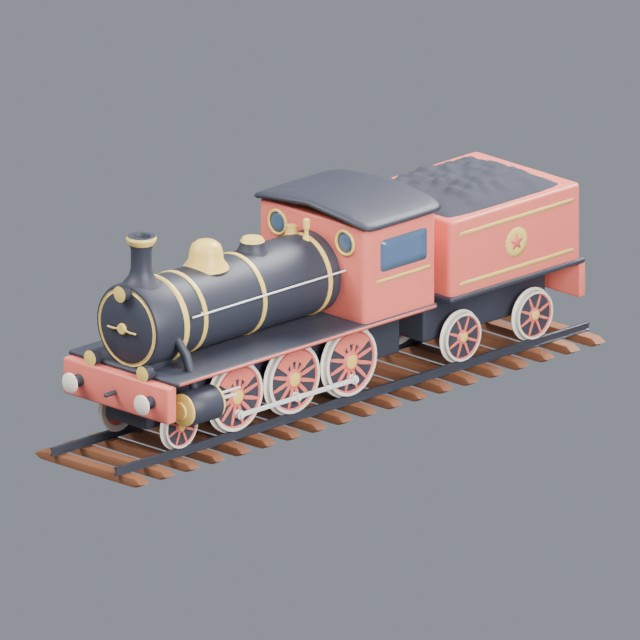

- Creator: Grab3D; style: stylized; CC0-1.0
- 44,282 triangles; 3 texture images
- [Asset folder](../../assets/vehicles/rail/g3-steam-train/) · [Metadata](../../assets/vehicles/rail/g3-steam-train/asset.json) · [All inspection views](../../assets/vehicles/rail/g3-steam-train/previews/contact-sheet.jpg)

## Subway train car

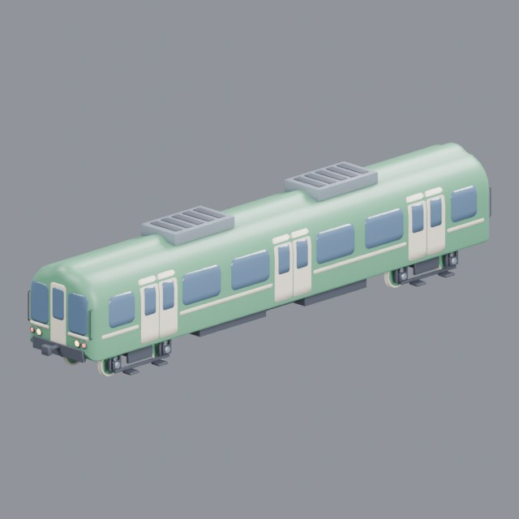

- Creator: Grab3D; style: stylized; CC0-1.0
- 30,092 triangles; 3 texture images
- [Asset folder](../../assets/vehicles/rail/g3-subway-train/) · [Metadata](../../assets/vehicles/rail/g3-subway-train/asset.json) · [All inspection views](../../assets/vehicles/rail/g3-subway-train/previews/contact-sheet.jpg)

## Railway tank car

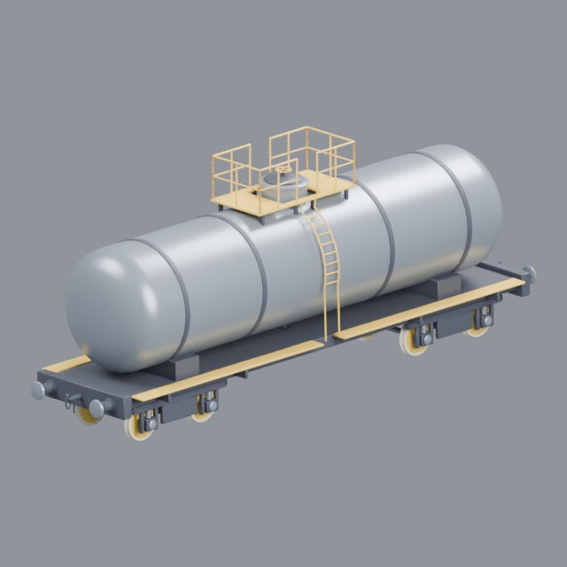

- Creator: Grab3D; style: stylized; CC0-1.0
- 18,884 triangles; 3 texture images
- [Asset folder](../../assets/vehicles/rail/g3-tank-car/) · [Metadata](../../assets/vehicles/rail/g3-tank-car/asset.json) · [All inspection views](../../assets/vehicles/rail/g3-tank-car/previews/contact-sheet.jpg)

## Tram

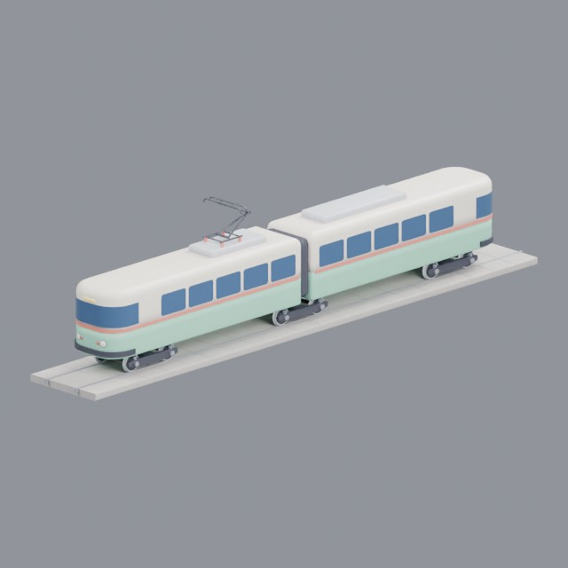

- Creator: Grab3D; style: stylized; CC0-1.0
- 29,124 triangles; 3 texture images
- [Asset folder](../../assets/vehicles/rail/g3-tram/) · [Metadata](../../assets/vehicles/rail/g3-tram/asset.json) · [All inspection views](../../assets/vehicles/rail/g3-tram/previews/contact-sheet.jpg)
