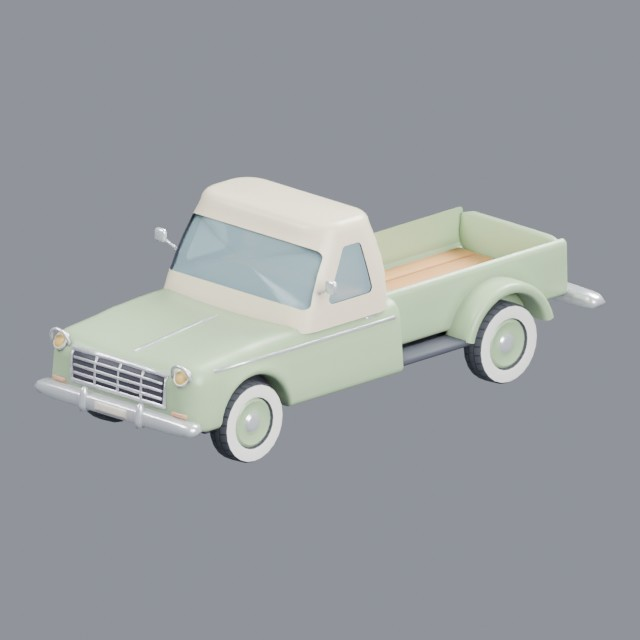
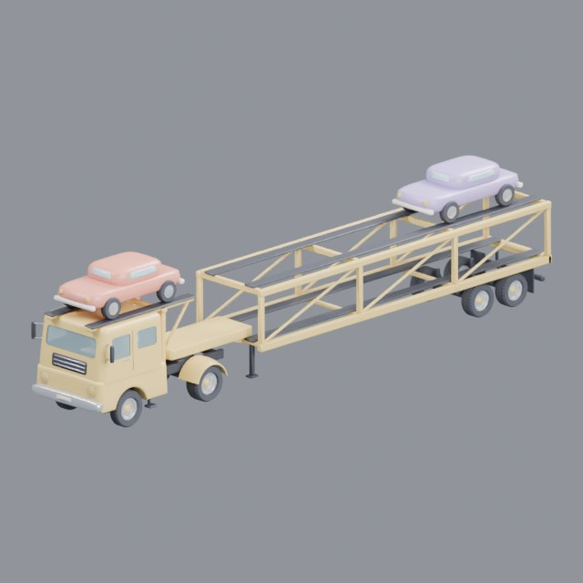
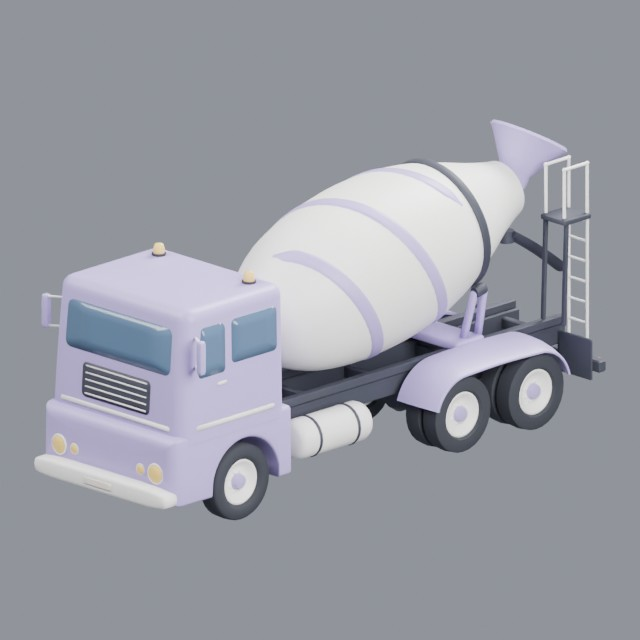
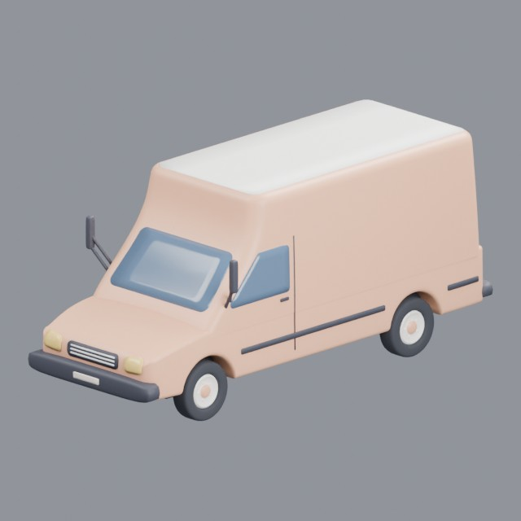
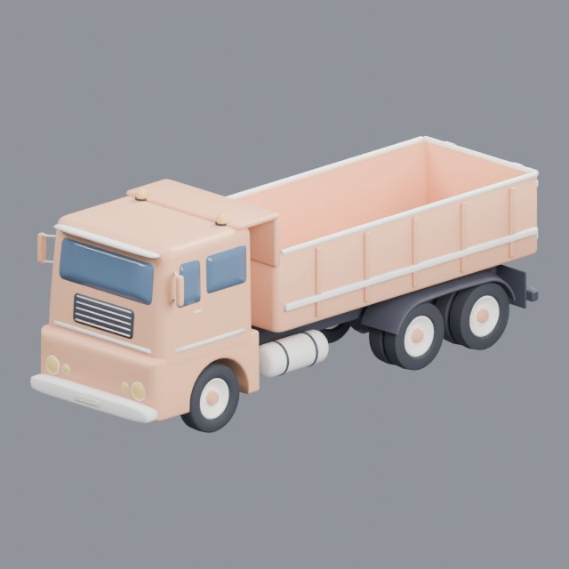
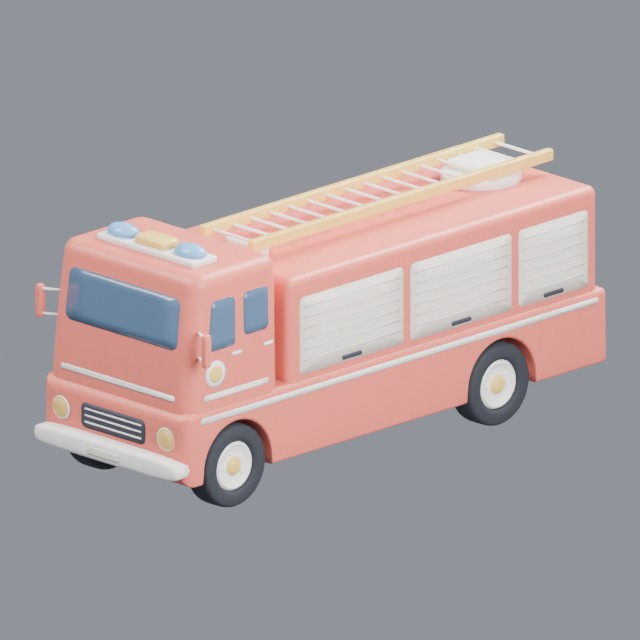
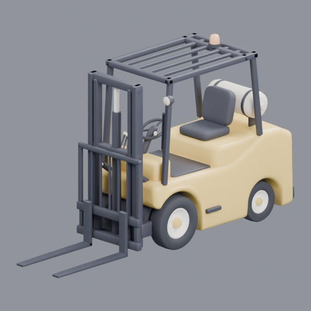

# vehicles/trucks

Trucks, lorries and haulage vehicles

Approved assets: **8**

## 1950s pickup truck

- Creator: Grab3D; style: stylized; CC0-1.0
- 16,872 triangles; 5 texture images
- [Asset folder](../../assets/vehicles/trucks/g3-1950s-pickup-truck/) · [Metadata](../../assets/vehicles/trucks/g3-1950s-pickup-truck/asset.json) · [All inspection views](../../assets/vehicles/trucks/g3-1950s-pickup-truck/previews/contact-sheet.jpg)

## Ambulance

- Creator: Grab3D; style: stylized; CC0-1.0
- 35,997 triangles; 3 texture images
- [Asset folder](../../assets/vehicles/trucks/g3-ambulance/) · [Metadata](../../assets/vehicles/trucks/g3-ambulance/asset.json) · [All inspection views](../../assets/vehicles/trucks/g3-ambulance/previews/contact-sheet.jpg)

## Double-deck car transporter

- Creator: Grab3D; style: stylized; CC0-1.0
- 29,970 triangles; 8 texture images
- [Asset folder](../../assets/vehicles/trucks/g3-car-transporter/) · [Metadata](../../assets/vehicles/trucks/g3-car-transporter/asset.json) · [All inspection views](../../assets/vehicles/trucks/g3-car-transporter/previews/contact-sheet.jpg)

## Cement mixer truck

- Creator: Grab3D; style: stylized; CC0-1.0
- 43,497 triangles; 6 texture images
- [Asset folder](../../assets/vehicles/trucks/g3-cement-mixer/) · [Metadata](../../assets/vehicles/trucks/g3-cement-mixer/asset.json) · [All inspection views](../../assets/vehicles/trucks/g3-cement-mixer/previews/contact-sheet.jpg)

## Delivery van

- Creator: Grab3D; style: stylized; CC0-1.0
- 31,517 triangles; 3 texture images
- [Asset folder](../../assets/vehicles/trucks/g3-delivery-van/) · [Metadata](../../assets/vehicles/trucks/g3-delivery-van/asset.json) · [All inspection views](../../assets/vehicles/trucks/g3-delivery-van/previews/contact-sheet.jpg)

## Dump truck

- Creator: Grab3D; style: stylized; CC0-1.0
- 34,442 triangles; 6 texture images
- [Asset folder](../../assets/vehicles/trucks/g3-dump-truck/) · [Metadata](../../assets/vehicles/trucks/g3-dump-truck/asset.json) · [All inspection views](../../assets/vehicles/trucks/g3-dump-truck/previews/contact-sheet.jpg)

## Fire truck

- Creator: Grab3D; style: stylized; CC0-1.0
- 47,288 triangles; 3 texture images
- [Asset folder](../../assets/vehicles/trucks/g3-fire-truck/) · [Metadata](../../assets/vehicles/trucks/g3-fire-truck/asset.json) · [All inspection views](../../assets/vehicles/trucks/g3-fire-truck/previews/contact-sheet.jpg)

## Forklift

- Creator: Grab3D; style: stylized; CC0-1.0
- 22,104 triangles; 3 texture images
- [Asset folder](../../assets/vehicles/trucks/g3-forklift/) · [Metadata](../../assets/vehicles/trucks/g3-forklift/asset.json) · [All inspection views](../../assets/vehicles/trucks/g3-forklift/previews/contact-sheet.jpg)
