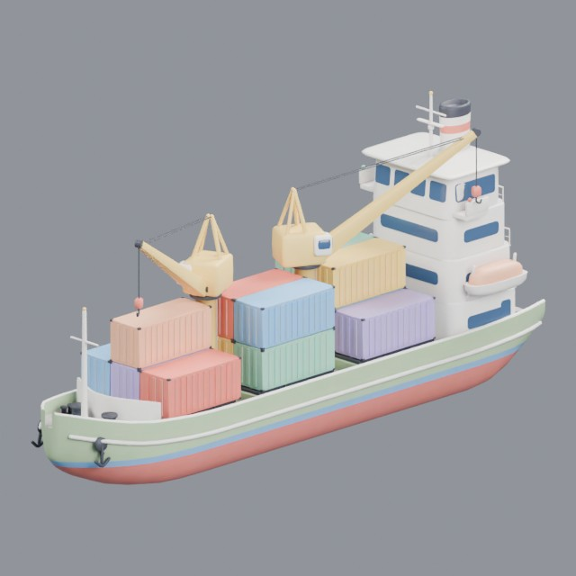
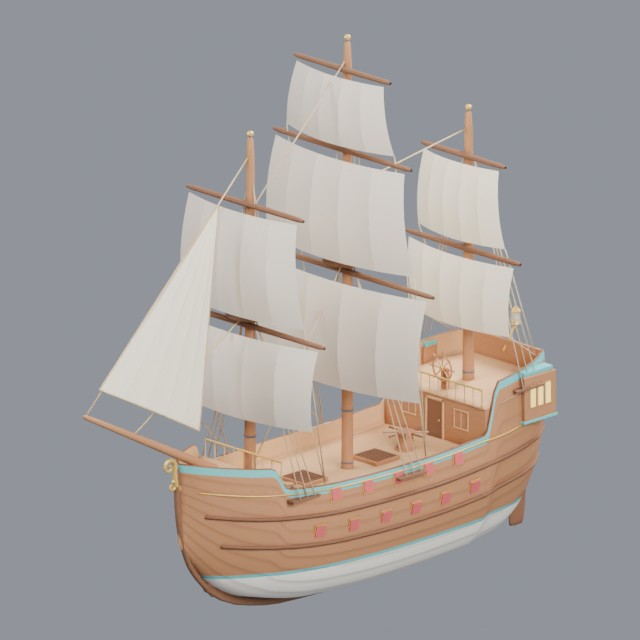
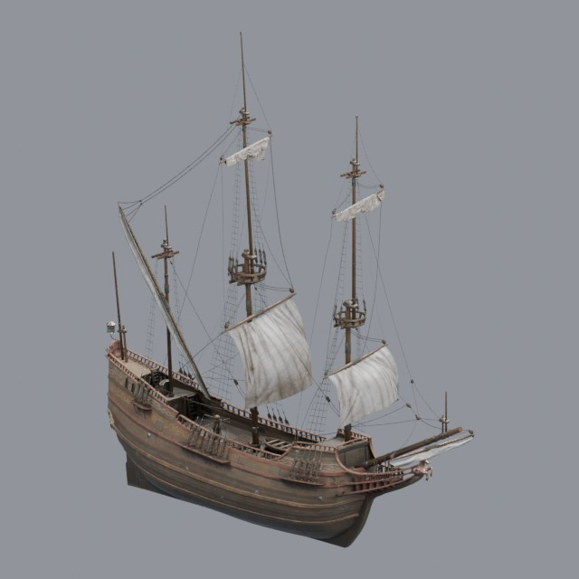

# vehicles/watercraft

Boats and sailing ships

Approved assets: **3**

## Container cargo ship

- Creator: Grab3D; style: stylized; CC0-1.0
- 37,716 triangles; 3 texture images
- [Asset folder](../../assets/vehicles/watercraft/g3-cargo-ship/) · [Metadata](../../assets/vehicles/watercraft/g3-cargo-ship/asset.json) · [All inspection views](../../assets/vehicles/watercraft/g3-cargo-ship/previews/contact-sheet.jpg)

## Three-masted galleon

- Creator: Grab3D; style: stylized; CC0-1.0
- 39,876 triangles; 3 texture images
- [Asset folder](../../assets/vehicles/watercraft/g3-galleon/) · [Metadata](../../assets/vehicles/watercraft/g3-galleon/asset.json) · [All inspection views](../../assets/vehicles/watercraft/g3-galleon/previews/contact-sheet.jpg)

## Dutch merchant sailing ship

- Creator: James Ray Cock, Rico Cilliers, Nicolò Zubbini; style: realistic; CC0-1.0
- 69,162 triangles; 9 texture images
- [Asset folder](../../assets/vehicles/watercraft/ph-dutch-merchant-ship/) · [Metadata](../../assets/vehicles/watercraft/ph-dutch-merchant-ship/asset.json) · [All inspection views](../../assets/vehicles/watercraft/ph-dutch-merchant-ship/previews/contact-sheet.jpg)
