# vehicles/watercraft

Boats and sailing ships

Approved assets: **19**

## Canoe

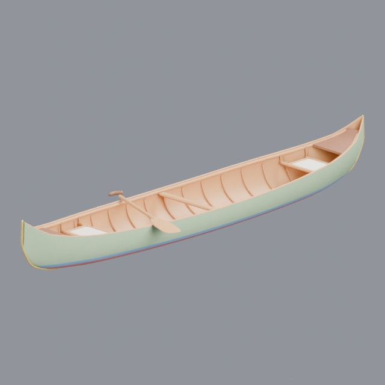

- Creator: Grab3D; style: stylized; CC0-1.0
- 13,744 triangles; 3 texture images
- [Asset folder](../../assets/vehicles/watercraft/g3-canoe/) · [Metadata](../../assets/vehicles/watercraft/g3-canoe/asset.json) · [All inspection views](../../assets/vehicles/watercraft/g3-canoe/previews/contact-sheet.jpg)

## Container cargo ship

- Creator: Grab3D; style: stylized; CC0-1.0
- 37,716 triangles; 3 texture images
- [Asset folder](../../assets/vehicles/watercraft/g3-cargo-ship/) · [Metadata](../../assets/vehicles/watercraft/g3-cargo-ship/asset.json) · [All inspection views](../../assets/vehicles/watercraft/g3-cargo-ship/previews/contact-sheet.jpg)

## Cruise ship

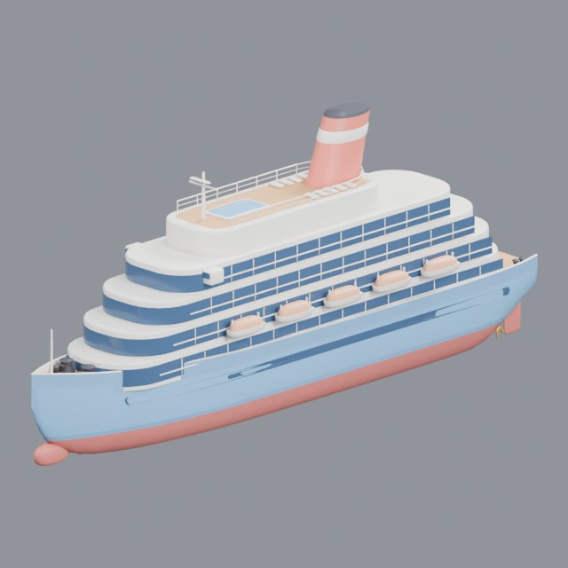

- Creator: Grab3D; style: stylized; CC0-1.0
- 29,160 triangles; 3 texture images
- [Asset folder](../../assets/vehicles/watercraft/g3-cruise-ship/) · [Metadata](../../assets/vehicles/watercraft/g3-cruise-ship/asset.json) · [All inspection views](../../assets/vehicles/watercraft/g3-cruise-ship/previews/contact-sheet.jpg)

## Car ferry

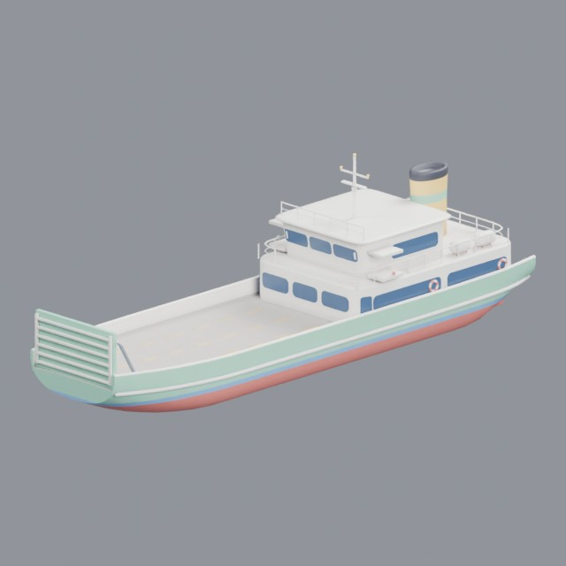

- Creator: Grab3D; style: stylized; CC0-1.0
- 26,106 triangles; 3 texture images
- [Asset folder](../../assets/vehicles/watercraft/g3-ferry/) · [Metadata](../../assets/vehicles/watercraft/g3-ferry/asset.json) · [All inspection views](../../assets/vehicles/watercraft/g3-ferry/previews/contact-sheet.jpg)

## Fishing boat

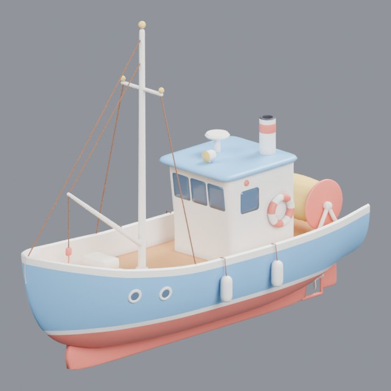

- Creator: Grab3D; style: stylized; CC0-1.0
- 20,910 triangles; 3 texture images
- [Asset folder](../../assets/vehicles/watercraft/g3-fishing-boat/) · [Metadata](../../assets/vehicles/watercraft/g3-fishing-boat/asset.json) · [All inspection views](../../assets/vehicles/watercraft/g3-fishing-boat/previews/contact-sheet.jpg)

## Three-masted galleon

- Creator: Grab3D; style: stylized; CC0-1.0
- 39,876 triangles; 3 texture images
- [Asset folder](../../assets/vehicles/watercraft/g3-galleon/) · [Metadata](../../assets/vehicles/watercraft/g3-galleon/asset.json) · [All inspection views](../../assets/vehicles/watercraft/g3-galleon/previews/contact-sheet.jpg)

## Pontoon houseboat

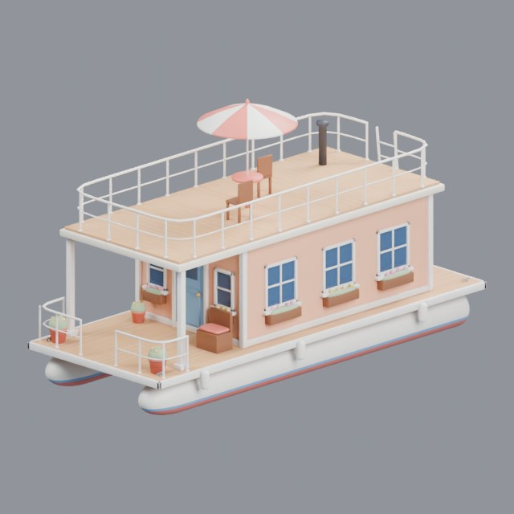

- Creator: Grab3D; style: stylized; CC0-1.0
- 25,474 triangles; 3 texture images
- [Asset folder](../../assets/vehicles/watercraft/g3-houseboat/) · [Metadata](../../assets/vehicles/watercraft/g3-houseboat/asset.json) · [All inspection views](../../assets/vehicles/watercraft/g3-houseboat/previews/contact-sheet.jpg)

## Personal watercraft

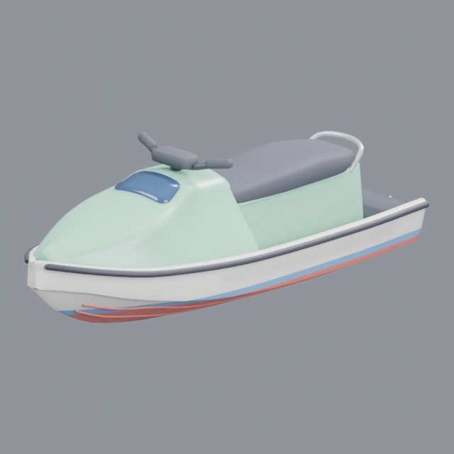

- Creator: Grab3D; style: stylized; CC0-1.0
- 13,209 triangles; 3 texture images
- [Asset folder](../../assets/vehicles/watercraft/g3-jet-ski/) · [Metadata](../../assets/vehicles/watercraft/g3-jet-ski/asset.json) · [All inspection views](../../assets/vehicles/watercraft/g3-jet-ski/previews/contact-sheet.jpg)

## Sea kayak

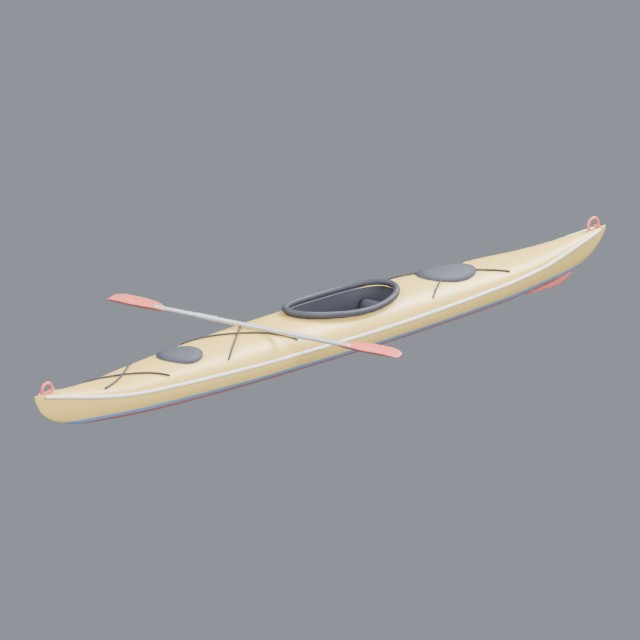

- Creator: Grab3D; style: stylized; CC0-1.0
- 14,528 triangles; 3 texture images
- [Asset folder](../../assets/vehicles/watercraft/g3-kayak/) · [Metadata](../../assets/vehicles/watercraft/g3-kayak/asset.json) · [All inspection views](../../assets/vehicles/watercraft/g3-kayak/previews/contact-sheet.jpg)

## Paddle steamer

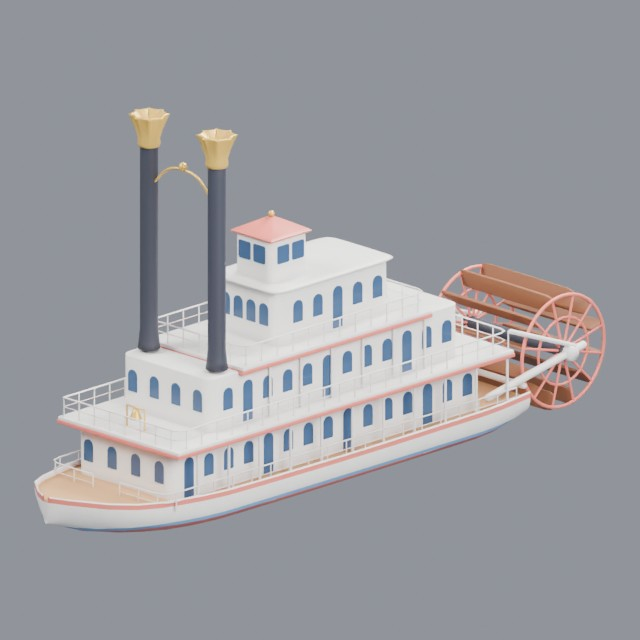

- Creator: Grab3D; style: stylized; CC0-1.0
- 29,474 triangles; 3 texture images
- [Asset folder](../../assets/vehicles/watercraft/g3-paddle-steamer/) · [Metadata](../../assets/vehicles/watercraft/g3-paddle-steamer/asset.json) · [All inspection views](../../assets/vehicles/watercraft/g3-paddle-steamer/previews/contact-sheet.jpg)

## Log sailing raft

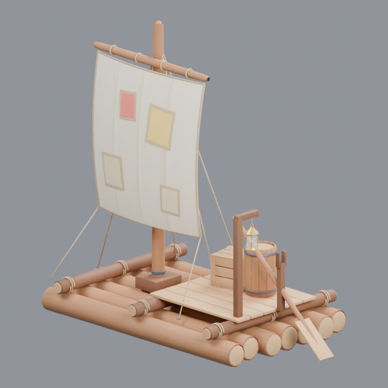

- Creator: Grab3D; style: stylized; CC0-1.0
- 27,726 triangles; 3 texture images
- [Asset folder](../../assets/vehicles/watercraft/g3-pirate-raft/) · [Metadata](../../assets/vehicles/watercraft/g3-pirate-raft/asset.json) · [All inspection views](../../assets/vehicles/watercraft/g3-pirate-raft/previews/contact-sheet.jpg)

## Sailing sloop

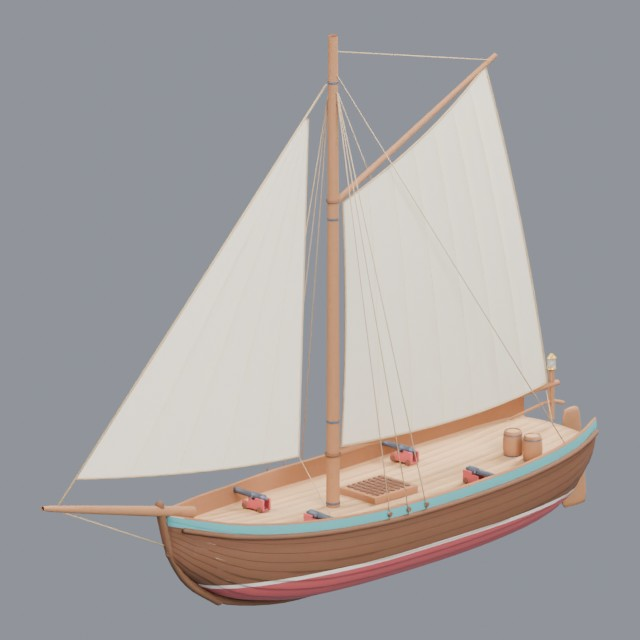

- Creator: Grab3D; style: stylized; CC0-1.0
- 36,324 triangles; 3 texture images
- [Asset folder](../../assets/vehicles/watercraft/g3-pirate-sloop/) · [Metadata](../../assets/vehicles/watercraft/g3-pirate-sloop/asset.json) · [All inspection views](../../assets/vehicles/watercraft/g3-pirate-sloop/previews/contact-sheet.jpg)

## Rowboat

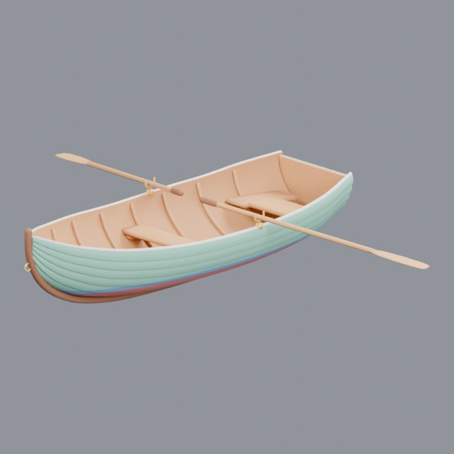

- Creator: Grab3D; style: stylized; CC0-1.0
- 18,408 triangles; 3 texture images
- [Asset folder](../../assets/vehicles/watercraft/g3-rowboat/) · [Metadata](../../assets/vehicles/watercraft/g3-rowboat/asset.json) · [All inspection views](../../assets/vehicles/watercraft/g3-rowboat/previews/contact-sheet.jpg)

## Cruising sailboat

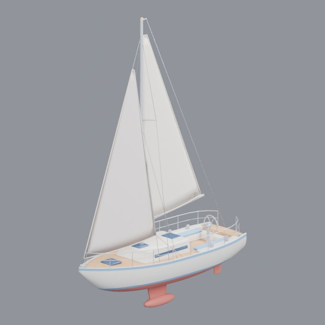

- Creator: Grab3D; style: stylized; CC0-1.0
- 19,799 triangles; 3 texture images
- [Asset folder](../../assets/vehicles/watercraft/g3-sailboat/) · [Metadata](../../assets/vehicles/watercraft/g3-sailboat/asset.json) · [All inspection views](../../assets/vehicles/watercraft/g3-sailboat/previews/contact-sheet.jpg)

## Harbor tugboat

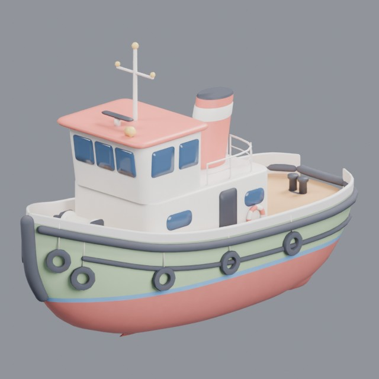

- Creator: Grab3D; style: stylized; CC0-1.0
- 26,380 triangles; 3 texture images
- [Asset folder](../../assets/vehicles/watercraft/g3-tugboat/) · [Metadata](../../assets/vehicles/watercraft/g3-tugboat/asset.json) · [All inspection views](../../assets/vehicles/watercraft/g3-tugboat/previews/contact-sheet.jpg)

## Motor yacht

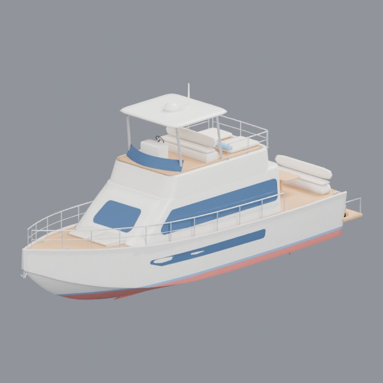

- Creator: Grab3D; style: stylized; CC0-1.0
- 23,812 triangles; 3 texture images
- [Asset folder](../../assets/vehicles/watercraft/g3-yacht/) · [Metadata](../../assets/vehicles/watercraft/g3-yacht/asset.json) · [All inspection views](../../assets/vehicles/watercraft/g3-yacht/previews/contact-sheet.jpg)

## Dutch merchant sailing ship

- Creator: James Ray Cock, Rico Cilliers, Nicolò Zubbini; style: realistic; CC0-1.0
- 69,162 triangles; 9 texture images
- [Asset folder](../../assets/vehicles/watercraft/ph-dutch-merchant-ship/) · [Metadata](../../assets/vehicles/watercraft/ph-dutch-merchant-ship/asset.json) · [All inspection views](../../assets/vehicles/watercraft/ph-dutch-merchant-ship/previews/contact-sheet.jpg)

## Dutch large sailing ship 01

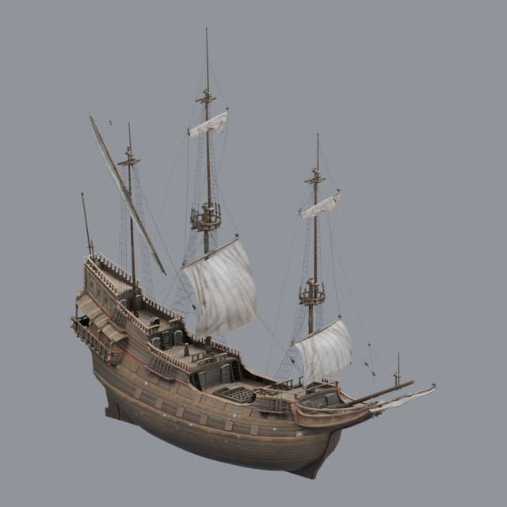

- Creator: James Ray Cock, Rico Cilliers, Nicolò Zubbini; style: realistic; CC0-1.0
- 110,616 triangles; 9 texture images
- [Asset folder](../../assets/vehicles/watercraft/ph-dutch-ship-large-01/) · [Metadata](../../assets/vehicles/watercraft/ph-dutch-ship-large-01/asset.json) · [All inspection views](../../assets/vehicles/watercraft/ph-dutch-ship-large-01/previews/contact-sheet.jpg)

## Colonial sailing pinnace

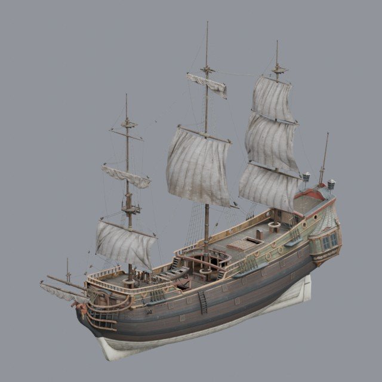

- Creator: James Ray Cock, Rico Cilliers, Nicolò Zubbini, Yann Kervran; style: realistic; CC0-1.0
- 168,317 triangles; 21 texture images
- [Asset folder](../../assets/vehicles/watercraft/ph-ship-pinnace/) · [Metadata](../../assets/vehicles/watercraft/ph-ship-pinnace/asset.json) · [All inspection views](../../assets/vehicles/watercraft/ph-ship-pinnace/previews/contact-sheet.jpg)
