# weapons/melee

Swords, axes, maces and other hand weapons

Approved assets: **11**

## Painted boomerang

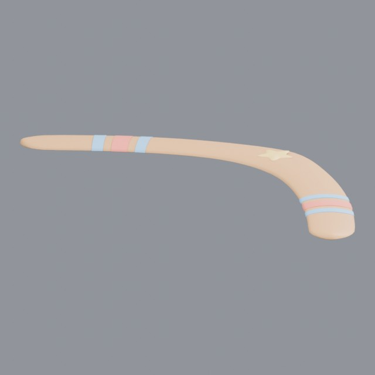

- Creator: Grab3D; style: stylized; CC0-1.0
- 5,440 triangles; 3 texture images
- [Asset folder](../../assets/weapons/melee/g3-boomerang/) · [Metadata](../../assets/weapons/melee/g3-boomerang/asset.json) · [All inspection views](../../assets/weapons/melee/g3-boomerang/previews/contact-sheet.jpg)

## Dagger with gemmed pommel

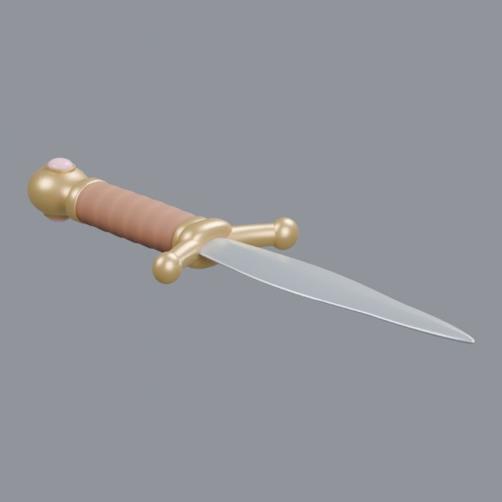

- Creator: Grab3D; style: stylized; CC0-1.0
- 9,468 triangles; 3 texture images
- [Asset folder](../../assets/weapons/melee/g3-dagger/) · [Metadata](../../assets/weapons/melee/g3-dagger/asset.json) · [All inspection views](../../assets/weapons/melee/g3-dagger/previews/contact-sheet.jpg)

## Enchanted sword in a plinth

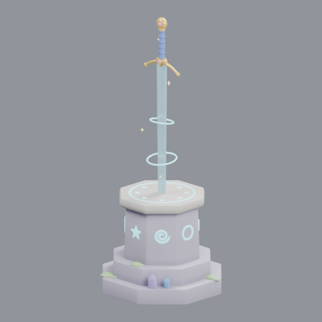

- Creator: Grab3D; style: stylized; CC0-1.0
- 19,840 triangles; 6 texture images
- [Asset folder](../../assets/weapons/melee/g3-enchanted-sword/) · [Metadata](../../assets/weapons/melee/g3-enchanted-sword/asset.json) · [All inspection views](../../assets/weapons/melee/g3-enchanted-sword/previews/contact-sheet.jpg)

## Chain flail

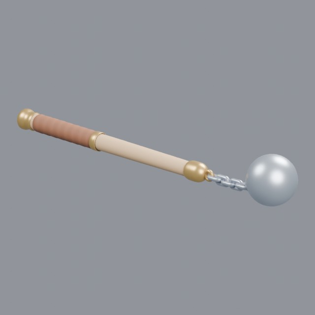

- Creator: Grab3D; style: stylized; CC0-1.0
- 9,458 triangles; 3 texture images
- [Asset folder](../../assets/weapons/melee/g3-flail/) · [Metadata](../../assets/weapons/melee/g3-flail/asset.json) · [All inspection views](../../assets/weapons/melee/g3-flail/previews/contact-sheet.jpg)

## Halberd with tassel

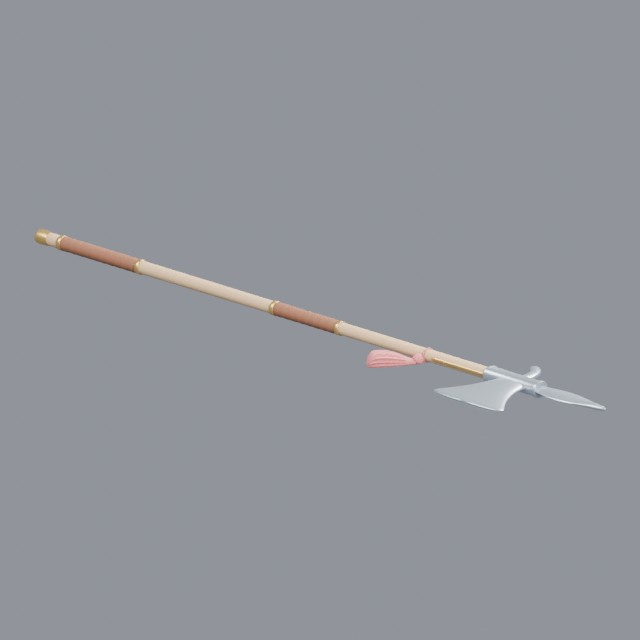

- Creator: Grab3D; style: stylized; CC0-1.0
- 9,614 triangles; 3 texture images
- [Asset folder](../../assets/weapons/melee/g3-halberd/) · [Metadata](../../assets/weapons/melee/g3-halberd/asset.json) · [All inspection views](../../assets/weapons/melee/g3-halberd/previews/contact-sheet.jpg)

## Bearded hand axe

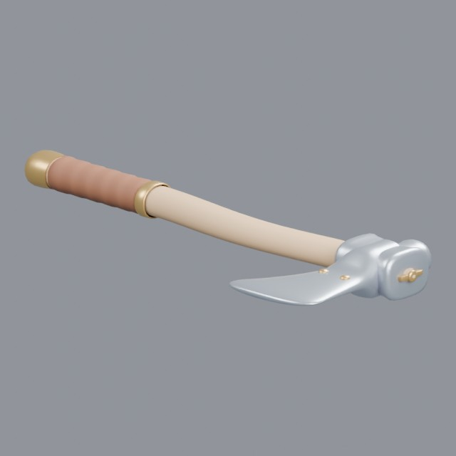

- Creator: Grab3D; style: stylized; CC0-1.0
- 8,118 triangles; 3 texture images
- [Asset folder](../../assets/weapons/melee/g3-hand-axe/) · [Metadata](../../assets/weapons/melee/g3-hand-axe/asset.json) · [All inspection views](../../assets/weapons/melee/g3-hand-axe/previews/contact-sheet.jpg)

## Katana with cord-wrapped grip

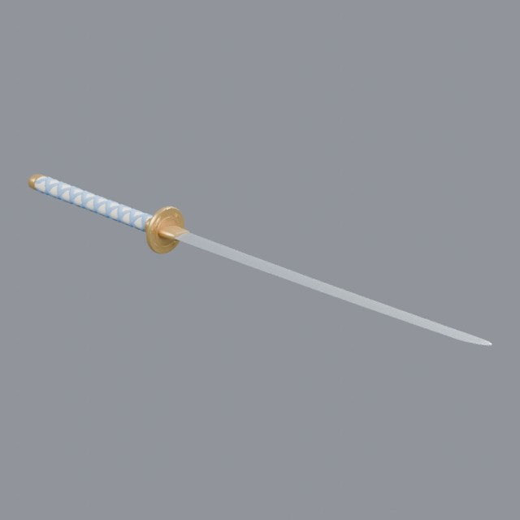

- Creator: Grab3D; style: stylized; CC0-1.0
- 9,624 triangles; 3 texture images
- [Asset folder](../../assets/weapons/melee/g3-katana/) · [Metadata](../../assets/weapons/melee/g3-katana/asset.json) · [All inspection views](../../assets/weapons/melee/g3-katana/previews/contact-sheet.jpg)

## Longsword with brass crossguard

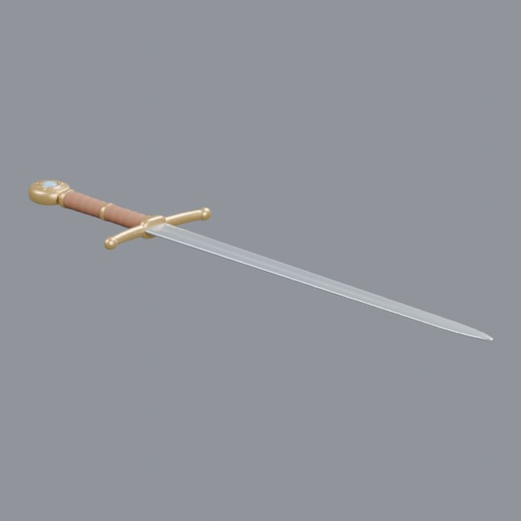

- Creator: Grab3D; style: stylized; CC0-1.0
- 9,720 triangles; 3 texture images
- [Asset folder](../../assets/weapons/melee/g3-longsword/) · [Metadata](../../assets/weapons/melee/g3-longsword/asset.json) · [All inspection views](../../assets/weapons/melee/g3-longsword/previews/contact-sheet.jpg)

## Flanged mace

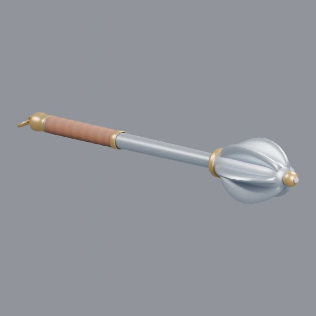

- Creator: Grab3D; style: stylized; CC0-1.0
- 9,402 triangles; 3 texture images
- [Asset folder](../../assets/weapons/melee/g3-mace/) · [Metadata](../../assets/weapons/melee/g3-mace/asset.json) · [All inspection views](../../assets/weapons/melee/g3-mace/previews/contact-sheet.jpg)

## Brass-capped quarterstaff

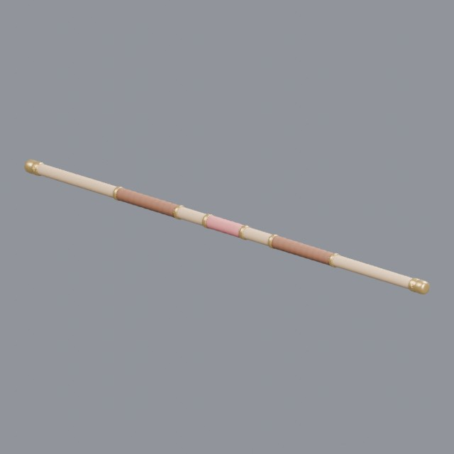

- Creator: Grab3D; style: stylized; CC0-1.0
- 8,114 triangles; 3 texture images
- [Asset folder](../../assets/weapons/melee/g3-quarterstaff/) · [Metadata](../../assets/weapons/melee/g3-quarterstaff/asset.json) · [All inspection views](../../assets/weapons/melee/g3-quarterstaff/previews/contact-sheet.jpg)

## Rapier with swept brass hilt

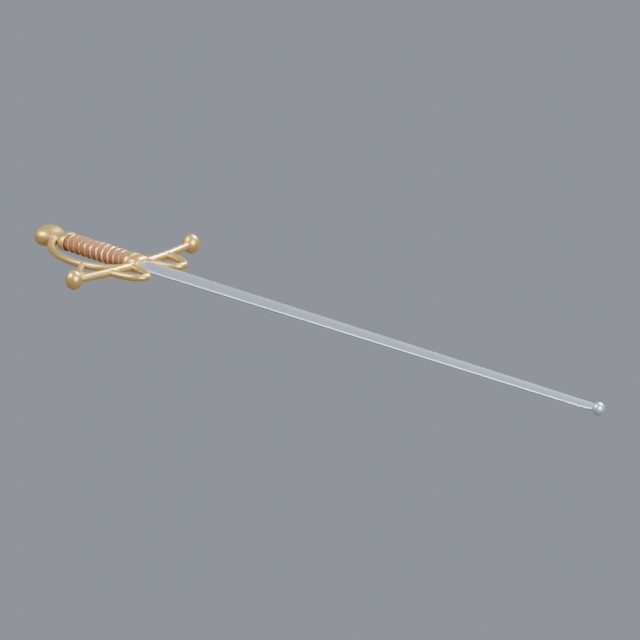

- Creator: Grab3D; style: stylized; CC0-1.0
- 9,788 triangles; 3 texture images
- [Asset folder](../../assets/weapons/melee/g3-rapier/) · [Metadata](../../assets/weapons/melee/g3-rapier/asset.json) · [All inspection views](../../assets/weapons/melee/g3-rapier/previews/contact-sheet.jpg)

